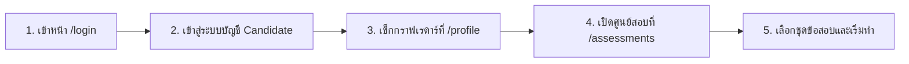

# คู่มือการทดสอบคลังข้อสอบมาตรฐานแบบจับมือทำ (Step-by-Step Assessment Testing Manual)

เอกสารฉบับนี้เป็นคู่มือปฏิบัติการสำหรับผู้ทดสอบ (QA / Tester / Admin) เพื่อใช้ตรวจสอบการทำงานของคลังข้อสอบมาตรฐานในระบบ **SmartCareer** ครบทั้ง **13 ชุดข้อสอบ (35 ข้อย่อย)** โดยระบุขั้นตอนการคลิกทีละปุ่ม โค้ดสำหรับคัดลอกไปวางเพื่อทดสอบ และผลลัพธ์ที่ต้องปรากฏบนหน้าจอในแต่ละขั้นตอน

> [!IMPORTANT]
> **กฎเหล็กของระบบคะแนนทักษะกลาง (Global Skill Score):**
> - **ข้อสอบปฏิบัติ (`PRACTICAL_CODING`)**: เมื่อสอบผ่านและกด Finalize คะแนนจะถูกนำไปอัปเดตกราฟเรดาร์ 5 แกนในหน้า `/profile` ทันที และได้รับเหรียญ **Verified Skill Badge**
> - **ข้อสอบทฤษฎี (`THEORY`)**: ใช้สำหรับทบทวนความรู้เท่านั้น คะแนนสอบทฤษฎีจะแสดงในประวัติการสอบ แต่จะ**ไม่ถูกนำไปปนกับคะแนนทักษะปฏิบัติบนกราฟเรดาร์**

---

## ส่วนที่ 1: การเตรียมตัวเข้าสู่ห้องสอบ (ทำครั้งเดียวก่อนเริ่มทดสอบ)



### ขั้นตอนที่ 1.1: เข้าสู่ระบบในฐานะผู้สมัครงาน (Candidate)
1. เปิดเว็บเบราว์เซอร์ไปที่ URL: `http://localhost:3000/login` (หรือโดเมนของเซิร์ฟเวอร์ที่ใช้งาน)
2. คลิกปุ่มเข้าสู่ระบบสำหรับ **ผู้สมัครงาน (Candidate / GitHub)** (หากเปิดโหมดทดสอบ สามารถกดปุ่ม **Demo Candidate Login** ได้ทันที)
3. **ผลลัพธ์ที่ต้องการ**:
   - ระบบพาเข้าสู่หน้า **โปรไฟล์ผู้สมัครและผลประเมินทักษะ (`/profile`)**
   - สังเกตส่วน **กราฟเรดาร์ทักษะ 5 มิติ** (`Frontend`, `Backend`, `Database`, `DevOps`, `Testing`) เพื่อดูค่าเริ่มต้นก่อนเริ่มสอบ

### ขั้นตอนที่ 1.2: เปิดหน้าศูนย์สอบมาตรฐานกลาง
1. บนแถบเมนูด้านบน (Navbar) คลิกเมนู **"ศูนย์สอบทักษะ" (`/assessments`)**
2. **ผลลัพธ์ที่ต้องการ**:
   - เห็นหัวข้อ **"ศูนย์สอบมาตรฐานกลาง (Skill Assessments)"**
   - เห็นการ์ดข้อสอบที่เปิดให้สอบทั้งหมด **13 ชุด** โดยแต่ละการ์ดจะแสดง:
     - ป้ายสถานะสีเขียว `สอบปฏิบัติ (อัปเดต Global Skill Score)` หรือสีม่วง `สอบทฤษฎี (ความรู้ประกอบ)`
     - เวลาสอบ (เช่น `⏱️ 45 นาที • เกณฑ์ผ่าน 70%`)
     - ชื่อทักษะที่วัดผล และปุ่ม **`เริ่มทำแบบทดสอบ →`**

---

## ส่วนที่ 2: ขั้นตอนมาตรฐานในการกดทดสอบข้อสอบปฏิบัติ (`PRACTICAL_CODING`)

สำหรับข้อสอบปฏิบัติทุกชุด ให้ทำตาม **6 จังหวะมาตรฐาน** ดังนี้:

1. **เข้าห้องสอบ**: ที่หน้า `/assessments` คลิกปุ่ม **`เริ่มทำแบบทดสอบ →`** ของชุดข้อสอบที่ต้องการ
   - **ผลลัพธ์ที่ต้องการ**: เข้าสู่หน้า `/assessments/[id]` มุมบนซ้ายแสดงป้าย `PRACTICAL_CODING` และตัวนับเวลาถอยหลังสีเขียว เช่น `⏱️ เหลือเวลา 44:58`
2. **ทดสอบกรณีเขียนโค้ดผิด (Negative Test — ทดสอบด้วย Starter Code เดิม)**:
   - โดยยังไม่ต้องแก้โค้ดในกล่องดำ (Code Editor) ให้คลิกปุ่ม **`▶ รันทดสอบ Visible Test Cases`**
   - **ผลลัพธ์ที่ต้องการ**: ด้านล่างกล่องโค้ดจะแสดงกล่องผลลัพธ์ `ผลรันชุดทดสอบตัวอย่าง: ผ่าน 0/2 ข้อ` พร้อมแถบสีแดง `Test #1: FAILED (Actual: ...)`
3. **ทดสอบกรณีเขียนโค้ดถูก (Positive Test — วางโค้ดเฉลยจากคู่มือนี้)**:
   - ลบโค้ดเดิมในกล่องดำออกทั้งหมด แล้วคัดลอก **โค้ดเฉลย** ของข้อนั้นจากส่วนที่ 3 ด้านล่างไปวางแทน
   - คลิกปุ่ม **`▶ รันทดสอบ Visible Test Cases`** อีกครั้ง
   - **ผลลัพธ์ที่ต้องการ**: แสดงข้อความ `ผลรันชุดทดสอบตัวอย่าง: ผ่าน 2/2 ข้อ` และแถบสีเขียว `Test #1: PASSED`, `Test #2: PASSED` ทุกข้อ
4. **กรอกคำอธิบายแนวคิดและทดสอบ Autosave**:
   - ในช่อง **"คำอธิบายแนวคิดการเขียนโค้ด"** ด้านล่าง ให้พิมพ์ข้อความสั้นๆ เช่น `ออกแบบฟังก์ชันให้จัดการ Edge Cases และใช้ Time Complexity O(n)`
   - คลิกปุ่ม **`บันทึกฉบับร่าง (Autosave)`** ด้านบนขวา (เมื่อรีเฟรชหน้าเว็บ โค้ดและคำอธิบายที่พิมพ์ไว้จะต้องยังอยู่ครบ)
5. **ส่งคำตอบรายข้อ**:
   - คลิกปุ่มสีน้ำเงิน **`บันทึกและส่งคำตอบข้อนี้`** (มุมขวาบนของกล่อง Code Editor)
   - **ผลลัพธ์ที่ต้องการ**:
     - ระบบรันตรวจทั้ง **Visible Test Cases** และ **Hidden Test Cases**
     - ปุ่มเลขข้อด้านซ้ายมือจะเปลี่ยนเป็นสีเขียวพร้อมเครื่องหมายถูก เช่น **`ข้อ 1 ✓`**
     - ด้านล่างแสดงแถบสีเขียว: `บันทึกคำตอบข้อนี้แล้ว • กดปุ่ม “ยืนยันส่งข้อสอบปฏิบัติ (Finalize)” ด้านบนเมื่อทำครบทุกข้อ`
   - คลิกปุ่ม **`ข้อ 2`** และ **`ข้อ 3`** ทางซ้ายมือ แล้วทำซ้ำข้อ 3–5 จนขึ้นเครื่องหมาย **`✓`** ครบทุกข้อ
6. **ยืนยันส่งข้อสอบทั้งชุด (Finalize)**:
   - คลิกปุ่มสีน้ำเงินด้านบนสุด **`ยืนยันส่งข้อสอบปฏิบัติ (Finalize)`**
   - **ผลลัพธ์ที่ต้องการ**:
     - หน้าจอเปลี่ยนเป็นหน้าสรุปผล แสดงป้ายสีเขียว **`ส่งข้อสอบเรียบร้อยแล้ว`**
     - แสดง **`คะแนนสุทธิ (Final Score): 100%`** และป้ายสีเขียว **`ผ่านเกณฑ์มาตรฐาน (PASSED)`**
     - เมื่อคลิก **`กลับหน้ารวมข้อสอบ`** จะเห็น:
       1. กล่องสีทองด้านบนสุด **`🏅 เหรียญรับรองทักษะที่คุณได้รับ (Verified Skill Badges)`** เพิ่มเหรียญของทักษะนั้นเข้ามา
       2. ตาราง **`ประวัติการเข้าสอบของฉัน`** ด้านล่างแสดงสถานะ `COMPLETED`, คะแนน `100%`, ผลสอบ `ผ่านเกณฑ์`
       3. เมื่อคลิกปุ่ม **`ดูผลวิเคราะห์ / เฉลย`** ในตาราง จะเปิดหน้าต่าง Modal แสดงคะแนนดิบ `100 / 100 คะแนน` พร้อมโค้ดและคำอธิบายที่ส่งในแต่ละข้อ

---

## ส่วนที่ 3: โพยโค้ดและผลลัพธ์สำหรับทดสอบรายข้อ (ครบทั้ง 13 ชุด / 35 ข้อ)

---

### หมวด A: ข้อสอบอ้างอิงจาก **freeCodeCamp.org** (3 ชุด)

#### ชุดที่ 1: `JavaScript Algorithms & Data Structures (freeCodeCamp Reference)`
- **ทักษะที่วัด**: `JavaScript` (หมวด `FRONTEND`) | **เวลา**: 45 นาที | **เกณฑ์ผ่าน**: 75%

##### ข้อที่ 1: Alphanumeric Palindrome Validator (30 คะแนน)
- **ขั้นตอนทดสอบ**: เลือก **`ข้อ 1`** -> วางโค้ดด้านล่างลงในช่อง Code Editor -> คลิก **`▶ รันทดสอบ Visible Test Cases`** -> คลิก **`บันทึกและส่งคำตอบข้อนี้`**
```javascript
function solution(text) {
  const cleaned = String(text || '').toLowerCase().replace(/[^a-z0-9]/g, '');
  const reversed = cleaned.split('').reverse().join('');
  return cleaned === reversed;
}
```
- **ผลลัพธ์ที่ต้องการ**:
  - กดรันตัวอย่าง: `ผลรันชุดทดสอบตัวอย่าง: ผ่าน 2/2 ข้อ` (`Test #1: PASSED` สำหรับ `"A man, a plan, a canal. Panama"`, `Test #2: PASSED` สำหรับ `"race a car"`)
  - กดส่งคำตอบข้อนี้: ผ่าน Hidden Test Cases อีก 3 ข้อ (รวม 5/5) ปุ่มเปลี่ยนเป็น **`ข้อ 1 ✓`** ได้ 30 คะแนนเต็ม

##### ข้อที่ 2: Roman Numeral Converter (35 คะแนน)
- **ขั้นตอนทดสอบ**: คลิกปุ่ม **`ข้อ 2`** -> วางโค้ดด้านล่าง -> คลิก **`▶ รันทดสอบ Visible Test Cases`** -> คลิก **`บันทึกและส่งคำตอบข้อนี้`**
```javascript
function solution(num) {
  const n = Number(num);
  if (!Number.isInteger(n) || n < 1 || n > 3999) return '';
  const pairs = [
    [1000, 'M'], [900, 'CM'], [500, 'D'], [400, 'CD'],
    [100, 'C'], [90, 'XC'], [50, 'L'], [40, 'XL'],
    [10, 'X'], [9, 'IX'], [5, 'V'], [4, 'IV'], [1, 'I']
  ];
  let rem = n;
  let out = '';
  for (const [val, sym] of pairs) {
    while (rem >= val) {
      out += sym;
      rem -= val;
    }
  }
  return out;
}
```
- **ผลลัพธ์ที่ต้องการ**:
  - กดรันตัวอย่าง: `ผลรันชุดทดสอบตัวอย่าง: ผ่าน 2/2 ข้อ` (`[36]` ได้ `"XXXVI"`, `[1994]` ได้ `"MCMXCIV"`)
  - กดส่งคำตอบข้อนี้: ผ่าน Hidden Test Cases อีก 3 ข้อ (รวม 5/5) ปุ่มเปลี่ยนเป็น **`ข้อ 2 ✓`** ได้ 35 คะแนนเต็ม

##### ข้อที่ 3: Caesar Cipher ROT13 Decoder (35 คะแนน)
- **ขั้นตอนทดสอบ**: คลิกปุ่ม **`ข้อ 3`** -> วางโค้ดด้านล่าง -> คลิก **`▶ รันทดสอบ Visible Test Cases`** -> คลิก **`บันทึกและส่งคำตอบข้อนี้`** -> คลิก **`ยืนยันส่งข้อสอบปฏิบัติ (Finalize)`**
```javascript
function solution(encoded) {
  return String(encoded || '').replace(/[A-Z]/g, (ch) => {
    const code = ch.charCodeAt(0) - 65;
    return String.fromCharCode(((code + 13) % 26) + 65);
  });
}
```
- **ผลลัพธ์ที่ต้องการ**:
  - กดรันตัวอย่าง: `ผลรันชุดทดสอบตัวอย่าง: ผ่าน 2/2 ข้อ` (`"SERR PBQR PNZC"` แปลงเป็น `"FREE CODE CAMP"`)
  - เมื่อกด **Finalize**: ได้ **`คะแนนสุทธิ (Final Score): 100%`** (`PASSED`)

---

#### ชุดที่ 2: `Node.js Backend & REST API Engineering (freeCodeCamp Reference)`
- **ทักษะที่วัด**: `Node.js` (หมวด `BACKEND`) | **เวลา**: 45 นาที | **เกณฑ์ผ่าน**: 70%

##### ข้อที่ 1: Sanitize REST Pagination Parameters (30 คะแนน)
- **ขั้นตอนทดสอบ**: เลือก **`ข้อ 1`** -> วางโค้ดด้านล่าง -> กดรันทดสอบ -> กดบันทึกและส่งคำตอบ
```javascript
function solution(query) {
  const q = query || {};
  const rawPage = parseInt(q.page, 10);
  const page = Number.isFinite(rawPage) && rawPage >= 1 ? rawPage : 1;
  const rawLimit = parseInt(q.limit, 10);
  let limit = 20;
  if (Number.isFinite(rawLimit) && rawLimit >= 1) {
    limit = Math.min(100, rawLimit);
  }
  const totalItems = Math.max(0, Number(q.totalItems) || 0);
  const offset = (page - 1) * limit;
  const totalPages = Math.max(1, Math.ceil(totalItems / limit));
  return { page, limit, offset, totalPages };
}
```
- **ผลลัพธ์ที่ต้องการ**: ผ่าน Visible 2/2 ข้อ และ Hidden 2/2 ข้อ (รวม 4/4) ปุ่มขึ้น **`ข้อ 1 ✓`**

##### ข้อที่ 2: Sliding Window API Rate Limiter (35 คะแนน)
- **ขั้นตอนทดสอบ**: เลือก **`ข้อ 2`** -> วางโค้ดด้านล่าง -> กดรันทดสอบ -> กดบันทึกและส่งคำตอบ
```javascript
function solution(timestamps, windowMs, maxRequests) {
  const accepted = [];
  const out = [];
  for (const t of timestamps || []) {
    while (accepted.length > 0 && accepted[0] <= t - windowMs) {
      accepted.shift();
    }
    if (accepted.length < maxRequests) {
      accepted.push(t);
      out.push(true);
    } else {
      out.push(false);
    }
  }
  return out;
}
```
- **ผลลัพธ์ที่ต้องการ**: ผ่าน Visible 2/2 ข้อ (`[true,true,false,true]`) และ Hidden 2/2 ข้อ ปุ่มขึ้น **`ข้อ 2 ✓`**

##### ข้อที่ 3: Idempotent Webhook Ledger Aggregator (35 คะแนน)
- **ขั้นตอนทดสอบ**: เลือก **`ข้อ 3`** -> วางโค้ดด้านล่าง -> กดรันทดสอบ -> กดบันทึกและส่งคำตอบ -> กด **Finalize**
```javascript
function solution(events) {
  const seen = new Set();
  const balances = new Map();
  for (const ev of events || []) {
    if (!ev || !ev.eventId || !ev.accountId) continue;
    if (seen.has(ev.eventId)) continue;
    seen.add(ev.eventId);
    const prev = balances.get(ev.accountId) || 0;
    balances.set(ev.accountId, prev + Number(ev.amount || 0));
  }
  return Array.from(balances.entries())
    .sort((a, b) => a[0].localeCompare(b[0]))
    .map(([accountId, balance]) => ({ accountId, balance }));
}
```
- **ผลลัพธ์ที่ต้องการ**: เมื่อกด **Finalize** ได้คะแนนสุทธิ **`100%`** (`PASSED`) และแกน **`Backend`** บนกราฟเรดาร์ในหน้า `/profile` จะถูกอัปเดต

---

#### ชุดที่ 3: `Automated Testing & Quality Assurance (freeCodeCamp Reference)`
- **ทักษะที่วัด**: `Automated Testing` (หมวด `TESTING`) | **เวลา**: 45 นาที | **เกณฑ์ผ่าน**: 70%

##### ข้อที่ 1: Boundary Value Partition Classifier (30 คะแนน)
```javascript
function solution(values, min, max) {
  return (values || []).map((v) => {
    if (typeof v !== 'number' || v < min || v > max) return 'OUT_OF_RANGE';
    if (v === min || v === min + 1 || v === max - 1 || v === max) return 'BOUNDARY';
    return 'NOMINAL';
  });
}
```
- **ผลลัพธ์ที่ต้องการ**: ผ่าน Visible 2/2 ข้อ และ Hidden 2/2 ข้อ ปุ่มขึ้น **`ข้อ 1 ✓`**

##### ข้อที่ 2: API Response Contract Validator (35 คะแนน)
```javascript
function solution(payload, schema) {
  const obj = payload && typeof payload === 'object' ? payload : {};
  const rules = schema && typeof schema === 'object' ? schema : {};
  const invalid = [];
  for (const [key, expectedType] of Object.entries(rules)) {
    const val = obj[key];
    if (expectedType === 'array') {
      if (!Array.isArray(val)) invalid.push(key);
    } else if (expectedType === 'number') {
      if (typeof val !== 'number' || Number.isNaN(val)) invalid.push(key);
    } else if (typeof val !== expectedType) {
      invalid.push(key);
    }
  }
  return invalid.sort();
}
```
- **ผลลัพธ์ที่ต้องการ**: ผ่าน Visible 2/2 ข้อ และ Hidden 2/2 ข้อ ปุ่มขึ้น **`ข้อ 2 ✓`**

##### ข้อที่ 3: CI Flaky Test Detector (35 คะแนน)
```javascript
function solution(runs) {
  const stats = new Map();
  for (const r of runs || []) {
    if (!r || !r.testName) continue;
    const cur = stats.get(r.testName) || { pass: false, fail: false };
    if (r.passed) cur.pass = true;
    else cur.fail = true;
    stats.set(r.testName, cur);
  }
  return Array.from(stats.entries())
    .filter(([, s]) => s.pass && s.fail)
    .map(([name]) => name)
    .sort();
}
```
- **ผลลัพธ์ที่ต้องการ**: เมื่อกด **Finalize** ได้คะแนนสุทธิ **`100%`** (`PASSED`) และเมื่อไปดูที่หน้า `/profile` แกน **`Testing`** บนกราฟเรดาร์จะมีคะแนนขึ้นเป็น `100%` ทันที!

---

### หมวด B: ข้อสอบอ้างอิงจาก **MDN Web Docs** (3 ชุด)

#### ชุดที่ 4: `TypeScript Type-Safe Data Modeling (MDN Web Docs Reference)`
- **ทักษะที่วัด**: `TypeScript` (หมวด `FRONTEND`) | **เวลา**: 45 นาที | **เกณฑ์ผ่าน**: 70%

##### ข้อที่ 1: Runtime Type Guard Validator (30 คะแนน)
```javascript
function solution(input) {
  if (!input || typeof input !== 'object' || Array.isArray(input)) return false;
  if (typeof input.id !== 'string' || input.id.trim().length === 0) return false;
  if (typeof input.email !== 'string' || !input.email.includes('@')) return false;
  if (!Array.isArray(input.roles) || input.roles.length === 0) return false;
  return input.roles.every((r) => typeof r === 'string' && r.trim().length > 0);
}
```
- **ผลลัพธ์ที่ต้องการ**: ผ่าน Visible 2/2 ข้อ และ Hidden 2/2 ข้อ ปุ่มขึ้น **`ข้อ 1 ✓`**

##### ข้อที่ 2: Discriminated Union Async State Machine (35 คะแนน)
```javascript
function solution(actions) {
  let state = { status: 'IDLE', data: null, error: null, attempts: 0 };
  for (const act of actions || []) {
    if (!act || !act.type) continue;
    if (act.type === 'FETCH_START') {
      state = { ...state, status: 'LOADING', error: null, attempts: state.attempts + 1 };
    } else if (act.type === 'FETCH_SUCCESS') {
      state = { ...state, status: 'SUCCESS', data: act.payload ?? null, error: null };
    } else if (act.type === 'FETCH_ERROR') {
      state = { ...state, status: 'ERROR', data: null, error: act.message ?? 'Unknown error' };
    } else if (act.type === 'RESET') {
      state = { status: 'IDLE', data: null, error: null, attempts: 0 };
    }
  }
  return state;
}
```
- **ผลลัพธ์ที่ต้องการ**: ผ่าน Visible 2/2 ข้อ และ Hidden 2/2 ข้อ ปุ่มขึ้น **`ข้อ 2 ✓`**

##### ข้อที่ 3: Generic GroupBy & Summary Mapper (35 คะแนน)
```javascript
function solution(records, keyField, valueField) {
  const map = new Map();
  for (const item of records || []) {
    if (!item || item[keyField] === undefined || item[keyField] === null) continue;
    const k = String(item[keyField]);
    const v = Number(item[valueField]) || 0;
    map.set(k, (map.get(k) || 0) + v);
  }
  const out = {};
  for (const k of Array.from(map.keys()).sort()) {
    out[k] = map.get(k);
  }
  return out;
}
```
- **ผลลัพธ์ที่ต้องการ**: เมื่อกด **Finalize** ได้คะแนนสุทธิ **`100%`** (`PASSED`) พร้อมได้รับเหรียญ `SmartCareer Verified — TypeScript`

---

#### ชุดที่ 5: `React State Management & UI Selectors (MDN Web Docs Reference)`
- **ทักษะที่วัด**: `React` (หมวด `FRONTEND`) | **เวลา**: 45 นาที | **เกณฑ์ผ่าน**: 70%

##### ข้อที่ 1: Immutable Cart State Reducer (30 คะแนน)
```javascript
function solution(initialItems, action) {
  const items = Array.isArray(initialItems) ? initialItems.map((x) => ({ ...x })) : [];
  if (!action || !action.type) return items.filter((x) => x.qty > 0);
  if (action.type === 'REMOVE') {
    return items.filter((x) => x.id !== action.id && x.qty > 0);
  }
  if (action.type === 'ADD') {
    const idx = items.findIndex((x) => x.id === action.id);
    if (idx >= 0) {
      items[idx].qty += Number(action.qty || 0);
    } else if (Number(action.qty || 0) > 0) {
      items.push({ id: action.id, qty: Number(action.qty) });
    }
  }
  return items.filter((x) => x.qty > 0);
}
```
- **ผลลัพธ์ที่ต้องการ**: ผ่าน Visible 2/2 ข้อ และ Hidden 2/2 ข้อ ปุ่มขึ้น **`ข้อ 1 ✓`**

##### ข้อที่ 2: Memoized Job Filter & Sort Selector (35 คะแนน)
```javascript
function solution(jobs, filter) {
  const f = filter || {};
  const minSal = Number(f.minSalary) || 0;
  const q = String(f.search || '').trim().toLowerCase();
  return (jobs || [])
    .filter((j) => {
      if (!j) return false;
      if ((Number(j.salary) || 0) < minSal) return false;
      if (q && !String(j.title || '').toLowerCase().includes(q)) return false;
      return true;
    })
    .sort((a, b) => {
      if (b.salary !== a.salary) return b.salary - a.salary;
      return String(a.id).localeCompare(String(b.id));
    })
    .map((j) => j.id);
}
```
- **ผลลัพธ์ที่ต้องการ**: ผ่าน Visible 2/2 ข้อ และ Hidden 1/1 ข้อ ปุ่มขึ้น **`ข้อ 2 ✓`**

##### ข้อที่ 3: Hierarchical Comment Tree Builder (35 คะแนน)
```javascript
function solution(comments) {
  const map = new Map();
  const roots = [];
  for (const c of comments || []) {
    map.set(c.id, { id: c.id, text: c.text, children: [] });
  }
  for (const c of comments || []) {
    const node = map.get(c.id);
    if (c.parentId && map.has(c.parentId)) {
      map.get(c.parentId).children.push(node);
    } else {
      roots.push(node);
    }
  }
  return roots;
}
```
- **ผลลัพธ์ที่ต้องการ**: เมื่อกด **Finalize** ได้คะแนนสุทธิ **`100%`** (`PASSED`) และเมื่อไปดูประกาศงาน **`Frontend Engineer (React / TypeScript)`** ในหน้า `/jobs` ค่าความครอบคลุมของการประเมิน (Assessment Coverage) จะพุ่งขึ้นเป็น **100%** ครบทุกทักษะ!

---

#### ชุดที่ 6: `Web Security, HTTP & Browser Standards (MDN Web Docs Reference)`
- **ทักษะที่วัด**: `Application Security` (หมวด `SECURITY`) | **ประเภท**: `THEORY` (ปรนัย 5 ข้อ) | **เวลา**: 25 นาที | **เกณฑ์ผ่าน**: 75%
- **ขั้นตอนการทดสอบแบบจับมือทำ**:
  1. คลิก **`เริ่มทำแบบทดสอบ →`** ที่การ์ด `Web Security, HTTP & Browser Standards (MDN Web Docs Reference)`
  2. หน้าจอจะแสดงคำถามปรนัยเรียงลงมาทั้ง 5 ข้อ ให้คลิกเลือกตัวเลือก (Radio Button) ดังนี้เพื่อให้ได้คะแนนเต็ม 100%:
     - **ข้อที่ 1 (HttpOnly Cookie Protection)**: เลือก `ป้องกัน JavaScript ฝั่งไคลเอนต์เข้าถึงค่าคุกกี้ผ่าน document.cookie เมื่อเกิดช่องโหว่ XSS`
     - **ข้อที่ 2 (CORS Preflight Request Method)**: เลือก `HTTP OPTIONS (Preflight Request)`
     - **ข้อที่ 3 (Content-Security-Policy Defense)**: เลือก `Content-Security-Policy`
     - **ข้อที่ 4 (HTTP 401 vs 403 Semantics)**: เลือก `401 คือยังไม่ได้ยืนยันตัวตนหรือ Token ไม่ถูกต้อง ส่วน 403 คือยืนยันตัวตนแล้วแต่บทบาทไม่มีสิทธิ์เข้าถึง`
     - **ข้อที่ 5 (SameSite Cookie Attribute)**: เลือก `Cross-Site Request Forgery (CSRF)`
  3. คลิกปุ่ม **`ยืนยันส่งข้อสอบทฤษฎี`** ด้านบนขวา
- **ผลลัพธ์ที่ต้องการ**:
  - แสดงหน้าสรุปผล **`คะแนนสุทธิ (Final Score): 100%`** (`ผ่านเกณฑ์มาตรฐาน (PASSED)`)
  - ในตารางประวัติการสอบจะบันทึกคะแนน 100% แต่จะ**ไม่ไปเปลี่ยนแปลงคะแนนปฏิบัติบนกราฟเรดาร์** ตามกฎแยกคะแนนทฤษฎีและปฏิบัติ

---

### หมวด C: ข้อสอบอ้างอิงจาก **W3Schools.com** (3 ชุด)

#### ชุดที่ 7: `PostgreSQL & Relational Query Logic (W3Schools Reference)`
- **ทักษะที่วัด**: `PostgreSQL` (หมวด `DATABASE`) | **เวลา**: 45 นาที | **เกณฑ์ผ่าน**: 70%

##### ข้อที่ 1: Relational INNER JOIN Matcher (30 คะแนน)
```javascript
function solution(users, orders) {
  const userMap = new Map((users || []).map((u) => [u.id, u.name]));
  return (orders || [])
    .filter((o) => o && userMap.has(o.userId))
    .sort((a, b) => a.orderId - b.orderId)
    .map((o) => ({ orderId: o.orderId, name: userMap.get(o.userId), total: o.total }));
}
```
- **ผลลัพธ์ที่ต้องการ**: ผ่าน Visible 2/2 ข้อ และ Hidden 1/1 ข้อ ปุ่มขึ้น **`ข้อ 1 ✓`**

##### ข้อที่ 2: GROUP BY Category with HAVING Clause (35 คะแนน)
```javascript
function solution(sales, minRevenue) {
  const groups = new Map();
  for (const s of sales || []) {
    if (!s || s.status !== 'PAID') continue;
    const cur = groups.get(s.category) || { category: s.category, totalRevenue: 0, orderCount: 0 };
    cur.totalRevenue += Number(s.amount || 0);
    cur.orderCount += 1;
    groups.set(s.category, cur);
  }
  return Array.from(groups.values())
    .filter((g) => g.totalRevenue >= Number(minRevenue || 0))
    .sort((a, b) => b.totalRevenue - a.totalRevenue || a.category.localeCompare(b.category));
}
```
- **ผลลัพธ์ที่ต้องการ**: ผ่าน Visible 2/2 ข้อ และ Hidden 1/1 ข้อ ปุ่มขึ้น **`ข้อ 2 ✓`**

##### ข้อที่ 3: Window Function Top-N Per Department (35 คะแนน)
```javascript
function solution(employees, topN) {
  const limit = Math.max(0, Number(topN) || 0);
  const byDept = new Map();
  for (const emp of employees || []) {
    if (!emp || !emp.department) continue;
    const list = byDept.get(emp.department) || [];
    list.push({ department: emp.department, name: emp.name, salary: Number(emp.salary || 0) });
    byDept.set(emp.department, list);
  }
  const out = [];
  for (const dept of Array.from(byDept.keys()).sort()) {
    const sorted = byDept.get(dept).sort((a, b) => b.salary - a.salary || a.name.localeCompare(b.name));
    out.push(...sorted.slice(0, limit));
  }
  return out;
}
```
- **ผลลัพธ์ที่ต้องการ**: เมื่อกด **Finalize** ได้คะแนนสุทธิ **`100%`** (`PASSED`) และแกน **`Database`** บนกราฟเรดาร์ในหน้า `/profile` จะถูกอัปเดต

---

#### ชุดที่ 8: `Python Data Processing & Analytics (W3Schools Reference)`
- **ทักษะที่วัด**: `Python` (หมวด `BACKEND` — รันด้วยเอนจิน **Python 3 Sandbox**) | **เวลา**: 45 นาที | **เกณฑ์ผ่าน**: 70%

##### ข้อที่ 1: Clean & Summarize Sensor Readings (30 คะแนน)
```python
def solution(readings):
    valid = [float(x) for x in (readings or []) if isinstance(x, (int, float)) and not isinstance(x, bool) and x >= 0]
    if not valid:
        return {"count": 0, "average": 0}
    avg = round(sum(valid) / len(valid), 2)
    if avg.is_integer():
        avg = int(avg)
    return {"count": len(valid), "average": avg}
```
- **ผลลัพธ์ที่ต้องการ**: ระบบตรวจจับคำสั่ง `def solution` และรันด้วย Python อัตโนมัติ ผ่าน Visible 2/2 ข้อ และ Hidden 2/2 ข้อ ปุ่มขึ้น **`ข้อ 1 ✓`**

##### ข้อที่ 2: 2D Matrix Transpose (35 คะแนน)
```python
def solution(matrix):
    if not matrix or not matrix[0]:
        return []
    return [list(col) for col in zip(*matrix)]
```
- **ผลลัพธ์ที่ต้องการ**: ผ่าน Visible 2/2 ข้อ และ Hidden 2/2 ข้อ ปุ่มขึ้น **`ข้อ 2 ✓`**

##### ข้อที่ 3: Service Error Rate Spike Detector (35 คะแนน)
```python
def solution(logs, thresholdPercent):
    totals = {}
    errors = {}
    for entry in (logs or []):
        if not isinstance(entry, dict) or 'service' not in entry:
            continue
        svc = str(entry['service'])
        status = int(entry.get('status', 200))
        totals[svc] = totals.get(svc, 0) + 1
        if status >= 500:
            errors[svc] = errors.get(svc, 0) + 1
    flagged = []
    for svc, total in totals.items():
        err_rate = (errors.get(svc, 0) / total) * 100.0
        if err_rate >= float(thresholdPercent):
            flagged.append(svc)
    return sorted(flagged)
```
- **ผลลัพธ์ที่ต้องการ**: เมื่อกด **Finalize** ได้คะแนนสุทธิ **`100%`** (`PASSED`)

---

#### ชุดที่ 9: `Docker & DevOps Configuration Linter (W3Schools Reference)`
- **ทักษะที่วัด**: `Docker` (หมวด `DEVOPS`) | **เวลา**: 45 นาที | **เกณฑ์ผ่าน**: 70%

##### ข้อที่ 1: Docker Environment File (.env) Parser (30 คะแนน)
```javascript
function solution(envText) {
  const out = {};
  const lines = String(envText || '').split(/\r?\n/);
  for (const raw of lines) {
    const line = raw.trim();
    if (!line || line.startsWith('#')) continue;
    const eqIdx = line.indexOf('=');
    if (eqIdx <= 0) continue;
    const key = line.slice(0, eqIdx).trim();
    let val = line.slice(eqIdx + 1).trim();
    if ((val.startsWith('"') && val.endsWith('"')) || (val.startsWith("'") && val.endsWith("'"))) {
      val = val.slice(1, -1);
    }
    out[key] = val;
  }
  return out;
}
```
- **ผลลัพธ์ที่ต้องการ**: ผ่าน Visible 2/2 ข้อ และ Hidden 1/1 ข้อ ปุ่มขึ้น **`ข้อ 1 ✓`**

##### ข้อที่ 2: Dockerfile Security & Best-Practice Linter (35 คะแนน)
```javascript
function solution(lines) {
  const issues = new Set();
  let lastUser = null;
  for (const raw of lines || []) {
    const line = String(raw || '').trim();
    if (!line || line.startsWith('#')) continue;
    if (/^FROM\s+/i.test(line)) {
      const image = line.replace(/^FROM\s+/i, '').split(/\s+/)[0];
      if (!image.includes(':') || image.endsWith(':latest')) {
        issues.add('AVOID_LATEST_TAG');
      }
    } else if (/^USER\s+/i.test(line)) {
      lastUser = line.replace(/^USER\s+/i, '').trim().toLowerCase();
    } else if (/^ADD\s+/i.test(line)) {
      issues.add('PREFER_COPY_OVER_ADD');
    }
  }
  if (lastUser === 'root') {
    issues.add('AVOID_ROOT_USER');
  }
  return Array.from(issues).sort();
}
```
- **ผลลัพธ์ที่ต้องการ**: ผ่าน Visible 2/2 ข้อ และ Hidden 1/1 ข้อ ปุ่มขึ้น **`ข้อ 2 ✓`**

##### ข้อที่ 3: Docker Compose Startup Order Resolver (35 คะแนน)
```javascript
function solution(services) {
  const graph = services && typeof services === 'object' ? services : {};
  const names = Object.keys(graph).sort();
  const resolved = new Set();
  const order = [];
  let progress = true;
  while (order.length < names.length && progress) {
    progress = false;
    for (const name of names) {
      if (resolved.has(name)) continue;
      const deps = Array.isArray(graph[name]) ? graph[name] : [];
      if (deps.every((d) => resolved.has(d))) {
        resolved.add(name);
        order.push(name);
        progress = true;
        break;
      }
    }
  }
  if (order.length < names.length) return ['CYCLE_DETECTED'];
  return order;
}
```
- **ผลลัพธ์ที่ต้องการ**: เมื่อกด **Finalize** ได้คะแนนสุทธิ **`100%`** (`PASSED`) และเมื่อไปดูที่หน้า `/profile` แกน **`DevOps`** บนกราฟเรดาร์จะมีคะแนนขึ้นเป็น `100%` ทันที!

---

### หมวด D: ข้อสอบพื้นฐานเดิมในระบบ (4 ชุด)

#### ชุดที่ 10: `JavaScript Practical Coding Assessment` (`javascript-practical-coding-v1`)
- **ข้อที่ 1 (Sum Positive Numbers — 50 คะแนน)**:
```javascript
function solution(numbers) {
  if (!Array.isArray(numbers)) return 0;
  return numbers.filter((n) => typeof n === 'number' && n > 0).reduce((a, b) => a + b, 0);
}
```
- **ข้อที่ 2 (Normalize Unique Tags — 50 คะแนน)**:
```javascript
function solution(tags) {
  if (!Array.isArray(tags)) return [];
  const set = new Set(tags.map((t) => String(t).trim().toLowerCase()).filter(Boolean));
  return Array.from(set).sort();
}
```
- **ผลลัพธ์ที่ต้องการ**: ผ่านครบทั้ง 2 ข้อ ได้คะแนนสุทธิ **`100%`** (`PASSED`)

#### ชุดที่ 11: `SQL & Data Query Logic Assessment` (`sql-data-query-practical-v1`)
- **ข้อที่ 1 (Aggregate Department Salary — 100 คะแนน)**:
```javascript
function solution(rows, minSalary) {
  const out = {};
  for (const r of rows || []) {
    if (r && typeof r.salary === 'number' && r.salary >= minSalary) {
      out[r.department] = (out[r.department] || 0) + 1;
    }
  }
  return out;
}
```
- **ผลลัพธ์ที่ต้องการ**: ผ่านครบ 4/4 Test Cases ได้คะแนนสุทธิ **`100%`** (`PASSED`)

#### ชุดที่ 12: `Python Practical Problem Solving` (`python-practical-coding-v1`)
- **ข้อที่ 1 (Word Frequency Counter — 100 คะแนน)**:
```python
def solution(words):
    counts = {}
    for w in (words or []):
        k = str(w).strip().lower()
        if k:
            counts[k] = counts.get(k, 0) + 1
    return counts
```
- **ผลลัพธ์ที่ต้องการ**: ผ่านครบ 3/3 Test Cases ได้คะแนนสุทธิ **`100%`** (`PASSED`)

#### ชุดที่ 13: `Web & Cloud Engineering Fundamentals (Theory)` (`web-engineering-theory-v1`)
- **ข้อที่ 1 (JavaScript Block Scope — 50 คะแนน)**: เลือกตัวเลือก **`let`**
- **ข้อที่ 2 (HTTP Status Code for Conflict — 50 คะแนน)**: เลือกตัวเลือก **`409 Conflict`**
- **ผลลัพธ์ที่ต้องการ**: กด **`ยืนยันส่งข้อสอบทฤษฎี`** ได้คะแนนสุทธิ **`100%`** (`PASSED`)

---

## ส่วนที่ 4: การตรวจสอบผลลัพธ์รวมหลังทำข้อสอบครบทุกหมวด (End-to-End Verification)

หลังจากลองทำข้อสอบครบตามคู่มือด้านบนแล้ว ให้ตรวจสอบความเชื่อมโยงของระบบ 3 จุดดังนี้:

1. **หน้าโปรไฟล์ผู้สมัคร (`/profile`)**:
   - กราฟเรดาร์ทั้ง 5 แกน (`Frontend`, `Backend`, `Database`, `DevOps`, `Testing`) ต้องแสดงคะแนนเต็ม **`100`** ครบทุกแกน (ไม่มีแกนใดเป็น `ยังไม่ได้สอบ`)
   - รายการทักษะด้านล่างแสดงป้ายสถานะสีเขียว **`ASSESSED`** พร้อมเวลาที่สอบเสร็จและรหัส `criteriaHash`
2. **หน้าค้นหางาน (`/jobs`)**:
   - คลิกเข้าไปดูรายละเอียดงาน เช่น **`Full Stack JavaScript Developer`** หรือ **`Frontend Engineer (React / TypeScript)`**
   - กล่องวิเคราะห์ความเหมาะสมกับตำแหน่งงานจะเปลี่ยนสถานะจาก `PRELIMINARY` / `AWAITING_ASSESSMENT` เป็น **`ASSESSED`** พร้อมค่าความครอบคลุม **`100%`** และคะแนนจับคู่งาน (`Match Score`) **`100%`**
3. **หน้าแผนการเรียนรู้ (`/learning-plan`)**:
   - หากมีทักษะใดที่จงใจส่งโค้ดผิดเพื่อให้ได้คะแนนต่ำกว่าเกณฑ์ผ่าน (เช่น ได้ `0%`) ระบบจะขึ้นสถานะ **`GAP`** และแนะนำคอร์สเรียนจาก YouTube / Udemy ที่ตรงกับทักษะนั้นให้อัตโนมัติ
