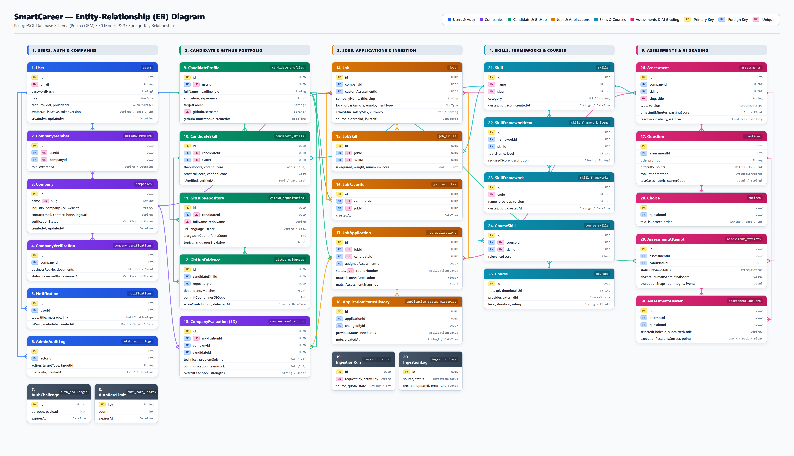
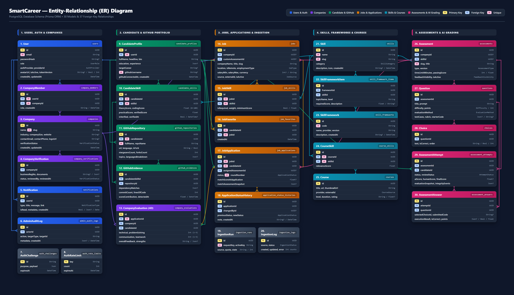
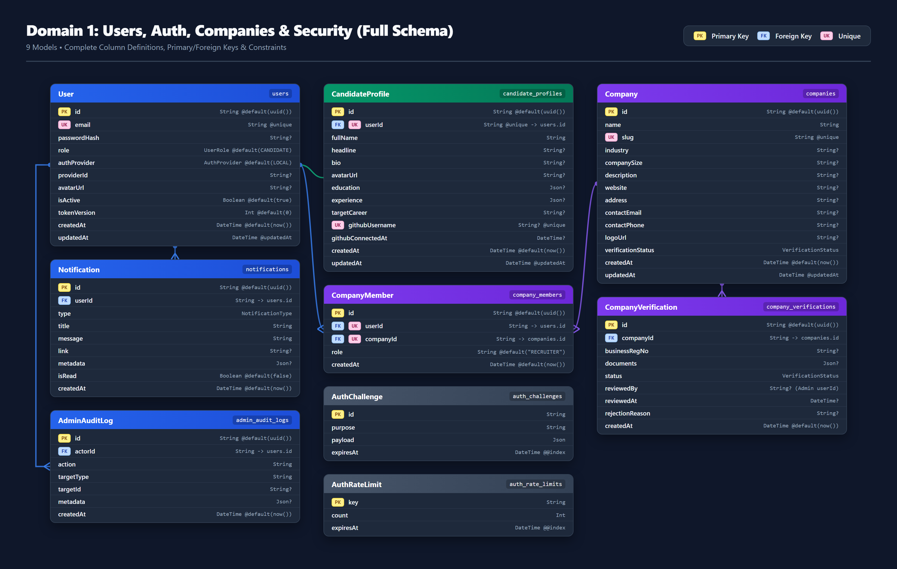
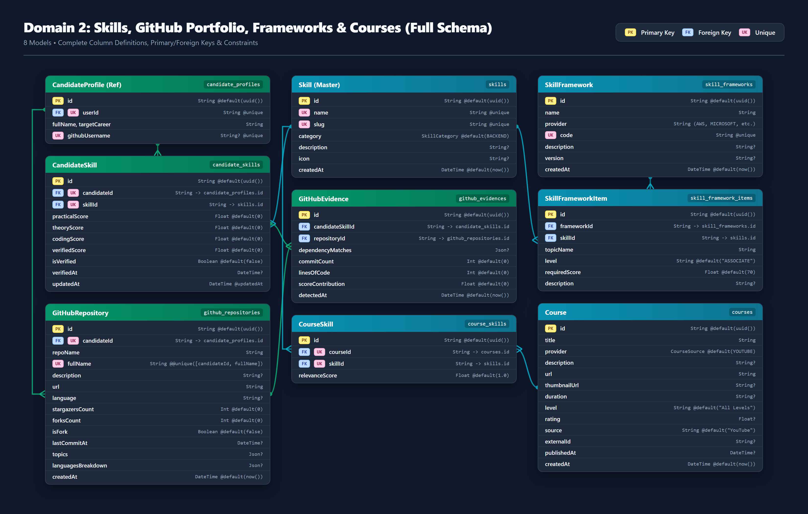
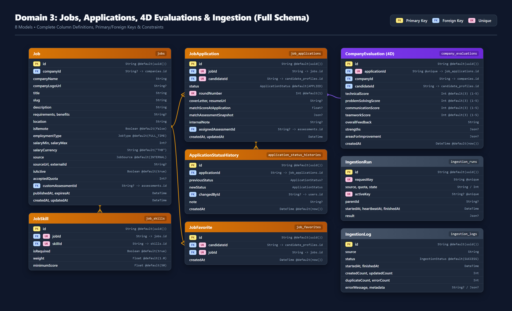
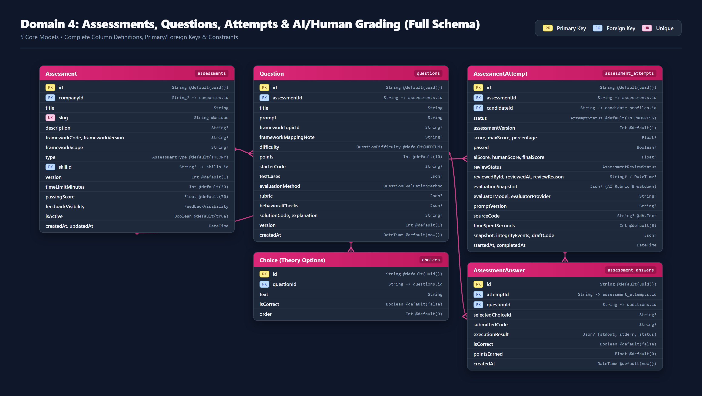
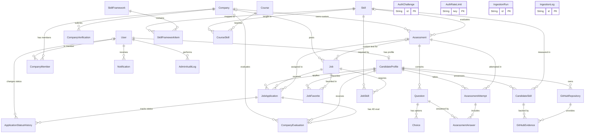

# SmartCareer — Entity-Relationship (ER) Diagram

เอกสารนี้แสดงโครงสร้างฐานข้อมูล PostgreSQL ทั้งหมดของโปรเจกต์ **SmartCareer** (ทั้งหมด **30 ตาราง / Models** และ **15 Enums**) อ้างอิงจากไฟล์ [`prisma/schema.prisma`](./prisma/schema.prisma)

- 📘 **ไฟล์ PDF รวมเล่ม (8 หน้า)**: [`SmartCareer_ER_Diagram.pdf`](./SmartCareer_ER_Diagram.pdf)
- 🗺️ **ไฟล์ PDF แผ่นเดียวแบบ Vector (Light Theme)**: [`docs/er-diagrams/er_diagram_overview_light.pdf`](./docs/er-diagrams/er_diagram_overview_light.pdf)
- 🗺️ **ไฟล์ PDF แผ่นเดียวแบบ Vector (Dark Theme)**: [`docs/er-diagrams/er_diagram_overview_dark.pdf`](./docs/er-diagrams/er_diagram_overview_dark.pdf)

---

## 1. รูปภาพ ER Diagram ความละเอียดสูง (PNG Images)

### 1.1 ภาพรวมทั้งระบบครบ 30 ตาราง (Light Theme — สำหรับพิมพ์/ใส่เล่มรายงาน)

### 1.2 ภาพรวมทั้งระบบครบ 30 ตาราง (Dark Theme — สำหรับสไลด์นำเสนอ)

### 1.3 แผนภาพแยกตาม 4 โดเมนหลัก (แสดงครบทุกคอลัมน์และชนิดข้อมูล)

#### โดเมนที่ 1: ระบบผู้ใช้งาน บริษัท การยืนยันตัวตน และความปลอดภัย (Users, Auth, Companies & Security)

#### โดเมนที่ 2: ทักษะ หลักฐานจาก GitHub กรอบมาตรฐานสากล และคอร์สเรียน (Skills, GitHub Portfolio, Frameworks & Courses)

#### โดเมนที่ 3: ตำแหน่งงาน การสมัครงาน การประเมิน 4 มิติ และการดึงข้อมูลงาน (Jobs, Applications, 4D Evaluations & Ingestion)

#### โดเมนที่ 4: ระบบข้อสอบ คำถาม การเข้าสอบ และการตรวจด้วย AI / ผู้เชี่ยวชาญ (Assessments, Questions, Attempts & AI/Human Grading)

---

## 2. แผนภาพ Mermaid ER Diagram ภาพรวมทั้งระบบ

---

## 3. ตารางสรุป Models และความสัมพันธ์ทั้งหมด (Entity Reference)

| ลำดับ | Model (Prisma) | ชื่อตาราง (PostgreSQL) | หน้าที่หลัก | Foreign Keys / ความสัมพันธ์สำคัญ |
| :--- | :--- | :--- | :--- | :--- |
| 1 | `AuthChallenge` | `auth_challenges` | เก็บสถานะ OAuth / One-time code ชั่วคราว | Standalone (Index: `expiresAt`) |
| 2 | `AuthRateLimit` | `auth_rate_limits` | จำกัดอัตราการเรียก Auth API (Rate Limiting) | Standalone (Index: `expiresAt`) |
| 3 | `User` | `users` | บัญชีผู้ใช้หลัก (`CANDIDATE`, `COMPANY`, `ADMIN`) | 1:1 กับ `CandidateProfile`, 1:N กับ `CompanyMember`, `Notification`, `AdminAuditLog` |
| 4 | `CandidateProfile` | `candidate_profiles` | ข้อมูลโปรไฟล์ผู้สมัครงาน ประวัติ และ GitHub | `userId` → `User` (Cascade) |
| 5 | `Company` | `companies` | ข้อมูลบริษัทและสถานะการยืนยันตัวตน | 1:N กับ `CompanyMember`, `CompanyVerification`, `Job`, `Assessment` |
| 6 | `CompanyMember` | `company_members` | ตารางเชื่อมผู้ใช้กับบริษัท (`OWNER`, `RECRUITER`, `HR`) | `userId` → `User`, `companyId` → `Company` |
| 7 | `CompanyVerification` | `company_verifications` | คำขอยืนยันตัวตนบริษัทและเอกสารแนบ | `companyId` → `Company` |
| 8 | `Skill` | `skills` | ข้อมูลทักษะหลัก (Master Data) แยกตามหมวดหมู่ | เชื่อมกับ `CandidateSkill`, `JobSkill`, `CourseSkill`, `Assessment` |
| 9 | `CandidateSkill` | `candidate_skills` | คะแนนทักษะของผู้สมัคร (Theory, Coding, Practical) | `candidateId` → `CandidateProfile`, `skillId` → `Skill` |
| 10 | `GitHubRepository` | `github_repositories` | ข้อมูล Repository ที่ดึงจาก GitHub ของผู้สมัคร | `candidateId` → `CandidateProfile` |
| 11 | `GitHubEvidence` | `github_evidences` | หลักฐานการใช้ทักษะจาก Repo (Dependencies, LOC) | `candidateSkillId` → `CandidateSkill`, `repositoryId` → `GitHubRepository` |
| 12 | `SkillFramework` | `skill_frameworks` | กรอบมาตรฐานทักษะสากล (AWS, Microsoft, ฯลฯ) | 1:N กับ `SkillFrameworkItem` |
| 13 | `SkillFrameworkItem` | `skill_framework_items` | หัวข้อย่อยในกรอบมาตรฐานทักษะ | `frameworkId` → `SkillFramework`, `skillId` → `Skill` |
| 14 | `Job` | `jobs` | ประกาศรับสมัครงาน (ทั้งภายในและดึงจากภายนอก) | `companyId` → `Company`, `customAssessmentId` → `Assessment` |
| 15 | `JobSkill` | `job_skills` | ทักษะที่ต้องการในแต่ละตำแหน่งงาน (Required/Preferred) | `jobId` → `Job`, `skillId` → `Skill` |
| 16 | `JobApplication` | `job_applications` | ใบสมัครงาน คะแนน Match ณ ตอนสมัคร และรอบสมัคร | `jobId` → `Job`, `candidateId` → `CandidateProfile`, `assignedAssessmentId` → `Assessment` |
| 17 | `JobFavorite` | `job_favorites` | งานที่ผู้สมัครกดบันทึกเป็นรายการโปรด | `candidateId` → `CandidateProfile`, `jobId` → `Job` |
| 18 | `ApplicationStatusHistory` | `application_status_histories` | ประวัติการเปลี่ยนสถานะใบสมัครงาน | `applicationId` → `JobApplication`, `changedById` → `User` |
| 19 | `Assessment` | `assessments` | ชุดข้อสอบวัดทักษะ (Theory / Practical Coding) | `companyId` → `Company`, `skillId` → `Skill` |
| 20 | `Question` | `questions` | โจทย์คำถาม, Test Cases, Rubric และ Starter Code | `assessmentId` → `Assessment` |
| 21 | `Choice` | `choices` | ตัวเลือกสำหรับข้อสอบปรนัย (Theory) | `questionId` → `Question` |
| 22 | `AssessmentAttempt` | `assessment_attempts` | การเข้าทำข้อสอบ คะแนน AI/Human และ Integrity Log | `assessmentId` → `Assessment`, `candidateId` → `CandidateProfile` |
| 23 | `AssessmentAnswer` | `assessment_answers` | คำตอบรายข้อและผลรันโค้ด (Execution Result) | `attemptId` → `AssessmentAttempt`, `questionId` → `Question` |
| 24 | `CompanyEvaluation` | `company_evaluations` | ผลประเมินผู้สมัครแบบ 4 มิติ (4D Evaluation) จากบริษัท | `applicationId` → `JobApplication` (1:1), `companyId` → `Company`, `candidateId` → `CandidateProfile` |
| 25 | `Course` | `courses` | คอร์สเรียนแนะนำ (YouTube / Udemy) สำหรับปิด Skill Gap | 1:N กับ `CourseSkill` |
| 26 | `CourseSkill` | `course_skills` | ตารางเชื่อมคอร์สเรียนกับทักษะที่สอน | `courseId` → `Course`, `skillId` → `Skill` |
| 27 | `IngestionRun` | `ingestion_runs` | ตารางคุม Lock และสถานะการทำงานขณะดึงข้อมูลงาน | Standalone (Unique: `requestKey`, `activeKey`) |
| 28 | `IngestionLog` | `ingestion_logs` | ประวัติผลการดึงข้อมูลประกาศงานจากแหล่งภายนอก | Standalone |
| 29 | `Notification` | `notifications` | การแจ้งเตือนในระบบของผู้ใช้แต่ละคน | `userId` → `User` |
| 30 | `AdminAuditLog` | `admin_audit_logs` | บันทึกประวัติการกระทำของ Admin (Audit Trail) | `actorId` → `User` |
