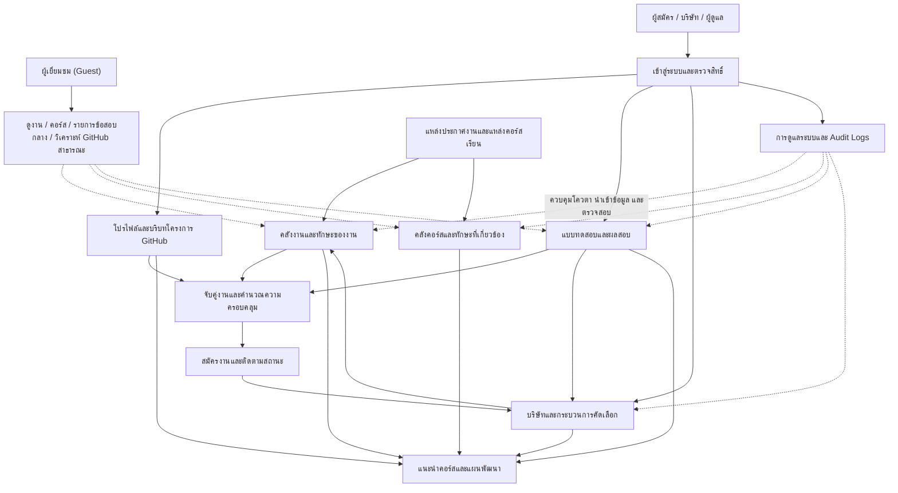
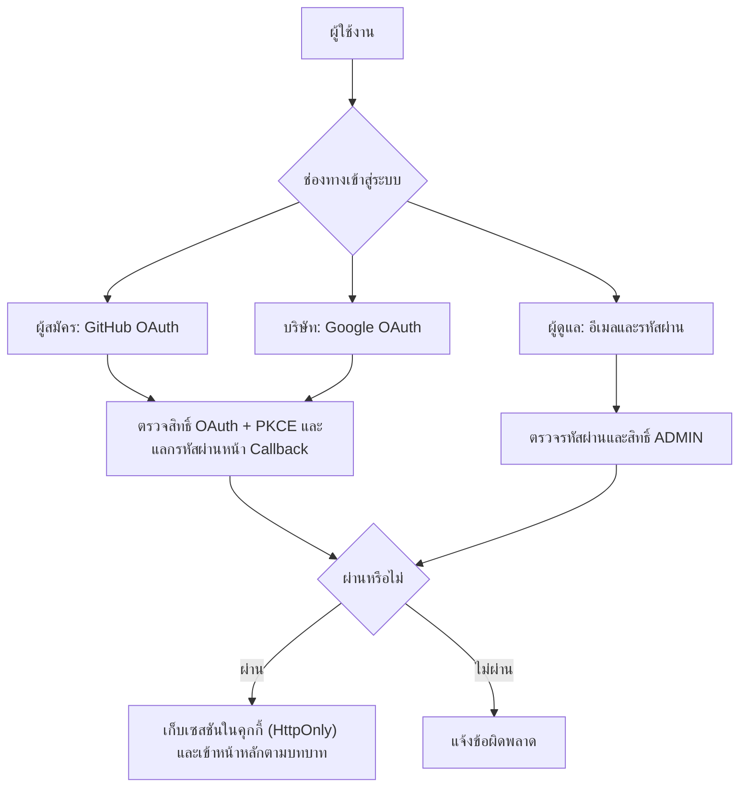
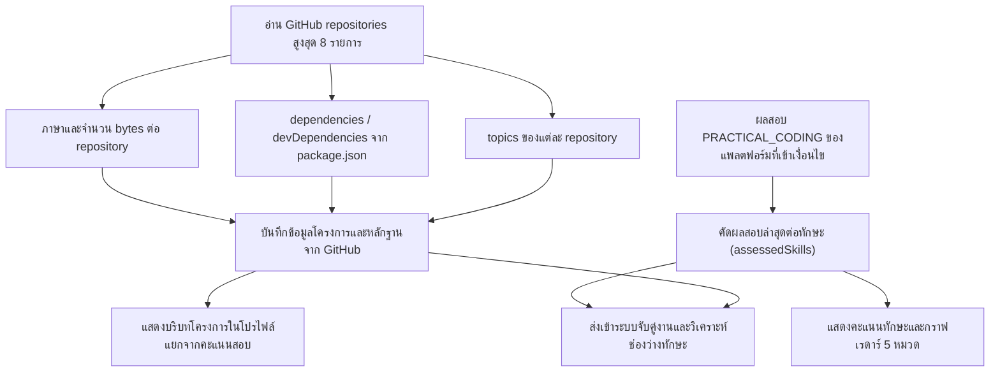
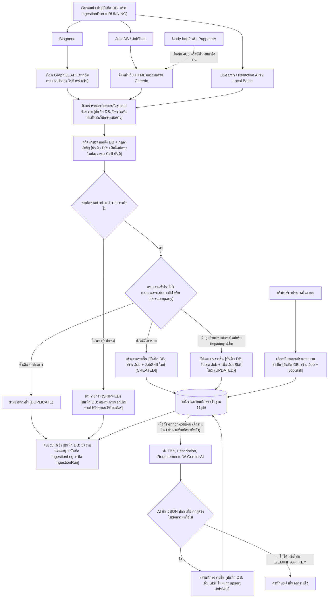
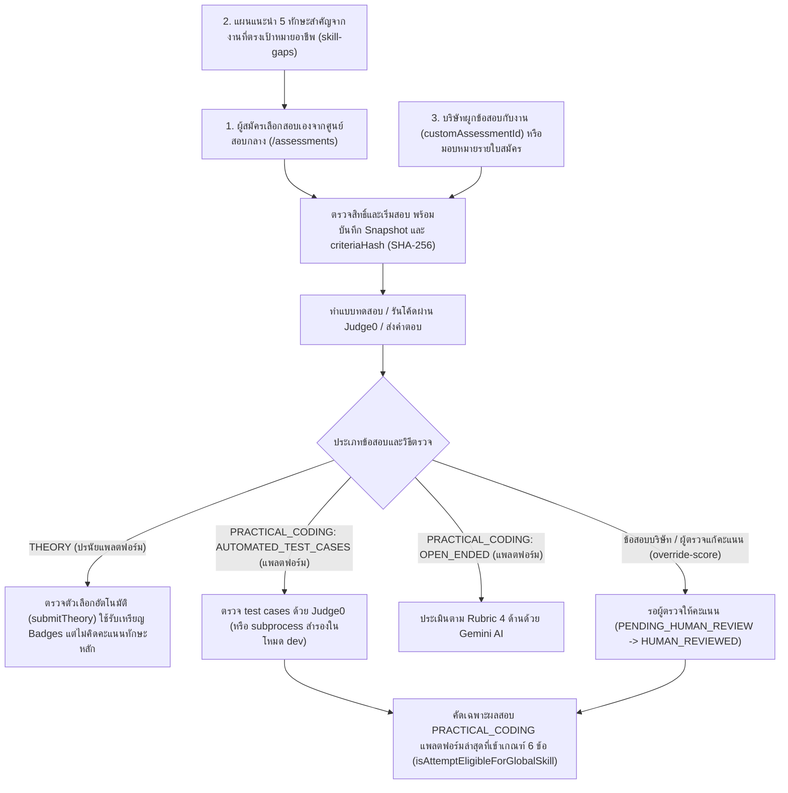
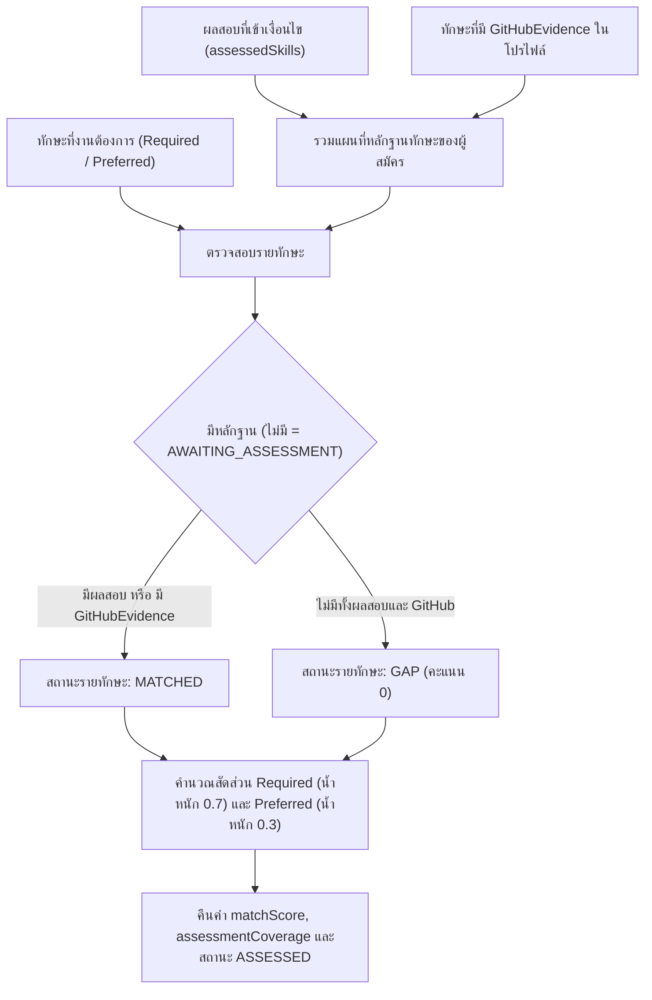
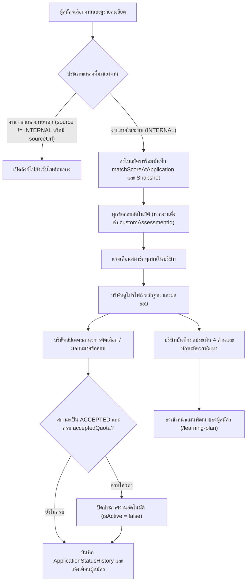
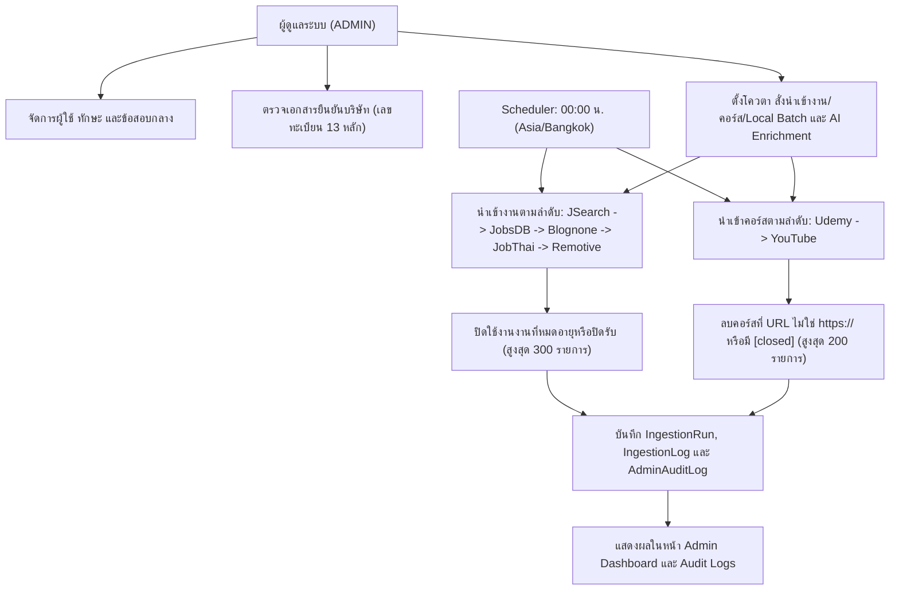
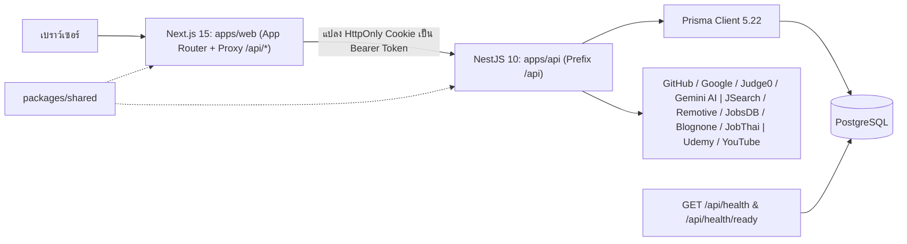

# SmartCareer — ระบบวิเคราะห์ทักษะและจับคู่งาน

SmartCareer รวบรวมประกาศงานจากแหล่งภายนอกและประกาศงานโดยตรงจากบริษัท แสดงบริบทโครงการจาก GitHub จัดสอบทักษะเชิงปฏิบัติและทฤษฎี เปรียบเทียบทักษะของผู้สมัครกับความต้องการของงาน และแนะนำคอร์สเรียนพร้อมแผนพัฒนาทักษะ ผู้สมัครสามารถทำแบบทดสอบและสมัครงาน ส่วนบริษัทสามารถยืนยันตัวตน ประกาศงาน คัดเลือกผู้สมัคร มอบหมายแบบทดสอบ และบันทึกผลประเมินได้

เอกสารนี้สรุปการทำงานและแผนภาพ Mermaid จากโค้ดจริงใน workspace ณ วันที่ 29 ตุลาคม 2569 เป็นคำอธิบายความสามารถที่พบในโค้ด ไม่ใช่การรับรองว่าทุกบริการภายนอกพร้อมใช้งานหรือทุกกรณีผ่านการทดสอบแล้ว

## สารบัญ

- [ภาพรวมระบบ](#overview)
- [ผู้ใช้งานและสิทธิ์](#access)
- [โปรไฟล์และหลักฐานทักษะ](#profile)
- [ประกาศงานและการวิเคราะห์ทักษะ](#ingestion)
- [แบบทดสอบและผลประเมิน](#assessment)
- [การจับคู่งานและสูตรคะแนน](#matching)
- [การสมัครงานและคัดเลือก](#recruitment)
- [คำแนะนำคอร์สและแผนพัฒนา](#learning)
- [ผู้ดูแลและงานเบื้องหลัง](#administration)
- [สถาปัตยกรรมและไฟล์สำคัญ](#architecture)
- [การติดตั้งและใช้งาน](#setup)

<a id="overview"></a>

## 1. ภาพรวมระบบ



ภาพรวมเชื่อมกระบวนการหลักของผู้เยี่ยมชมและผู้ใช้งานทั้ง 3 บทบาทเข้าด้วยกัน ส่วนแผนภาพย่อยด้านล่างอธิบายรายละเอียดตามโค้ดในแต่ละโมดูล ลูกศรเส้นประแสดงการเข้าถึงข้อมูลสาธารณะหรือการกำกับดูแลงานเบื้องหลังโดยผู้ดูแลระบบ

<a id="access"></a>

## 2. ผู้ใช้งานและสิทธิ์

ระบบกำหนดบทบาทใน `UserRole` (`CANDIDATE`, `COMPANY`, `ADMIN`) และตรวจสอบสิทธิ์ผ่าน `JwtAuthGuard`, `OptionalJwtAuthGuard` และ `RolesGuard` ([roles.guard.ts](apps/api/src/auth/roles.guard.ts))

| บทบาท | ความสามารถหลักในโค้ด |
|---|---|
| ผู้เยี่ยมชม (Guest) | ค้นหาและดูรายละเอียดงาน (`GET /api/jobs`, `GET /api/jobs/:id`, `GET /api/jobs/:id/detail`) ดูรายการแบบทดสอบแพลตฟอร์ม (`GET /api/assessments`, `GET /api/assessments/:id`) ค้นหาคอร์สเรียน (`GET /api/recommendations/courses`) ดูคลังทักษะและกรอบสมรรถนะ (`GET /api/skills`, `GET /api/skills/frameworks`) และทดลองวิเคราะห์ GitHub สาธารณะ (`GET /api/github/public/:username`) |
| ผู้สมัคร (`CANDIDATE`) | จัดการโปรไฟล์ (`GET/PUT /api/candidate/profile`) ดูกราฟเรดาร์และรายการทักษะ (`GET /api/candidate/radar`, `GET /api/candidate/skills`) ซิงก์ข้อมูล GitHub (`POST /api/github/sync`) บันทึกงานที่สนใจและดูผลจับคู่รายตำแหน่ง (`POST /api/jobs/:id/favorite`, `GET /api/jobs/:id/match`) ทำแบบทดสอบและรันโค้ด สมัครงานและยกเลิกใบสมัคร รวมถึงดูช่องว่างทักษะและอัปเดตความคืบหน้าแผนพัฒนา |
| บริษัท (`COMPANY`) | จัดการโปรไฟล์บริษัท (`GET/PUT /api/company/profile`) ส่งคำขอยืนยันตัวตนพร้อมเอกสาร (`POST /api/company/verify`) สร้าง/แก้ไข/เปิด-ปิดประกาศงาน (ต้องผ่านการยืนยัน `VERIFIED` ก่อนจึงสร้างงานได้) สร้างข้อสอบของบริษัท ดูข้อมูลผู้สมัคร เปลี่ยนสถานะใบสมัคร มอบหมายแบบทดสอบ ส่งออกรายชื่อผู้สมัครเป็น CSV (`GET /api/company/applications/export`) และบันทึกผลประเมินผู้สมัคร (`POST /api/evaluations/:applicationId`) |
| ผู้ดูแล (`ADMIN`) | ดูภาพรวมระบบ (`GET /api/admin/dashboard`) เปิด/ปิดสถานะผู้ใช้ จัดการคลังทักษะ ตรวจอนุมัติหรือปฏิเสธคำขอยืนยันบริษัท จัดการข้อสอบกลางและปรับคะแนนด้วยผู้ตรวจ (`POST /api/assessments/attempts/:attemptId/override-score`) ควบคุมโควตาและสั่งนำเข้างาน/คอร์ส/Local Batch/AI Enrichment รวมถึงตรวจสอบข้อมูลระบบและประวัติการกระทำ (`GET /api/admin/audit-logs`) |



การสมัครสมาชิกแบบรหัสผ่านถูกปิดไว้ (`registerLocal` ใน [auth.service.ts](apps/api/src/auth/auth.service.ts) จะโยน `BadRequestException` เสมอ และหน้า `/register` แสดงหน้าเดียวกับ `/login`) บัญชีผู้สมัครและบริษัทจะถูกสร้างอัตโนมัติเมื่อเข้าสู่ระบบผ่าน OAuth ครั้งแรก

<a id="profile"></a>

## 3. โปรไฟล์และบริบทโครงการ GitHub

บริการ [github.service.ts](apps/api/src/github/github.service.ts) ดึงรายการ repository สาธารณะล่าสุดจาก GitHub (`users/{username}/repos?per_page=10&sort=updated`) แล้วนำมาประมวลผลสูงสุด 8 repositories แรก โดยอ่านข้อมูลสัดส่วนภาษา (`languages_url`, หากดึงไม่ได้ใช้ค่าสำรอง `{ [primaryLanguage]: 10000 }`), ป้ายกำกับโครงการ (`repo.topics`) และอ่านไฟล์ `package.json` จากกิ่งหลัก (default branch, `main` หรือ `master`) เพื่อเทียบชื่อแพ็กเกจใน `dependencies` และ `devDependencies` กับตาราง `DEPENDENCY_SKILL_MAP`



- **สูตรสัดส่วนภาษาในแต่ละ repository:** `Math.round((bytes / totalBytes) * 1000) / 10` (ทศนิยม 1 ตำแหน่ง) เป็นสัดส่วนโค้ดในโครงการ ไม่ใช่คะแนนความชำนาญของผู้สมัคร
- **การบันทึกหลักฐาน GitHub (`syncCandidateGitHub`):** ระบบผูกทักษะ `git` (หากมีในระบบ) พร้อมภาษา ป้ายกำกับ (`topics`) และเครื่องมือที่ตรวจพบเข้ากับ `CandidateSkill` โดยตั้งค่าเริ่มต้น `practicalScore = 0`, `theoryScore = 0`, `codingScore = 0`, `verifiedScore = 0` (ไม่เขียนทับแถวเดิม) และสร้างรายการ `GitHubEvidence` ที่มี `scoreContribution = 0` เสมอ (ทั้งนี้ `MatchingService` และ `RecommendationsService.getSkillGapsAndPlan` ยังนำสถานะ `hasGithubEvidence` ไปใช้ตัดสินว่ามีทักษะนั้นแล้ว)
- **การวิเคราะห์ GitHub สาธารณะ (`GET /api/github/public/:username`):** คืนค่า `contextOnly: true` และ `proficiencyScore: null` พร้อมสรุปภาษาและเฟรมเวิร์กที่พบเรียงตามจำนวนโครงการ
- **ข้อมูลโปรไฟล์ (`GET /api/candidate/profile`):** ใน [candidate.service.ts](apps/api/src/candidate/candidate.service.ts) รายการ `skills[]` จะคืนค่า `assessmentScore` (เป็น `null` หากยังไม่มีผลสอบที่ใช้ได้), `assessmentStatus` (`ASSESSED`, `GAP`, `NOT_ASSESSED`), `assessmentResult`, `hasGithubEvidence` และ `githubEvidences[]` โดยไม่ส่งคอลัมน์ `practicalScore` ออกไป
- **กราฟเรดาร์ (`GET /api/candidate/radar`):** คำนวณค่าเฉลี่ยเลขคณิต (ปัดเศษเป็นจำนวนเต็ม) เฉพาะทักษะที่มีผลสอบที่เข้าเงื่อนไขใน 5 หมวดคงที่ ได้แก่ `FRONTEND`, `BACKEND`, `DATABASE`, `DEVOPS` และ `TESTING` หมวดที่ยังไม่มีผลสอบจะคืน `score: null` และ `averageScore: null` (ไม่แทนด้วย 0) พร้อมแสดง `githubCount` และ `githubCoveragePct` แยกต่างหาก

<a id="ingestion"></a>

## 4. ประกาศงานและการวิเคราะห์ทักษะ

### เครื่องมือและแหล่งข้อมูล

| เครื่องมือหรือช่องทาง | หน้าที่ในโค้ด |
|---|---|
| Axios | ดึงหน้าเว็บ HTML, เรียก GraphQL ของ Blognone, เรียก API ของ JSearch / Remotive / YouTube / Udemy / Gemini |
| Cheerio | แยกข้อมูลการ์ดงานและหน้ารายละเอียดจาก HTML ของ JobsDB, Blognone และ JobThai |
| Node `http2` | ทางสำรองเมื่อ JobsDB หรือ Blognone ตอบกลับ `HTTP 403` ([public-job-http2.ts](apps/api/src/ingestion/public-job-http2.ts), [blognone-public-http2.ts](apps/api/src/ingestion/blognone-public-http2.ts)) จำกัดเฉพาะโดเมนใน allowlist |
| `puppeteer-core` | เรนเดอร์หน้าเว็บเมื่อการดึงด้วย Axios/HTTP2 ยังไม่พบ selector ของรายการงาน ([rendered-job-html.ts](apps/api/src/ingestion/rendered-job-html.ts)) |
| JSearch / Remotive API | ดึงประกาศงานรูปแบบ JSON โดยตรง (JSearch ต้องใช้ `JSEARCH_API_KEY` หรือ `RAPIDAPI_KEY`) |
| Local Job Batch | นำเข้าไฟล์ชุดข้อมูลงาน `JOBSDB` หรือ `BLOGNONE` ที่เก็บจากเครื่องภายนอก พร้อมตรวจโครงสร้างและค่า SHA-256 digest ([local-job-batch.ts](apps/api/src/ingestion/local-job-batch.ts)) |
| Prisma & IngestionService | จัดรูปแบบข้อความ ตรวจงานซ้ำ สกัดทักษะ และบันทึกสถานะการรันลง `IngestionRun` และ `IngestionLog` |

รายละเอียดการดึงข้อมูลงานจาก 5 แหล่งภายนอกใน [ingestion.service.ts](apps/api/src/ingestion/ingestion.service.ts):

- **REMOTIVE:** เรียก `https://remotive.com/api/remote-jobs?category=software-dev&limit=N` (หากได้ 0 รายการจะลองใหม่โดยไม่ระบุหมวด) กำหนด `isRemote = true`, `employmentType = REMOTE`, สกุลเงิน `USD`
- **JSEARCH:** เรียก `JSEARCH_API_URL` (ค่าเริ่มต้นในโค้ดคือ `https://jsearch.p.rapidapi.com/search-v2`) ค้นหา `software developer` ในประเทศไทย หากไม่ได้ตั้งคีย์บริการจะคืนข้อผิดพลาดและไม่สร้างข้อมูลจำลอง
- **BLOGNONE:** ลองเรียก GraphQL (`https://jobs-api.blognone.com/graphql` query `getHome`) ด้วย Axios ก่อน หากติด 403 จะสลับไปใช้ `http2` และหากยังไม่ได้ผลจึงดึงหน้า HTML จาก `https://jobs.blognone.com/search`
- **JOBSDB:** ดึงหน้าค้นหา `https://th.jobsdb.com/jobs?keywords=developer` สูงสุด 2 หน้า อ่านจากทั้ง `[data-testid="job-card"]` และตัวแปร `window.SEEK_REDUX_DATA`
- **JOBTHAI:** ดึงหน้า `https://www.jobthai.com/th/jobs?keyword=software` สูงสุด 3 หน้าด้วย Axios โดยตรง (ไม่มี fallback ไปยัง HTTP/2 หรือ Puppeteer) กำหนดสถานที่เริ่มต้นเป็น `Bangkok, Thailand` และประเภทงาน `FULL_TIME`

สำหรับงานจาก `JOBSDB`, `JOBTHAI` และ `BLOGNONE` (เฉพาะกรณีคำอธิบายสั้นกว่า 200 ตัวอักษรหรือไม่มีโลโก้) ระบบจะดึงหน้ารายละเอียดเพิ่มเติมผ่าน `fetchJobDetail` ([job-detail-content.ts](apps/api/src/ingestion/job-detail-content.ts)) เพื่ออ่าน JSON-LD `JobPosting` และเนื้อหาฉบับเต็ม หากพบข้อความว่าประกาศหมดอายุ ระบบจะปิดใช้งาน (`isActive = false`) งานเดิมในฐานข้อมูลที่ตรงกันทันที

#### กลไกสำรองเมื่อดึงหน้าเว็บไม่ได้ (`Node http2` และ `Puppeteer`)

ในการดึงหน้าเว็บ `JOBSDB` และ `BLOGNONE` ระบบใช้ฟังก์ชัน `fetchJobSourceHtml` ซึ่งทำงานเป็นลำดับขั้นเพื่อแก้ปัญหาการป้องกันบอทและหน้าเว็บที่ต้องเรนเดอร์ด้วย JavaScript:

1. **ด่านแรก (`Axios` HTTP/1.1):** ดึงหน้าเว็บปกติและตรวจว่าพบโครงสร้างการ์ดงาน (`[data-testid="job-card"]`, `window.SEEK_REDUX_DATA` หรือ `a[href*="/job/"] h3`) หรือไม่
2. **ด่านที่สอง (`Node http2` — แก้ปัญหาติด `HTTP 403`):** หากเว็บไซต์ต้นทางปฏิเสธคำขอด้วยรหัส `403` (เช่น ระบบป้องกันบอทบล็อกการเชื่อมต่อแบบ HTTP/1.1) ระบบจะสลับไปเชื่อมต่อผ่านโมดูล `http2` ([public-job-http2.ts](apps/api/src/ingestion/public-job-http2.ts) และ [blognone-public-http2.ts](apps/api/src/ingestion/blognone-public-http2.ts)) ซึ่งจำกัดเฉพาะโดเมนใน allowlist (`th.jobsdb.com`, `jobs.blognone.com`, `jobs-api.blognone.com`) และจำกัดการเปลี่ยนเส้นทางไม่เกิน 3 ครั้ง
3. **ด่านที่สาม (`puppeteer-core` — แก้ปัญหาหน้าเว็บว่างที่ต้องรอ JavaScript วาดข้อมูล):** หากดึง HTML มาได้แต่ยังไม่พบรายการการ์ดงาน ระบบจะสั่งเปิดเบราว์เซอร์จริง (Chrome หรือ Edge ในเครื่อง) แบบซ่อนหน้าจอผ่าน [rendered-job-html.ts](apps/api/src/ingestion/rendered-job-html.ts) โดยจัดคิวเปิดทีละ 1 เบราว์เซอร์ และบล็อกการโหลดรูปภาพ ฟอนต์ และสื่อมีเดียเพื่อความรวดเร็วและประหยัดแบนด์วิดท์

#### การนำเข้าผ่านไฟล์ `Local Job Batch`

กรณีที่เซิร์ฟเวอร์ปลายทางถูกบล็อกไม่ให้ดึงข้อมูลสดจาก `JOBSDB` หรือ `BLOGNONE` ผู้ดูแลระบบสามารถรันสคริปต์เก็บข้อมูลจากเครื่องตัวเองแล้วอัปโหลดเข้าผ่าน `POST /api/ingestion/local-jobs` ([local-job-batch.ts](apps/api/src/ingestion/local-job-batch.ts)) โดยมีเงื่อนไขตรวจสอบดังนี้:

- ขนาดไฟล์ JSON ไม่เกิน `256 KiB`, ระบุ `version: 1` และเวลาที่เก็บข้อมูล `collectedAt` ต้องไม่เก่าเกิน **7 วัน** (และไม่ล้ำอนาคตเกิน 5 นาที)
- รองรับเฉพาะแหล่ง `JOBSDB` (ไม่เกิน 60 งานต่อชุด, ลิงก์ต้องอยู่ในรูปแบบ `https://th.jobsdb.com/job/<ตัวเลข>`) และ `BLOGNONE` (ไม่เกิน 30 งานต่อชุด, ลิงก์ต้องอยู่ในรูปแบบ `https://jobs.blognone.com/company/<บริษัท>/job/<slug>`)
- ระบบคำนวณค่า `SHA-256 digest` ของไฟล์เพื่อตรวจสอบความถูกต้องระหว่างขั้นตอน Preview (`POST /api/ingestion/local-jobs/preview`) และขั้นตอนยืนยันนำเข้าจริง

ตัวอย่างโครงสร้างไฟล์ `Local Job Batch`:

```json
{
  "version": 1,
  "source": "BLOGNONE",
  "collectedAt": "2026-10-27T14:57:48.965Z",
  "jobs": [
    {
      "id": "mobile-developer-f-0aER",
      "title": "Mobile Developer ( Flutter or React Native )",
      "company": "NILECON THAILAND",
      "logoUrl": null,
      "description": "Responsibilities:\n- Design, develop, and maintain cross-platform mobile applications...\n\nSkills: dart, react-native, flutter, mobile, cross-platform",
      "requirements": null,
      "benefits": null,
      "location": "ห้วยขวาง, กรุงเทพมหานคร",
      "isRemote": false,
      "employmentType": "FULL_TIME",
      "salaryMin": 20000,
      "salaryMax": 40000,
      "salaryCurrency": "THB",
      "url": "https://jobs.blognone.com/company/nilecon-thailand-co-ltd/job/mobile-developer-f-0aER"
    }
  ]
}
```



การจัดข้อมูลและตรวจงานซ้ำไม่ใช้ AI ระบบตรวจซ้ำจากแหล่งที่มาและรหัสประกาศ (`source + externalId`) หรือจากชื่อตำแหน่งกับชื่อบริษัท (`title + companyName` แบบไม่แยกตัวพิมพ์เล็ก–ใหญ่) และข้ามประกาศที่ไม่พบทักษะทางเทคนิคอย่างน้อย 1 รายการ

### AI และข้อความสั่งงาน

ระบบมีการใช้ Gemini AI สกัดทักษะของประกาศงานอยู่ในบริการ [gemini-extractor.service.ts](apps/api/src/ingestion/gemini-extractor.service.ts) (`extractSkills` และ `callGeminiFlash`) โดยเรียกผ่าน REST API (`generativelanguage.googleapis.com/v1beta`, ตั้งค่า `responseMimeType: 'application/json'`, `temperature: 0.1`, `timeout: 8000` ms) ตามลำดับโมเดลดังนี้:

1. ค่าจาก `process.env.AI_EVALUATOR_MODEL` (หากไม่กำหนดจะใช้ `gemini-3.6-flash` เป็นค่าเริ่มต้นในโค้ด ทั้งนี้ใน `.env.example` ตั้งค่าตัวอย่างไว้เป็น `gemini-2.5-flash`)
2. `gemini-3.5-flash-lite`
3. `gemini-3.6-flash`

หากได้รับสถานะ `HTTP 429` (Rate Limit) ระบบจะหยุดลองโมเดลถัดไปทันที

- **จังหวะที่ AI ถูกเรียกใช้งาน:** ในรอบการนำเข้างานอัตโนมัติ (`startOrFollowJobRun`) ระบบจะเรียก `extractJobSkills` โดยไม่ส่งแฟล็ก AI (`useAi` เป็น `undefined`/`false`) จึงใช้เฉพาะคลังทักษะในฐานข้อมูลและกฎคำสำคัญเป็นหลัก ส่วนการเรียก Gemini AI จะทำงานเมื่อเรียกผ่าน `POST /api/ingestion/enrich-jobs-ai` (`enrichJobsAi` ใน [ingestion.service.ts](apps/api/src/ingestion/ingestion.service.ts)) ซึ่งส่ง `{ useAi: true }` เข้าไปสกัดทักษะเพิ่มเติมให้กับงานที่เปิดรับอยู่
- **ข้อความสั่งงาน (Prompt) ที่ส่งให้ AI:** กำหนดไว้ใน [gemini-extractor.service.ts](apps/api/src/ingestion/gemini-extractor.service.ts) (บรรทัดที่ 240–244) ดังนี้:

```text
Extract technical skills explicitly mentioned in this job posting:
Title: ${title}
Description: ${description}
Requirements: ${requirements || 'N/A'}
Return ONLY a JSON array of objects with fields: name, category, isRequired, minimumScore.
```

- **การตรวจสอบผลลัพธ์หลังรับค่าจาก AI:**
  1. ตัดเครื่องหมาย ```` ```json ```` ออกและแปลงเป็นอาร์เรย์ JSON
  2. แปลง `category` ให้ตรงกับ `SkillCategory` ด้วย `normalizeCategory` (หากไม่ตรงกับหมวดใดเลยจะใช้ค่าเริ่มต้น `BACKEND`)
  3. บังคับค่า `minimumScore` ให้อยู่ในช่วง `50` ถึง `95` (หาก AI ไม่ระบุหรือส่งค่าไม่ใช่ตัวเลขจะใช้ค่าเริ่มต้น `70`)
  4. **ป้องกัน AI คาดเดาทักษะที่ไม่มีในประกาศ:** ระบบนำชื่อทักษะที่ AI ส่งกลับมาตรวจซ้ำว่าตรงกับทักษะที่ได้จากกฎคำสำคัญ หรือปรากฏคำนั้นจริงในข้อความ `${title} ${description} ${requirements}` แบบตรงขอบเขตคำ (`new RegExp('(^|[^a-z0-9])' + escaped + '($|[^a-z0-9])', 'i')`) เท่านั้น ก่อนนำมารวมกับผลจากกฎคำสำคัญโดยไม่ซ้ำกัน

### กฎคำสำคัญและทักษะในฐานข้อมูล (วิธีหลักและวิธีสำรอง)

เมื่อสกัดทักษะจากข้อความประกาศงาน ระบบทำงาน 2 ส่วนควบคู่กัน:

1. **เทียบกับคลังทักษะในฐานข้อมูล (`dbSkills`):** หากพบชื่อทักษะในข้อความแบบตรงขอบเขตคำ (word boundary) จะกำหนด `isRequired = true` เมื่อพบในชื่อตำแหน่งหรืออยู่ใน 3 ลำดับแรกที่พบ และกำหนด `minimumScore = 70` เมื่อพบในชื่อตำแหน่ง (หากพบเฉพาะในเนื้อหาจะได้ `minimumScore = 60`)
2. **เทียบกับกฎคำสำคัญ (`SKILL_EXTRACTION_RULES`):** ค้นหาแบบไม่แยกตัวพิมพ์เล็ก–ใหญ่ ทุกทักษะที่พบจากกฎคำสำคัญจะถูกกำหนดค่าเริ่มต้นเป็น `isRequired = true` และ `minimumScore = 70`

| หมวด (`SkillCategory`) | ทักษะที่รองรับใน `SKILL_EXTRACTION_RULES` |
|---|---|
| `FRONTEND` | React (`react.js`, `reactjs`), Next.js (`nextjs`), JavaScript (`js`, `es5`, `es6`, `jsx`), TypeScript (`ts`), HTML5 (`html`), CSS3 (`css`), Tailwind CSS (`tailwind`), Bootstrap, Angular (`angularjs`), Vue.js (`vue`, `vuejs`, `nuxt`), Redux (`flux`), RxJS, Adobe XD, Figma |
| `BACKEND` | Node.js (`nodejs`), NestJS, REST APIs (`rest api`, `restful`), GraphQL, Python (`django`, `fastapi`, `flask`), Java, Spring Boot, Go (`golang`), C# (`c#`, `.net`, `dotnet`, `asp.net`), PHP (`laravel`), PLC (`programmable logic controller`) |
| `DATABASE` | PostgreSQL (`postgres`), MySQL, MongoDB (`mongo`), Redis, SQL |
| `DEVOPS` | Docker, Kubernetes (`k8s`), AWS (`amazon web services`), Git (`github`, `gitlab`), CI/CD (`ci/cd`, `cicd`), Linux (`ubuntu`, `centos`, `red hat`, `debian`, `unix`), OpenShift, Tomcat (`apache tomcat`), Storage Systems (`san`, `nas`), Technical Support (`level 2 support`), Network Switching (`network switch`, `vlan`), Structured Cabling (`lan cabling`, `fiber optic`), Server Hardware, Network Administration (`vpn`, `lan/wan`, `firewall`, `mikrotik`, `cisco`, `ระบบเครือข่าย`), Hardware & Software Troubleshooting (`it support`, `helpdesk`, `service desk`, `ซ่อมบำรุง`) |
| `TESTING` | Postman, Selenium, Playwright, Cypress, Jest, Automated Testing, Manual Testing, Functional Testing, Non-Functional Testing, Integration Testing, Performance Testing, Load Testing, Security Testing, Test Case Design, UAT (`user acceptance test`) |
| `SECURITY` | Network Security, Cybersecurity (`cyber security`, `information security`, `infosec`) |
| `MOBILE` | Flutter, React Native, iOS (`swift`, `objective-c`), Android (`kotlin`) |
| `SALES` | Sales Proposal Writing (`จัดทำข้อเสนอ`), Sales Quotation (`ใบเสนอราคา`), Customer Relationship Management (`ดูแลฐานลูกค้า`) |
| `COORDINATION` | Coordination (`ประสานงาน`), Communication (`ทักษะในการสื่อสาร`), Negotiation (`เจรจาต่อรอง`), Project Management (`agile`, `scrum`, `บริหารโครงการ`), Requirements Analysis (`business requirements`, `system analysis`, `วิเคราะห์ความต้องการ`) |
| `WRITING` | Content Writing (`เขียนบทความ`, `copywriting`), Microsoft Word (`ms word`), OpenOffice, SEO (`search engine optimization`) |

### การนำเข้าคอร์สเรียน

รองรับแหล่งข้อมูล `UDEMY` และ `YOUTUBE` (`syncCourses` ใน [ingestion.service.ts](apps/api/src/ingestion/ingestion.service.ts)):

- **YouTube:** ใช้ YouTube Data API v3 ค้นหาวิดีโอและดึงรายละเอียด (`snippet`, `contentDetails`, `status`) ตรวจสอบรหัสวิดีโอ 11 ตัวอักษร แปลงความยาวแบบ ISO 8601 (`youtubeDurationFromIso`) และคัดเฉพาะวิดีโอสาธารณะที่ไม่ใช่รายการสด
- **Udemy:** เรียก Udemy API v2.0 ด้วย Basic Auth (`UDEMY_CLIENT_ID` / `UDEMY_CLIENT_SECRET`)
- **คลังคอร์สสำรอง (`CURATED_COURSES_CATALOG`):** หากไม่ได้ตั้งคีย์ API หรือการเรียกบริการภายนอกล้มเหลว ระบบจะใช้รายการคอร์สคัดสรรในโค้ดแทน (มี Udemy 15 รายการ และ YouTube 4 รายการ)
- **การตรวจซ้ำและผูกทักษะ:** ตรวจซ้ำด้วย `(provider, externalId)` หรือ URL ที่ตัด `#hash` และ `/` ท้ายสุดออกแล้ว (`normalizeCourseUrl`) จากนั้นผูกทักษะเป้าหมายด้วยน้ำหนัก `relevance = 1.0` และผูกทักษะอื่นที่พบหลักฐานในชื่อ/คำอธิบาย/แท็ก (`hasCourseSkillEvidence`) ด้วย `relevance = 0.9`

<a id="assessment"></a>

## 5. แบบทดสอบและผลประเมิน

ระบบแบ่งข้อสอบเป็น 2 ประเภท (`AssessmentType`) คือ `THEORY` (ปรนัย) และ `PRACTICAL_CODING` (เขียนโค้ด) โดยมีวิธีตรวจ (`QuestionEvaluationMethod`) 2 แบบคือ `AUTOMATED_TEST_CASES` และ `OPEN_ENDED`:

- **ข้อสอบกลางของแพลตฟอร์ม (`companyId = null`):** สร้างโดยผู้ดูแลระบบ หรือนำเข้าจากไฟล์ตั้งต้น [javascript-sandbox.json](prisma/assessment-bank/javascript-sandbox.json) ซึ่งมี 4 ชุด ได้แก่ *JavaScript Practical Coding Assessment* (เกณฑ์ผ่าน 70%), *SQL & Data Query Logic Assessment* (เกณฑ์ผ่าน 60%), *Python Practical Problem Solving* (เกณฑ์ผ่าน 70%) และ *Web & Cloud Engineering Fundamentals (Theory)* (เกณฑ์ผ่าน 70%)
- **ข้อสอบของบริษัท (`companyId != null`):** สร้างโดยบริษัทสำหรับคัดเลือกผู้สมัคร ข้อสอบประเภท `PRACTICAL_CODING` ของบริษัทจะถูกบังคับให้ใช้วิธีตรวจแบบ `OPEN_ENDED` เสมอ และเมื่อผู้สมัครส่งคำตอบจะเข้าสู่สถานะ `PENDING_HUMAN_REVIEW` เพื่อให้ผู้ตรวจให้คะแนนเอง



### การบันทึก Snapshot และ `criteriaHash` (`SHA-256`)

เมื่อผู้สมัครกดเริ่มทำข้อสอบ ระบบจะเรียกใช้ฟังก์ชัน `buildAssessmentSnapshot` และ `computeCriteriaHash` ใน [assessment-validation.ts](packages/shared/src/assessment-validation.ts) เพื่อบันทึกข้อมูลลงในรอบการสอบ (`AssessmentAttempt`):

- **Snapshot (สำเนาใบกติกาการสอบ ณ วินาทีที่เริ่มสอบ):** บันทึกรายละเอียดกติกาของข้อสอบชุดนั้นไว้ในฟิลด์ `snapshot` ได้แก่ รุ่นโครงสร้างข้อมูล (`skillAssessmentVersion: 1`), รหัสและเวอร์ชันของข้อสอบ, ประเภทข้อสอบ, โหมดการตรวจ (`PLATFORM_AUTOMATED` หรือ `COMPANY_MANUAL`), เกณฑ์คะแนนผ่าน (`passingScore`), เวลาจำกัด (`timeLimitMinutes`), การแสดงผลเฉลย (`feedbackVisibility`), ทักษะที่ผูกไว้ และรายการคำถามแต่ละข้อ (รหัสคำถาม, คะแนนเต็ม, วิธีตรวจ, จำนวนชุดทดสอบที่เปิดเผยและซ่อนเร้น, เกณฑ์รูบริก) เพื่อให้เป็นหลักฐานอ้างอิงถาวรแม้ในอนาคตผู้ดูแลระบบหรือบริษัทจะแก้ไขตัวข้อสอบก็ตาม
- **`criteriaHash` (ตราประทับดิจิทัล `SHA-256`):** นำกติกาสำคัญที่มีผลต่อการคิดคะแนน (รหัสและเวอร์ชันข้อสอบ, โหมดการตรวจ, เกณฑ์ผ่าน, ทักษะ และรหัสคำถาม/คะแนน/วิธีตรวจ/จำนวนชุดทดสอบของทุกข้อ) มาเข้ารหัส `SHA-256` เพื่อใช้ตรวจจับการแก้ไขข้อสอบระหว่างที่ผู้สมัครยังทำข้อสอบไม่เสร็จ หากผู้สมัครกลับมาทำต่อหรือกดส่งคำตอบแล้วพบว่า `criteriaHash` ของข้อสอบปัจจุบันเปลี่ยนไปไม่ตรงกับตอนเริ่มสอบ ระบบจะเปลี่ยนสถานะรอบที่ค้างอยู่เป็น `EXPIRED` หรือปฏิเสธการส่งคำตอบด้วย `409 Conflict` เพื่อป้องกันไม่ให้ตรวจคำตอบด้วยกติกาที่ถูกเปลี่ยนกลางคัน

### การตั้งเฉลยและการรันโค้ดตรวจ `test cases` ด้วย Judge0

อ้างอิงจาก [judge0.client.ts](apps/api/src/assessments/judge0.client.ts), [assessment-validation.ts](packages/shared/src/assessment-validation.ts) และ [assessments.service.ts](apps/api/src/assessments/assessments.service.ts):

- **ผู้กำหนดโจทย์และเฉลย (`testCases`):** เฉพาะข้อสอบกลางของแพลตฟอร์ม (`companyId = null`) ที่สร้างโดยผู้ดูแลระบบ (Admin) หรือมาจากการนำเข้าไฟล์คลังข้อสอบตั้งต้นเท่านั้นที่ใช้การตรวจเทียบเฉลยอัตโนมัติ (`AUTOMATED_TEST_CASES`) โดยฟังก์ชัน `validateAssessmentReadiness` บังคับว่าแต่ละข้อต้องมีชุดทดสอบอย่างน้อย **2 ชุด** (สูงสุด 100 ชุด) ซึ่งผู้ดูแลระบบต้องกำหนดคู่ค่า `input` (ข้อมูลป้อนเข้า) และ `expectedOutput` (เฉลยผลลัพธ์) แบ่งออกเป็น 2 ส่วนเสมอ:
  1. **ชุดทดสอบแบบเปิดเผย (`isHidden: false` อย่างน้อย 1 ชุด):** ใช้สำหรับปุ่มซ้อมรันโค้ด (`Run Code`) ระหว่างทำข้อสอบ (จำกัดความถี่การกดทุก 3 วินาที) เพื่อให้ผู้สมัครตรวจสอบรูปแบบผลลัพธ์เบื้องต้นได้
  2. **ชุดทดสอบแบบซ่อน (`isHidden: true` อย่างน้อย 1 ชุด):** ระบบจะกรองข้อมูลชุดที่ซ่อนออกก่อนส่งไปหน้าเว็บด้วยฟังก์ชัน `sanitizeAssessmentForCandidate` ใน [candidate-feedback.ts](apps/api/src/assessments/candidate-feedback.ts) โดยผู้สมัครจะไม่เห็นทั้ง `input` และ `expectedOutput` และระบบจะนำมารวมตรวจจริงเมื่อกดส่งคำตอบ (`Submit`) เท่านั้น
- **ขั้นตอนการรันและตรวจคำตอบ (`runAutomatedTestCases`):**
  1. **ตรวจขนาดและแยกภาษา:** ตรวจสอบขนาดโค้ดไม่ให้เกิน 64 KB (`validateSourceLength`) และตรวจจับภาษาจาก `starterCode` ว่ามี `def solution(` หรือ `# language: python` หรือไม่ หากพบจะรันด้วยภาษา Python (Judge0 ID `71`) มิฉะนั้นใช้ภาษา JavaScript (Judge0 ID `63`)
  2. **หุ้มโค้ดด้วยชุดทดสอบ (`buildJavaScriptHarness` / `buildPythonHarness`):** สร้างโค้ดหุ้มเพื่อแปลงค่า `input` ของแต่ละชุดทดสอบเป็นพารามิเตอร์ส่งเข้าฟังก์ชัน `solution(...)` ของผู้สมัคร แล้วพิมพ์ผลลัพธ์ออกทาง `stdout`
  3. **ประมวลผลใน Sandbox (หรือ `subprocess` สำรองในโหมด dev):** ส่งโค้ดไปรันที่เซิร์ฟเวอร์ `Judge0` โดยจำกัดเวลา CPU ไม่เกิน **3 วินาที** (หรือ **5 วินาที** สำหรับโจทย์ปลายเปิด) และหน่วยความจำไม่เกิน **128 MB** หากเปิด `JUDGE0_FIXTURE_MODE=true` หรือ `ENABLE_DEV_MOCK_AUTH=true` และไม่ได้เชื่อมต่อ `Judge0` ระบบจะสลับมารันผ่าน `subprocess` (`node` หรือ `python`) ในเครื่องแทนโดยคุมเวลาไม่เกิน 3 วินาทีเช่นกัน
  4. **เทียบผลลัพธ์กับเฉลย 4 ระดับ (`compareOutputs`):** ชุดทดสอบจะถือว่าผ่านเมื่อโค้ดทำงานสำเร็จโดยไม่เกิดข้อผิดพลาด และผลลัพธ์ที่ได้ (`actualOutput`) ตรงกับเฉลย (`expectedOutput`) ตามเงื่อนไขข้อใดข้อหนึ่งต่อไปนี้:
     - ตรงกันทุกตัวอักษรหลังจากตัดช่องว่างหัวท้าย (`trim`)
     - ตัวอักษรตรงกันโดยไม่สนใจตัวพิมพ์เล็ก–พิมพ์ใหญ่ (`toLowerCase`)
     - ค่าตัวเลขเท่ากันโดยยอมให้ทศนิยมคลาดเคลื่อนได้ไม่เกิน `1e-9`
     - โครงสร้างข้อมูล `JSON` เมื่อแปลงแล้วเหมือนกันทุกประการ
  5. **การคิดคะแนนและการป้องกันระบบล่ม:** คะแนนที่ได้คำนวณตามสัดส่วน `(จำนวนชุดทดสอบที่ผ่าน ÷ จำนวนชุดทดสอบทั้งหมด) × คะแนนเต็มของข้อ` (ปัดทศนิยม 1 ตำแหน่ง) ทั้งนี้หาก `Judge0` เกิดขัดข้องตอนส่งคำตอบ ระบบจะเปลี่ยนสถานะรอบสอบเป็น `SYSTEM_ERROR` พร้อมคะแนน `null` เพื่อไม่ให้ผู้สมัครได้ 0 คะแนนจากความผิดพลาดของระบบ

### การประเมินตาม Rubric 4 ด้านด้วย AI (`OPEN_ENDED`)

โมดูล [ai-evaluator.service.ts](apps/api/src/assessments/ai-evaluator.service.ts) ทำงานเฉพาะกับโจทย์เขียนโค้ดแบบปลายเปิด (`OPEN_ENDED`) ของข้อสอบกลางแพลตฟอร์ม (ไม่รันกับข้อสอบบริษัท) โดยหลังจากรันโค้ดใน `Judge0` เพื่อเก็บผลลัพธ์การทำงาน (`stdout`, `stderr`, `statusDescription`) แล้ว ระบบจะส่งข้อมูลให้โมเดลตามลำดับ `gemini-3.6-flash`, `gemini-3.5-flash-lite`, `gemini-3.7-flash` และ `gemini-3.8-flash` (หรือเริ่มจาก `AI_EVALUATOR_MODEL`) ประเมินคะแนนเต็ม 100 ใน **4 ด้าน (`DEFAULT_AI_RUBRIC_WEIGHTS`)**:

1. **`functionalCorrectness` (น้ำหนัก 40%):** ความถูกต้องของการทำงานและการแก้ปัญหาตามที่โจทย์กำหนด
2. **`codeQuality` (น้ำหนัก 25%):** คุณภาพ โครงสร้าง ความสะอาด และความอ่านเข้าใจง่ายของโค้ด
3. **`efficiency` (น้ำหนัก 20%):** ประสิทธิภาพของวิธีคิดและการใช้ทรัพยากร
4. **`errorHandling` (น้ำหนัก 15%):** การดักจับข้อผิดพลาดและการรองรับกรณีขอบเขต (edge cases)

คะแนนรวมของข้อจะคำนวณจากผลรวมถ่วงน้ำหนักทั้ง 4 ด้าน (หากโมเดลไม่ได้ส่งค่าด้านใดด้านหนึ่งมาจะใช้ค่าเริ่มต้น `70` และหากไม่ได้ตั้งค่า `GEMINI_API_KEY` ในโหมดพัฒนา ระบบมีฟังก์ชันสำรอง `buildDeterministicFallback` ที่คำนวณคะแนนเบื้องต้นจากความยาวโค้ดและผลการรันแทน) โดยใช้ชุดคำสั่ง (`Prompt` รุ่น `v1.0-rubric-2026`) ดังนี้:

```text
You are a technical code evaluator. Grade the following submission on a 0-100 scale for each dimension:
1. functionalCorrectness (weight 40%)
2. codeQuality (weight 25%)
3. efficiency (weight 20%)
4. errorHandling (weight 15%)

Question: ${params.questionTitle}
Prompt: ${params.questionPrompt}
Custom Rubric: ${JSON.stringify(params.customRubric || {})}
Execution Status: ${params.executionReport.statusDescription}
Stdout: ${params.executionReport.stdout || ''}
Stderr: ${params.executionReport.stderr || ''}
Candidate Explanation: ${params.candidateExplanation || ''}
Submitted Code:
${params.sourceCode}

Respond ONLY in valid JSON with keys: functionalCorrectness, codeQuality, efficiency, errorHandling, feedback, strengths (array), improvements (array).
```

### เงื่อนไขการนับเป็นผลทักษะส่วนกลาง

ฟังก์ชัน `isAttemptEligibleForGlobalSkill` ใน [skill-assessment.ts](packages/shared/src/skill-assessment.ts) กำหนดว่าผลสอบที่จะนำมาคำนวณเป็นระดับทักษะของผู้สมัครต้องผ่านเกณฑ์ครบทั้ง 6 ข้อ:

1. สถานะการทำข้อสอบเป็น `COMPLETED`
2. เป็นข้อสอบกลางของแพลตฟอร์ม (`companyId === null` และ `gradingMode === 'PLATFORM_AUTOMATED'`)
3. มี snapshot รุ่น `skillAssessmentVersion === 1`, ประเภท `PRACTICAL_CODING`, ผูก `skill.id`, มี `criteriaHash` และมีรายการโจทย์ไม่ว่าง (ข้อสอบ `THEORY` ไม่นำมาคิดคะแนนทักษะเชิงปฏิบัติ)
4. มีค่า `passingScore` อยู่ในช่วงมากกว่า 0 ถึง 100
5. ทุกข้อเป็น `AUTOMATED_TEST_CASES` ที่มีจำนวน test cases มากกว่า 0 หรือผ่านการตรวจทานโดยคนแล้ว (`reviewStatus === 'HUMAN_REVIEWED'`) — ดังนั้นคะแนนจาก AI Evaluator ที่ยังไม่ได้รับการยืนยันจากผู้ตรวจจะไม่ถูกนำมาคิดเป็นระดับทักษะส่วนกลาง
6. อ่านค่าเปอร์เซ็นต์คะแนน (`readAttemptPercentage`) ได้ไม่เป็น `null`

ระบบเลือก **ผลสอบล่าสุดที่เข้าเงื่อนไข** ต่อทักษะ (`assessedSkills` เรียงตาม `completedAt ?? startedAt` ล่าสุด) ไม่เลือกคะแนนสูงสุดในอดีต หากเกณฑ์ข้อสอบเปลี่ยนไปจากตอนเริ่มทำ (`criteriaHash` ไม่ตรงกัน) รอบสอบค้างจะถูกตั้งเป็น `EXPIRED` หรือปฏิเสธด้วย `409 Conflict` ทั้งนี้ผลประเมินทุกทักษะมีค่า `qualityStatus: 'PENDING_EXPERT_REVIEW_AND_PILOT'`

<a id="matching"></a>

## 6. การจับคู่งานและสูตรคะแนน

ในโค้ดปัจจุบันมีตรรกะการคำนวณคะแนนจับคู่งานอยู่ **2 ส่วน** ซึ่งมีความแตกต่างกันดังนี้:

### 1. สูตรที่ API ใช้งานจริง (`MatchingService.computeMatchForJobObject`)

โมดูล [matching.service.ts](apps/api/src/matching/matching.service.ts) เป็นฟังก์ชันที่ถูกเรียกใช้จริงเมื่อแสดงรายการงาน ดูรายละเอียดงาน (`jobs.service.ts`) และบันทึกใบสมัครงาน (`applications.service.ts`):



- **เงื่อนไขการผ่านรายทักษะ (`isMatched`):** ทักษะของงานจะถูกนับเป็น `MATCHED` ทันทีหากผู้สมัครมีผลสอบที่เข้าเงื่อนไข (`examScore !== null`) **หรือ** มีหลักฐานจาก GitHub (`hasGithubEvidence === true`) โดยไม่ได้นำคะแนนสอบไปเปรียบเทียบกับ `minimumScore` ของงาน (หากไม่มีผลสอบแต่มี GitHub จะกำหนด `candidateScore = 100` ส่วนทักษะที่ไม่พบหลักฐานเลยจะได้สถานะ `GAP` และ `candidateScore = 0`)
- **สูตรคำนวณคะแนนรวม (`matchScore`):**
  - กรณีงานมีทั้งทักษะจำเป็น (`isRequired = true`) และทักษะเสริม (`isRequired = false`):
    $$\text{matchScore} = \text{round}\left(\left(\frac{\text{reqMatched}}{\text{reqTotal}} \times 0.7 + \frac{\text{prefMatched}}{\text{prefTotal}} \times 0.3\right) \times 100,\ 2\right)$$
  - กรณีงานมีเฉพาะทักษะจำเป็น หรือมีเฉพาะทักษะเสริมเพียงกลุ่มเดียว จะคิดเป็นสัดส่วน 100% ของกลุ่มนั้นโดยตรง
- **ความครอบคลุมและสถานะ:** `assessmentCoverage = round((matchedCount / totalSkills) * 100, 2)` หากงานไม่มีทักษะหรือผู้สมัครยังไม่มีหลักฐานทักษะใดเลย ระบบจะคืน `matchScore = null` และ `status = 'AWAITING_ASSESSMENT'` แต่หากผู้สมัครมีหลักฐานอย่างน้อย 1 ทักษะ จะคืน `status = 'ASSESSED'` เสมอ (ไม่มีการคืนสถานะ `PRELIMINARY` และ `unassessedSkills` จะเป็นอาร์เรย์ว่าง `[]`)

### 2. สูตรในแพ็กเกจกลาง (`assessmentMatch` ใน `@smartcareer/shared`)

ฟังก์ชัน `assessmentMatch` ใน [skill-assessment.ts](packages/shared/src/skill-assessment.ts) เป็นสูตรเชิงนโยบายที่ถูกทดสอบในชุดทดสอบ [skill-assessment.spec.cjs](tests/skill-assessment.spec.cjs) แต่ยังไม่ได้ถูกเชื่อมต่อเข้ากับ `MatchingService` ของ API:

| ประเด็นเปรียบเทียบ | `MatchingService` (API ใช้งานจริง) | `assessmentMatch` (`@smartcareer/shared`) |
|---|---|---|
| แหล่งข้อมูลที่ใช้คำนวณ | ผลสอบที่เข้าเงื่อนไข **รวมกับ** `GitHubEvidence` | เฉพาะผลสอบที่เข้าเงื่อนไขเท่านั้น (ไม่นับ GitHub) |
| การให้คะแนนรายทักษะ | แบบทวิภาค (`MATCHED` = 1, `GAP` = 0) ไม่เทียบ `minimumScore` | คิดเครดิตตามสัดส่วน $\min(1, \text{userScore} / \text{minimumScore}) \times 100$ |
| น้ำหนักกลุ่มทักษะ | Required `0.7` / Preferred `0.3` | Required `0.7` / Preferred `0.2` (หารด้วยผลรวมน้ำหนักของกลุ่มที่มีผลสอบ) |
| ทักษะที่ยังไม่เคยสอบ | จัดเข้า `missingSkills` (`GAP`) ทันทีหากไม่มี GitHub | แยกไว้ใน `unassessedSkills` (`userScore = null`) ไม่นับเป็น 0 คะแนน |
| สถานะผลลัพธ์ (`status`) | `AWAITING_ASSESSMENT` หรือ `ASSESSED` | `AWAITING_ASSESSMENT`, `PRELIMINARY` (ประเมินบางส่วน) หรือ `ASSESSED` (ประเมินครบ) |
| การตรวจเกณฑ์งานผิดปกติ | ใช้ค่าเริ่มต้น `minimumScore ?? 50` | หาก `minimumScore <= 0` หรือ `> 100` จะแยกออกพร้อมเหตุผล `INVALID_JOB_CRITERION` |

<a id="recruitment"></a>

## 7. การสมัครงานและคัดเลือก



รายละเอียดกระบวนการใน [applications.service.ts](apps/api/src/applications/applications.service.ts), [company.service.ts](apps/api/src/company/company.service.ts) และ [evaluations.service.ts](apps/api/src/evaluations/evaluations.service.ts):

- **การจำกัดช่องทางสมัคร:** งานที่ดึงจากแหล่งภายนอก (`job.source !== 'INTERNAL'` หรือมี `job.sourceUrl`) ไม่สามารถกดสมัครผ่าน API ของระบบได้ (จะได้รับ `400 Bad Request`) ผู้สมัครต้องกดลิงก์ไปสมัครที่เว็บไซต์ต้นทางเท่านั้น
- **รอบการสมัคร (`roundNumber`):** หากใบสมัครล่าสุดของงานเดิมถูกยกเลิก (`CANCELLED`) หรือถูกปฏิเสธ (`REJECTED`) ผู้สมัครสามารถสมัครใหม่ได้โดยระบบจะเพิ่มเลขรอบ `roundNumber` เป็นรอบถัดไป (`nextRound = latest.roundNumber + 1`) และเก็บประวัติรอบเดิมไว้ทั้งหมด
- **สถานะใบสมัคร (`ApplicationStatus`):** ประกอบด้วย `APPLIED`, `REVIEWING`, `INTERVIEW`, `TECHNICAL_TEST`, `OFFER`, `ACCEPTED`, `REJECTED` และ `CANCELLED`
  - ผู้สมัครยกเลิกใบสมัครของตนเองได้ตราบใดที่สถานะยังไม่เป็น `ACCEPTED`, `REJECTED` หรือ `CANCELLED`
  - บริษัทสามารถเปลี่ยนสถานะใบสมัคร (ที่ไม่ใช่ `CANCELLED`) ไปเป็นสถานะใดก็ได้ใน `ApplicationStatus` พร้อมบันทึก `internalNote` (ซ่อนไม่ให้ผู้สมัครเห็น) และเมื่อจำนวนผู้สมัครที่ได้รับสถานะ `ACCEPTED` ถึงค่า `acceptedQuota` ของงาน งานนั้นจะถูกตั้ง `isActive = false` อัตโนมัติ
- **การส่งออกข้อมูลผู้สมัคร:** บริษัทดาวน์โหลดข้อมูลผู้สมัครเป็นไฟล์ CSV ผ่าน `GET /api/company/applications/export?jobId=...`
- **การประเมินผู้สมัครโดยบริษัท (`CompanyEvaluation`):** ให้คะแนนจำนวนเต็ม 1–5 ใน 4 ด้าน (`technicalScore`, `problemSolvingScore`, `communicationScore`, `teamworkScore`) พร้อมความคิดเห็นรวม (`overallFeedback` ไม่เกิน 5,000 ตัวอักษร), จุดแข็ง (`strengths` สูงสุด 10 ข้อ) และทักษะที่ควรพัฒนา (`developmentSkillIds` สูงสุด 10 ทักษะ) โดยระบบจะรักษาสถานะความคืบหน้าเดิมของผู้สมัครไว้เมื่อบริษัทแก้ไขผลประเมิน

<a id="learning"></a>

## 8. คำแนะนำคอร์สและแผนพัฒนา

โมดูล [recommendations.service.ts](apps/api/src/recommendations/recommendations.service.ts) แบ่งการแนะนำและการติดตามผลออกเป็น 3 ส่วน:

1. **การวิเคราะห์ช่องว่างทักษะตามเป้าหมายอาชีพ (`GET /api/recommendations/skill-gaps`):**
   - ค้นหางานที่เปิดอยู่ (`isActive = true`, ไม่หมดอายุ และมีทักษะ) ซึ่งมีชื่อตำแหน่งตรงกับคำสำคัญของ `targetCareer` ตามตาราง `CAREER_DEFINITIONS` (หากไม่มีงานที่ตรงเลยจะคืนรายการว่างทันที ไม่ใช้เกณฑ์ `Full Stack Developer` แทนโดยเงียบ ๆ)
   - คำนวณเกณฑ์มาตรฐานรายทักษะจากค่าสูงสุดของงานในกลุ่มนั้น (`benchmarkPolicy = 'MAX_MINIMUM_SCORE_FROM_RELEVANT_ACTIVE_JOBS'`) และจัดลำดับความสำคัญสูงสุด 5 ทักษะ (`priorityLimit = 5`) เรียงตามจำนวนงานที่ระบุเป็นทักษะจำเป็น (`requiredCount`) ตามด้วยจำนวนงานทั้งหมด (`totalDemand`)
   - **การจัดกลุ่มทักษะและแนะนำคอร์ส:**
     - หากทักษะนั้นไม่มีทั้งผลสอบและหลักฐาน GitHub จะถูกจัดอยู่ใน `gaps` (`status = 'MISSING_FROM_GITHUB'`) พร้อมแนบคอร์สแนะนำสูงสุด 3 คอร์สที่มีลิงก์ `https://` ไม่ถูกปิด (`[closed]`) และมีหลักฐานคำในชื่อหรือคำอธิบาย (`hasCourseSkillEvidence`)
     - ทักษะที่ยังไม่มีผลสอบที่เข้าเงื่อนไขจะถูกเพิ่มลงใน `assessmentPlan` และ `unassessedSkills` พร้อมชี้เป้าข้อสอบ `PRACTICAL_CODING` ของแพลตฟอร์มที่พร้อมให้สอบ
2. **การค้นหาคลังคอร์สเรียน (`GET /api/recommendations/courses`):**
   - เปิดให้ค้นหาโดยไม่ต้องเข้าสู่ระบบ กรองตามคำค้นหา (`keyword`/`search`), ผู้ให้บริการ (`UDEMY`/`YOUTUBE`), ทักษะ (`skillId`) หรือสายอาชีพ (`career`) โดยตัดรายการที่ URL ซ้ำกันออกและเรียงตาม `rating` ล่าสุด
3. **แผนพัฒนาจากข้อเสนอแนะของบริษัท (`GET /api/recommendations/development-plan`):**
   - ดึงทักษะที่บริษัทระบุไว้ใน `CompanyEvaluation.areasForImprovement` มาสร้างขั้นตอนแนะนำ 3 ขั้นตอน (ศึกษาคอร์ส, สร้างผลงานจริงบน GitHub/HTTPS, เข้าสอบวัดระดับบนแพลตฟอร์ม) พร้อมแนบคอร์สที่ผ่านการตรวจคำสำคัญสูงสุด 3 คอร์สต่อทักษะ
   - ผู้สมัครอัปเดตความคืบหน้า (`NOT_STARTED`, `IN_PROGRESS`, `COMPLETED`) บันทึกหมายเหตุ และแนบลิงก์ผลงาน (`evidenceUrl` ต้องเป็น `https://`) ผ่าน `PATCH /api/recommendations/development-plan/:evaluationId/skills/:skillId/progress` ซึ่งมีการตรวจ `revision` / `expectedUpdatedAt` เพื่อป้องกันการเขียนทับพร้อมกัน (`409 Conflict`)

<a id="administration"></a>

## 9. ผู้ดูแลและงานเบื้องหลัง



- **การตรวจสอบและยืนยันบริษัท (`reviewVerification`):** บริษัทต้องส่งเลขทะเบียนนิติบุคคล 13 หลัก พร้อมไฟล์เอกสาร 1–5 ไฟล์ (เฉพาะ PDF, JPEG, PNG ขนาดรวมไม่เกิน 3 MiB โดยระบบตรวจทั้งส่วนหัว Data URL และ binary magic bytes จริง) เมื่อผู้ดูแลอนุมัติ (`APPROVE`) หรือปฏิเสธ (`REJECT` พร้อมระบุเหตุผล 10–2,000 ตัวอักษร) ระบบจะอัปเดต `Company.verificationStatus` แจ้งเตือนสมาชิกบริษัท และบันทึก `AdminAuditLog`
- **ตารางงานอัตโนมัติ ([scheduler.service.ts](apps/api/src/scheduler/scheduler.service.ts)):** ตั้งเวลาด้วย `@Cron('0 0 * * *', { timeZone: 'Asia/Bangkok' })` ทั้ง 2 งาน:
  1. **เวลา 00:00 น. (`runDailyJobSync`):** ดึงประกาศงานเรียงตามลำดับ `JSEARCH` → `JOBSDB` → `BLOGNONE` → `JOBTHAI` → `REMOTIVE` เมื่อครบทุกแหล่งแล้วจะรัน `runDailyClosedJobsCleanup` ต่อทันทีเพื่อปิดใช้งาน (`deleteMode: 'DEACTIVATE'`) งานที่หมดอายุหรือปิดรับสูงสุด 300 รายการโดยไม่ลบแถวข้อมูลเพื่อรักษาประวัติใบสมัคร
  2. **เวลา 00:00 น. (`runDailyCourseSync`):** ดึงข้อมูลคอร์สเรียงตามลำดับ `UDEMY` → `YOUTUBE` แล้วรัน `runDailyClosedCoursesCleanup` ต่อทันทีเพื่อลบคอร์สที่ URL ไม่ได้ขึ้นต้นด้วย `https://` หรือมีคำว่า `[closed]` ในชื่อ (สูงสุด 200 รายการ)
- **การควบคุมการรันซ้ำ (`IngestionRun`):** การนำเข้างานแต่ละแหล่งใช้ระบบ single-flight lock ต่อแหล่งข้อมูล หากมีคำสั่งซ้อนกันจะผูกเป็นรายการติดตาม (`FOLLOWING`) และหากการรันค้างไม่มีการอัปเดตเกิน 120 วินาที ระบบจะเปลี่ยนสถานะเป็น `INTERRUPTED` อัตโนมัติ

<a id="architecture"></a>

## 10. สถาปัตยกรรมและไฟล์สำคัญ



### โครงสร้างโฟลเดอร์หลัก

| ตำแหน่ง | หน้าที่ |
|---|---|
| `apps/web` | เว็บแอปพลิเคชันส่วนหน้า ใช้ Next.js 15, React 19, Tailwind CSS, Recharts และ Monaco Editor พร้อม Route Handler Proxy (`apps/web/app/api/[...path]/route.ts`) ที่จัดการคุกกี้ `smartcareer_session` แบบ `HttpOnly` และตรวจ `Origin` สำหรับคำขอเปลี่ยนแปลงข้อมูล |
| `apps/api` | ระบบหลังบ้าน NestJS 10 แยกตามโมดูลธุรกิจ (`auth`, `candidate`, `github`, `jobs`, `matching`, `applications`, `assessments`, `company`, `evaluations`, `recommendations`, `ingestion`, `scheduler`, `admin`, `notifications`, `skills`, `health`) |
| `packages/shared` | โค้ด TypeScript ที่ใช้ร่วมกันระหว่างเว็บและ API ได้แก่ กติกาผลประเมิน (`skill-assessment.ts`), การตรวจสอบความพร้อมของข้อสอบ (`assessment-validation.ts`), การอ่านคะแนน (`assessment-score.ts`) และกรอบมาตรฐาน AZ-204 (`assessment-framework.ts`) |
| `prisma` | โครงสร้างฐานข้อมูล PostgreSQL ([schema.prisma](prisma/schema.prisma)), สคริปต์ข้อมูลตั้งต้น ([seed.ts](prisma/seed.ts), [seed-production.ts](prisma/seed-production.ts)) และคลังข้อสอบตั้งต้น ([javascript-sandbox.json](prisma/assessment-bank/javascript-sandbox.json)) |
| `scripts` | สคริปต์สร้างบัญชีผู้ดูแลระบบ ([create-admin.cjs](scripts/create-admin.cjs)), ส่งออกประกาศงานจากเครื่อง ([export-local-jobs.cjs](scripts/export-local-jobs.cjs)) และรันชุดทดสอบถดถอยหลัก ([verify-core-regression.cjs](scripts/verify-core-regression.cjs)) |
| `tests` | ชุดทดสอบอัตโนมัติรันด้วย `node --test` ครอบคลุม Domain Invariants, Security, UAT E2E, Admin, Candidate, Company และ Live Scraping |
| `supabase` | สคริปต์ SQL สำหรับเปิดใช้งาน Row Level Security (RLS) และปิดกั้นการเข้าถึงตารางผ่าน PostgREST โดยตรง ([001_rls_lockdown.sql](supabase/migrations/001_rls_lockdown.sql)) |

### ไฟล์อ้างอิงหลักในโค้ด

- [กติกาผลประเมินและสูตรจับคู่ในแพ็กเกจกลาง](packages/shared/src/skill-assessment.ts)
- [การตรวจสอบความพร้อมข้อสอบและสร้าง Snapshot](packages/shared/src/assessment-validation.ts)
- [ระบบยืนยันตัวตน OAuth PKCE และตรวจสิทธิ์](apps/api/src/auth/auth.service.ts)
- [การซิงก์และวิเคราะห์ GitHub](apps/api/src/github/github.service.ts)
- [การนำเข้าประกาศงานและคอร์สเรียน](apps/api/src/ingestion/ingestion.service.ts)
- [Prompt และกฎคำสำคัญสกัดทักษะ](apps/api/src/ingestion/gemini-extractor.service.ts)
- [สูตรจับคู่งานที่ใช้งานใน API](apps/api/src/matching/matching.service.ts)
- [ระบบจัดการแบบทดสอบและประมวลผลคะแนน](apps/api/src/assessments/assessments.service.ts)
- [ตัวเชื่อมต่อ Judge0 และระบบรันโค้ดสำรอง](apps/api/src/assessments/judge0.client.ts)
- [ระบบแนะนำคอร์สและแผนพัฒนาทักษะ](apps/api/src/recommendations/recommendations.service.ts)
- [งานตั้งเวลาอัตโนมัติ (Scheduler)](apps/api/src/scheduler/scheduler.service.ts)
- [โครงสร้างตารางฐานข้อมูล Prisma](prisma/schema.prisma)

<a id="setup"></a>

## 11. การติดตั้งและใช้งาน

### 🔑 ช่องทางสมัครและเข้าสู่ระบบ

| บทบาท | สมัครสมาชิก | เข้าสู่ระบบ | หน้าหลักหลังเข้าสู่ระบบ |
|---|---|---|---|
| Candidate (`CANDIDATE`) | อัตโนมัติเมื่อเข้าด้วย GitHub ครั้งแรก | GitHub OAuth เท่านั้น | `/profile` |
| Company (`COMPANY`) | อัตโนมัติเมื่อเข้าด้วย Google ครั้งแรก | Google OAuth เท่านั้น | `/company/dashboard` |
| Admin (`ADMIN`) | สร้างผ่านสคริปต์ `npm run admin:create` | อีเมลและรหัสผ่าน (`POST /api/auth/login`) | `/admin/dashboard` |

- **กฎการเชื่อมบัญชีและป้องกันการสวมสิทธิ์:** อีเมลที่ใช้เข้าสู่ระบบผ่าน GitHub ต้องไม่ซ้ำกับบัญชีบทบาทอื่น และ `githubUsername` ที่ผูกกับโปรไฟล์แล้วไม่อนุญาตให้เปลี่ยนในภายหลัง ส่วนอีเมลที่ใช้เข้าผ่าน Google ต้องไม่ซ้ำกับบัญชีที่ไม่ใช่ `COMPANY`
- **การเพิกถอนเซสชันเมื่อออกจากระบบ:** เมื่อเรียก `POST /api/auth/logout` ระบบจะเพิ่มค่า `tokenVersion` ในตาราง `User` ทำให้ JWT เดิมทั้งหมดถูกปฏิเสธทันที และลบคุกกี้ `smartcareer_session`
- **โหมดจำลองการเข้าสู่ระบบสำหรับพัฒนา (`ENABLE_DEV_MOCK_AUTH`):** เมื่อตั้งค่า `ENABLE_DEV_MOCK_AUTH="true"` (และแสดงปุ่มบนหน้าเว็บด้วย `NEXT_PUBLIC_SHOW_DEMO_LOGIN="true"`) ระบบจะอนุญาตให้จำลอง OAuth ในเครื่องสำหรับทดสอบโดยไม่ต้องต่อ GitHub/Google จริง

---

### 🚀 วิธีการรันโปรเจค (Running Locally)

#### 1. เตรียมเครื่องและตั้งค่าเริ่มต้น

เตรียม Node.js (ใน `.github/workflows/verify.yml` และ `Dockerfile` ใช้ Node.js 20 ส่วน `@types/node` ในโปรเจครองรับ Node 22) และฐานข้อมูล PostgreSQL จากนั้นคัดลอกไฟล์ [.env.example](.env.example) เป็น `.env` ที่โฟลเดอร์หลัก แล้วปรับค่า `DATABASE_URL` และ `JWT_SECRET` (ความยาวอย่างน้อย 32 ตัวอักษร)

```bash
# ติดตั้งแพ็กเกจทั้งหมดใน Monorepo
npm install

# สร้าง Prisma Client และซิงก์โครงสร้างตารางลงฐานข้อมูล
npm run prisma:generate
npm run prisma:push

# สร้างแพ็กเกจ shared, api และ web
npm run build
```

> **หมายเหตุ:** โปรเจคนี้ใช้ `npm run prisma:push` (`prisma db push`) สำหรับซิงก์โครงสร้างฐานข้อมูลจาก `prisma/schema.prisma` และยังไม่มีโฟลเดอร์ `prisma/migrations` ในคลังโค้ด

#### ตัวแปรสภาพแวดล้อมที่สำคัญใน `.env`

- `PORT`: พอร์ตของระบบหลังบ้าน NestJS (ค่าเริ่มต้น `4000`)
- `FRONTEND_URL` และ `ALLOWED_ORIGINS`: ต้นทางที่อนุญาตสำหรับ CORS และ OAuth Redirect (ค่าเริ่มต้น `http://localhost:3000`)
- `NEXT_PUBLIC_API_URL` และ `API_URL`: ที่อยู่ของ Backend API ที่ส่วนหน้าและตัว Proxy เรียกใช้ (เช่น `http://localhost:4000/api`)
- `JWT_SECRET` (อย่างน้อย 32 ตัวอักษร) และ `JWT_EXPIRES_IN` (ค่าเริ่มต้น `7d`)
- `INGESTION_CONFIG_DIR`: โฟลเดอร์เก็บไฟล์ `ingestion-quotas.json` (ค่าเริ่มต้น `./apps/api/config` โดยมีโควตาเริ่มต้นคือ `JSEARCH: 15`, `JOBSDB: 30`, `JOBTHAI: 25`, `REMOTIVE: 20`, `BLOGNONE: 15`, `YOUTUBE: 10`, `UDEMY: 10` และปรับได้ในช่วง 1–100)

#### 2. รันระบบในโหมดพัฒนา (Development)

เปิดหน้าต่างเทอร์มินัล 2 หน้าต่างแยกกัน:

```bash
# หน้าต่างที่ 1: รัน Backend API (ทำงานที่ http://localhost:4000/api)
npm run dev:api

# หน้าต่างที่ 2: รัน Frontend Web (ทำงานที่ http://localhost:3000)
npm run dev:web
```

สำหรับการรันชุดที่ `npm run build` เสร็จแล้วในโหมด Production ใช้คำสั่ง `npm run start --workspace=@smartcareer/api` และ `npm run start --workspace=@smartcareer/web`

#### 3. การใส่ข้อมูลตั้งต้น (Seed) และการสร้างบัญชีผู้ดูแลระบบ

```bash
# ใส่ข้อมูลจำลองสำหรับพัฒนา (ต้องไม่ได้ตั้ง NODE_ENV=production หรือต้องเปิด ALLOW_PRODUCTION_SEED=true)
npm run prisma:seed

# หรือใส่เฉพาะคลังทักษะ กรอบมาตรฐาน AZ-204 และคลังข้อสอบตั้งต้นสำหรับ Production
npm run prisma:seed:prod

# สร้างบัญชีผู้ดูแลระบบจากค่า ADMIN_EMAIL และ ADMIN_PASSWORD ในสภาพแวดล้อม
npm run admin:create
```

สคริปต์ [create-admin.cjs](scripts/create-admin.cjs) กำหนดให้ `ADMIN_PASSWORD` ต้องมีความยาวอย่างน้อย 10 ตัวอักษร และประกอบด้วยตัวพิมพ์ใหญ่ ตัวพิมพ์เล็ก และตัวเลขครบทุกประเภท และจะไม่เขียนทับหากมีอีเมลนั้นอยู่ในฐานข้อมูลแล้ว

#### 4. การรันชุดทดสอบอัตโนมัติ

คำสั่งทดสอบทั้งหมดกำหนดไว้ใน [package.json](package.json):

| คำสั่ง | สิ่งที่ทดสอบ |
|---|---|
| `npm run lint` | ตรวจชนิดข้อมูล TypeScript (`tsc --noEmit`) ทั้ง `@smartcareer/shared`, `@smartcareer/api` และ `@smartcareer/web` |
| `npm run test:domain` | ทดสอบกติกาผลประเมินทักษะ (`tests/skill-assessment.spec.cjs`) และการแยกข้อมูลหน้ารายละเอียดงาน (`tests/job-detail-content.spec.cjs`) |
| `npm run test:security` | ทดสอบความปลอดภัย การตรวจสิทธิ์ และการแยกข้อมูลข้ามบทบาท (`tests/security.spec.cjs`) |
| `npm run test:uat` | ทดสอบกระบวนการทำงานแบบ End-to-End (`tests/uat-e2e.spec.cjs`) |
| `npm run test:admin` | ทดสอบความครบถ้วนของฟีเจอร์ผู้ดูแลระบบ (`tests/admin-completeness.spec.cjs`) |
| `npm run test:scraping` | ทดสอบการดึงข้อมูลงานจริงจากแหล่งภายนอก (`tests/live-scraping.spec.cjs`) |
| `npm test` | รัน `test:domain`, `test:security`, `test:uat` และ `test:admin` ต่อเนื่องกัน |
| `npm run verify:core` | สร้าง `@smartcareer/shared` แล้วรัน `test:domain`, `test:security` และ `test:uat` ([verify-core-regression.cjs](scripts/verify-core-regression.cjs)) |

---

### ⚠️ ข้อจำกัดและความไม่สอดคล้องที่พบในโค้ด

จากการตรวจสอบโค้ดจริงในโปรเจค พบจุดที่ควรทราบเมื่อนำไปติดตั้งหรือพัฒนาต่อดังนี้:

1. **สูตรจับคู่งานมี 2 แบบที่ไม่ตรงกัน:** `MatchingService.computeMatchForJobObject` ([matching.service.ts](apps/api/src/matching/matching.service.ts)) ที่ API เรียกใช้จริงใช้น้ำหนัก `0.7 / 0.3` แบบผ่าน/ไม่ผ่าน และนับทักษะที่มี `GitHubEvidence` ว่าผ่านเกณฑ์ทันที ขณะที่ฟังก์ชัน `assessmentMatch` ([skill-assessment.ts](packages/shared/src/skill-assessment.ts)) ที่ใช้น้ำหนัก `0.7 / 0.2` คิดคะแนนตามสัดส่วน `minimumScore` และไม่นับ GitHub ถูกเรียกใช้เฉพาะในไฟล์ทดสอบ `tests/skill-assessment.spec.cjs` เท่านั้น
2. **ค่าเริ่มต้นของพอร์ต API ไม่ตรงกันในบางไฟล์:**
   - [main.ts](apps/api/src/main.ts), [.env.example](.env.example) และ Proxy Route ([route.ts](apps/web/app/api/[...path]/route.ts)) ใช้พอร์ตเริ่มต้น `4000`
   - แต่ [oauth.ts](apps/web/lib/oauth.ts) ใช้ค่าสำรอง `http://localhost:3001/api` เมื่อไม่ได้กำหนด `NEXT_PUBLIC_API_URL` และไฟล์ [docker-compose.prod.yml](docker-compose.prod.yml) กับ [Dockerfile.api](Dockerfile.api) เปิดพอร์ต `3001` โดยไม่ได้กำหนด `PORT=3001` ใน environment ของบริการ `api` ดังนั้นจึงควรระบุ `PORT` และ `NEXT_PUBLIC_API_URL` ใน `.env` ให้ตรงกันเสมอ
3. **เกณฑ์ผ่านของทักษะใน `/api/candidate/skills` กับ `/api/candidate/profile` ต่างกัน:** ใน [candidate.service.ts](apps/api/src/candidate/candidate.service.ts) เมธอด `getCandidateProfile` ใช้ `passingScore` ของแต่ละข้อสอบในการตัดสินสถานะ `ASSESSED` หรือ `GAP` แต่เมธอด `getSkills` ใช้เกณฑ์คงที่ที่คะแนน `>= 60`
4. **การคัดแยกทักษะในหน้าคำแนะนำคอร์ส (`getSkillGapsAndPlan`):** ใน [recommendations.service.ts](apps/api/src/recommendations/recommendations.service.ts) ระบบตรวจเพียงว่ามีผลสอบที่เข้าเงื่อนไข (`assessed`) หรือไม่ หากมีผลสอบแล้วจะจัดเข้า `matchedSkills` ทันที แม้ว่าคะแนนสอบรอบล่าสุดจะต่ำกว่า `benchmarkScore` (`GAP`) ก็ตาม
5. **การเปลี่ยนหน้าหลังเข้าสู่ระบบผ่าน OAuth:** ฟังก์ชัน `consumePostLoginRedirect` ใน [oauth.ts](apps/web/lib/oauth.ts) ไม่ได้ถูกเรียกใช้ในหน้า [auth/callback/page.tsx](apps/web/app/auth/callback/page.tsx) ทำให้หลังเข้าสู่ระบบจะเปลี่ยนหน้าไปยังหน้าหลักตามบทบาท (`/profile`, `/company/dashboard` หรือ `/admin/dashboard`) เสมอ
