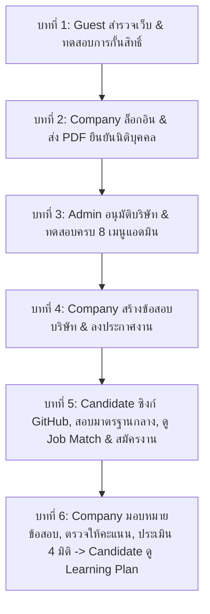

# คู่มือทดสอบการใช้งานระบบ SmartCareer แบบจับมือทำ (Step-by-Step Testing Guide)

เอกสารนี้ออกแบบมาเพื่อให้คุณ **ลองกดทดสอบได้ครบทุกฟีเจอร์ด้วยตัวเองตั้งแต่ต้นจนจบ** โดยระบุ **สิ่งที่ต้องกด/กรอกครบทุกช่อง 100%** พร้อม **ข้อมูลตัวอย่างและโค้ดคำตอบสำหรับคัดลอกไปวาง** และ **ผลลัพธ์ที่ต้องเห็นบนหน้าจอ (Expected Result)** ในทุกขั้นตอน

> [!TIP]
> **ลิงก์สำหรับเปิดทดสอบจริง (Production):** `https://smartcareer.34-9-86-92.sslip.io`
> **เคล็ดลับการทดสอบให้เร็วที่สุด:** แนะนำให้เปิดเบราว์เซอร์ **3 หน้าต่าง** (เช่น หน้าต่างปกติ 1 อัน, หน้าต่าง Incognito 1 อัน, หรือคนละโปรไฟล์ Chrome) เพื่อสลับบทบาท **Company**, **Admin**, และ **Candidate** ได้ทันทีโดยไม่ต้องล็อกเอาต์ไปมา

---

## สารบัญชุดการทดสอบ (34 การทดสอบ ครบทุกฟีเจอร์)

- **บทที่ 1: ทดสอบบทบาท Guest (ผู้เยี่ยมชมที่ยังไม่ล็อกอิน)** — 5 การทดสอบ
- **บทที่ 2: ทดสอบบทบาท Company (ช่วงที่ 1: สมัครและส่งเอกสารยืนยันตัวตน)** — 4 การทดสอบ
- **บทที่ 3: ทดสอบบทบาท Admin (ครบทั้ง 8 เมนูผู้ดูแลระบบ)** — 9 การทดสอบ
- **บทที่ 4: ทดสอบบทบาท Company (ช่วงที่ 2: ออกข้อสอบและประกาศรับสมัครงาน)** — 3 การทดสอบ
- **บทที่ 5: ทดสอบบทบาท Candidate (ผู้สมัครงาน ครบทุกฟีเจอร์)** — 8 การทดสอบ
- **บทที่ 6: ทดสอบบทบาท Company & Candidate (คัดกรอง สอบปฏิบัติ ประเมิน 4 มิติ และแผนพัฒนาทักษะ)** — 5 การทดสอบ



---

## บทที่ 1: ทดสอบบทบาท Guest (ผู้เยี่ยมชมที่ยังไม่ล็อกอิน)

> [!NOTE]
> **การเตรียมตัว:** เปิดเบราว์เซอร์ไปที่ `https://smartcareer.34-9-86-92.sslip.io` โดย **ยังไม่ต้องเข้าสู่ระบบ** (หากล็อกอินค้างอยู่ ให้กดปุ่ม **`ออกจากระบบ`** ที่มุมขวาบนก่อน)

### ทดสอบที่ 1.1: ทดลองวิเคราะห์ GitHub สาธารณะบนหน้าแรก (`/`)
1. **สิ่งที่ต้องทำ:**
   - เปิดหน้าแรก `https://smartcareer.34-9-86-92.sslip.io/`
   - มองหาหัวข้อ **"วิเคราะห์บริบท GitHub Repository สาธารณะ"**
   - ช่อง **กรอกชื่อผู้ใช้ GitHub:** พิมพ์ `BqnkZaa` (หรือ `octocat`) แล้วกดปุ่มวิเคราะห์/ค้นหา
2. **ผลลัพธ์ที่ต้องเห็น (Expected Result):**
   - แสดงหัวข้อ **`ผลวิเคราะห์ของ @BqnkZaa (... repositories)`**
   - แสดงรายการ **ภาษาโปรแกรมที่ตรวจพบในโปรเจกต์**, **Frameworks & Libraries ที่ตรวจพบจาก package.json**, และการ์ด **Repositories ล่าสุด** โดยไม่ต้องล็อกอิน

---

### ทดสอบที่ 1.2: ค้นหาและกรองตำแหน่งงานสาธารณะ (`/jobs`)
1. **สิ่งที่ต้องทำ:**
   - คลิกเมนู **`ตำแหน่งงาน`** ด้านบน (หรือไปที่ `/jobs`)
   - ช่อง **ค้นหาตำแหน่ง, บริษัท หรือทักษะ:** พิมพ์ `Developer`
   - ลองติ๊กตัวกรองด้านซ้าย เช่น **รับสมัครตรง (INTERNAL)** หรือ **รวมงานที่ “เงินเดือนตามตกลง”**
   - คลิกที่ชื่อตำแหน่งงานใดก็ได้ 1 รายการเพื่อเข้าหน้า `/jobs/[id]`
2. **ผลลัพธ์ที่ต้องเห็น (Expected Result):**
   - หน้า `/jobs` แสดงหัวข้อ **`ค้นหาตำแหน่งงานสายเทคโนโลยี`** พร้อมรายการการ์ดงานที่ตรงกับคำค้นหาและตัวกรอง
   - เมื่อคลิกเข้าหน้า `/jobs/[id]` จะเห็น **รายละเอียดงาน**, **คุณสมบัติผู้สมัคร (Requirements)**, **สวัสดิการ (Benefits)** และ **ทักษะที่ต้องการสำหรับตำแหน่งงานนี้**

---

### ทดสอบที่ 1.3: สำรวจศูนย์สอบมาตรฐานกลาง (`/assessments`) และคลังคอร์สเรียน (`/courses`)
1. **สิ่งที่ต้องทำ:**
   - คลิกเมนู **`ศูนย์สอบ`** (`/assessments`) และสังเกตการ์ดแบบทดสอบ
   - คลิกเมนู **`คอร์สเรียน`** (`/courses`)
   - ช่อง **ค้นหาชื่อคอร์ส หรือทักษะ:** พิมพ์ `TypeScript`
   - ลองกดปุ่มกรองตามผู้ให้บริการ (**`YOUTUBE`** / **`UDEMY`**)
2. **ผลลัพธ์ที่ต้องเห็น (Expected Result):**
   - หน้า `/assessments` แสดงหัวข้อ **`ศูนย์สอบมาตรฐานกลาง (Skill Assessments)`** และ **`รายการแบบทดสอบมาตรฐานที่เปิดให้สอบ`** พร้อมเวลาสอบและเกณฑ์คะแนนผ่าน
   - หน้า `/courses` แสดงหัวข้อ **`คลังคอร์สเรียนและคำแนะนำปิดช่องว่างทักษะ (Skill Gaps & Courses)`** และกรองแสดงเฉพาะคอร์สที่ตรงกับคำค้นหาหรือผู้ให้บริการที่เลือก

---

### ทดสอบที่ 1.4: ทดสอบระบบป้องกันการเข้าหน้าลับโดยไม่ล็อกอิน (Guest Route Guard)
1. **สิ่งที่ต้องทำ:**
   - ในขณะที่ยังไม่ได้ล็อกอิน ให้ลองพิมพ์ URL เหล่านี้ในช่อง Address Bar ของเบราว์เซอร์โดยตรง:
     - `https://smartcareer.34-9-86-92.sslip.io/profile`
     - `https://smartcareer.34-9-86-92.sslip.io/company/dashboard`
     - `https://smartcareer.34-9-86-92.sslip.io/admin/dashboard`
2. **ผลลัพธ์ที่ต้องเห็น (Expected Result):**
   - ระบบ **ไม่อนุญาตให้เข้าถึงหน้าเหล่านั้น** และทำการ **Redirect พากลับมาที่หน้า `/login?next=...`** ทุกครั้ง

---

### ทดสอบที่ 1.5: ทดสอบการล็อกอิน Admin ด้วยรหัสผ่านผิด (`/login`)
1. **สิ่งที่ต้องทำ:**
   - ที่หน้า `/login` เลื่อนลงมาที่กล่อง **"เข้าสู่ระบบผู้ดูแลระบบ"** แล้วกรอกข้อมูล:
     - **อีเมลผู้ดูแลระบบ:** `admin@smartcareer.local`
     - **รหัสผ่าน:** `wrong-password-123`
   - กดปุ่ม **`เข้าสู่ระบบ Admin`**
2. **ผลลัพธ์ที่ต้องเห็น (Expected Result):**
   - ระบบไม่อนุญาตให้เข้าใช้งาน แสดง **กล่องข้อความแจ้งเตือนสีแดง (`bg-red-50`)** แจ้งว่ารหัสผ่านไม่ถูกต้อง และยังคงอยู่ที่หน้า `/login` (พร้อมบันทึกเหตุการณ์ `AUTH_LOGIN_FAILED` ลงใน Audit Log ของระบบ)

---

## บทที่ 2: ทดสอบบทบาท Company — ช่วงที่ 1 (สมัครและส่งเอกสารยืนยันนิติบุคคล)

### ทดสอบที่ 2.1: เข้าสู่ระบบในฐานะบริษัท (`/login` → `/company/dashboard`)
1. **สิ่งที่ต้องทำ:**
   - ไปที่หน้า `/login` ในส่วน **"เข้าสู่ระบบด้วย Google (สำหรับบริษัท)"**
   - กดปุ่ม **`Continue with Google OAuth`** (เลือกบัญชี Google ของคุณ) **หรือ** กดปุ่มโหมดทดสอบ **`เข้าสู่ระบบทันทีด้วยบัญชีตัวอย่าง (Demo Company)`**
2. **ผลลัพธ์ที่ต้องเห็น (Expected Result):**
   - ระบบตรวจสอบสิทธิ์ PKCE และพาเข้าสู่หน้า `/company/dashboard`
   - เห็นหัวข้อ **`แดชบอร์ดบริษัท: ...`** แสดงการ์ดสรุปข้อมูลของบริษัท

---

### ทดสอบที่ 2.2: ทดสอบการป้องกันข้ามบทบาท (Company พยายามเข้าหน้า Candidate / Admin)
1. **สิ่งที่ต้องทำ:**
   - ขณะล็อกอินเป็น **Company** ให้ลองพิมพ์ URL ไปที่ `https://smartcareer.34-9-86-92.sslip.io/profile` หรือ `/learning-plan` หรือ `/admin/dashboard`
2. **ผลลัพธ์ที่ต้องเห็น (Expected Result):**
   - ระบบแสดงหน้าป้องกันสิทธิ์เต็มหน้า **`403 Forbidden — ไม่มีสิทธิ์เข้าถึงหน้าสำหรับผู้สมัครงาน`** (หรือผู้ดูแลระบบ) โดยไม่มีข้อมูลรั่วไหล

---

### ทดสอบที่ 2.3: แก้ไขข้อมูลบริษัทครบทุกช่อง และอัปโหลดไฟล์ PDF ยืนยันนิติบุคคล (`/company/profile`)
1. **สิ่งที่ต้องทำ:**
   - คลิกเมนู **`ข้อมูลบริษัท / ยืนยันตัวตน`** (หรือไปที่ `/company/profile`)
   - ในส่วน **"ข้อมูลทั่วไปของบริษัท"** ให้กรอกข้อมูลตัวอย่างครบทั้ง 9 ช่องดังนี้:
     - **ชื่อบริษัท:** `บริษัท สมาร์ทเทค อินโนเวชัน จำกัด`
     - **อุตสาหกรรม (Industry):** `Cloud & AI Infrastructure`
     - **ขนาดองค์กร:** `50-200 คน`
     - **เว็บไซต์:** `https://smarttech.example.com`
     - **อีเมลติดต่อฝ่ายบุคคล (Contact Email):** `hr@smarttech.example.com`
     - **เบอร์โทรศัพท์ติดต่อ (Contact Phone):** `02-123-4567`
     - **URL โลโก้บริษัท (Logo URL):** `https://smarttech.example.com/logo.png`
     - **สถานที่ตั้ง:** `กรุงเทพมหานคร`
     - **รายละเอียดเกี่ยวกับบริษัท:** `พัฒนาแพลตฟอร์ม AI และระบบคลาวด์ระดับองค์กร รองรับการประมวลผลข้อมูลขนาดใหญ่`
   - กดปุ่ม **`บันทึกข้อมูลบริษัท`**
   - จากนั้นในส่วน **"การยืนยันตัวตนนิติบุคคล (Business Verification)"** (กรณีสถานะยังไม่ใช่ `VERIFIED`):
     - **เลขทะเบียนนิติบุคคล 13 หลัก:** `0105569001234`
     - **อัปโหลดหนังสือรับรองบริษัท 1–5 ไฟล์ (PDF, JPG, PNG):** เลือกไฟล์ `.pdf` หรือรูปภาพ `.png`/`.jpg` จากเครื่องของคุณ 1–2 ไฟล์
     - กดปุ่ม **`ส่งเอกสารยืนยันนิติบุคคล`**
2. **ผลลัพธ์ที่ต้องเห็น (Expected Result):**
   - ตอนกดบันทึกข้อมูลทั่วไป: แสดงข้อความสีเขียว **`บันทึกข้อมูลบริษัทเรียบร้อยแล้ว`**
   - ตอนเลือกไฟล์: แสดงข้อความ **`เลือกแล้ว 1 ไฟล์`** (หรือตามจำนวนไฟล์ที่เลือก)
   - ตอนกดส่งเอกสารยืนยัน: แสดงข้อความสีเขียว **`ส่งคำขอยืนยันนิติบุคคลเรียบร้อยแล้ว (สถานะ: PENDING)`** และป้ายสถานะเปลี่ยนเป็น **`สถานะปัจจุบัน: PENDING`**

---

### ทดสอบที่ 2.4: ทดสอบกฎเหล็ก — บริษัทที่ยังไม่ `VERIFIED` ห้ามเผยแพร่ประกาศงาน (`/company/jobs/new`)
> [!WARNING]
> ทดสอบขั้นตอนนี้ในขณะที่บริษัทมีสถานะเป็น `UNVERIFIED` หรือ `PENDING` (หากใช้บัญชี Demo Company ที่ถูกอนุมัติไปแล้ว ให้ล็อกอินด้วย Google บัญชีใหม่ที่ยังเป็น `PENDING`)

1. **สิ่งที่ต้องทำ:**
   - ไปที่หน้า `/company/jobs/new`แล้วกรอกข้อมูล:
     - **ชื่อตำแหน่งงาน:** `Test Job While Pending`
     - **รายละเอียดงานและหน้าที่ความรับผิดชอบ:** `ทดสอบการบล็อกประกาศงานเมื่อบริษัทยังไม่ผ่านการยืนยันตัวตน`
   - กดปุ่ม **`เผยแพร่ประกาศตำแหน่งงาน`**
2. **ผลลัพธ์ที่ต้องเห็น (Expected Result):**
   - ระบบ **ปฏิเสธการสร้างประกาศงาน** และแสดงกล่องแจ้งเตือนสีแดง (`bg-red-50`) แจ้งว่าบริษัทต้องผ่านการยืนยันตัวตนนิติบุคคล (`VERIFIED`) จากผู้ดูแลระบบก่อน

---

## บทที่ 3: ทดสอบบทบาท Admin (ครบทั้ง 8 เมนูผู้ดูแลระบบ)

### ทดสอบที่ 3.1: ล็อกอินเข้าศูนย์ควบคุมผู้ดูแลระบบ (`/login` → `/admin/dashboard`)
1. **สิ่งที่ต้องทำ:**
   - เปิดหน้าต่างเบราว์เซอร์สำหรับ **Admin** ไปที่ `/login`
   - ในส่วน **"เข้าสู่ระบบผู้ดูแลระบบ"** กรอกครบทั้ง 2 ช่อง:
     - **อีเมลผู้ดูแลระบบ:** `admin@smartcareer.local`
     - **รหัสผ่าน:** `Admin@SmartCareer2026!`
   - กดปุ่ม **`เข้าสู่ระบบ Admin`**
2. **ผลลัพธ์ที่ต้องเห็น (Expected Result):**
   - เข้าสู่หน้า `/admin/dashboard` เห็นหัวข้อ **`ศูนย์ควบคุมระบบ (Admin Control Center)`**
   - แสดงตัวเลขสถิติรวมของผู้ใช้, บริษัทที่รอตรวจสอบ, คลังข้อสอบกลาง และ **`ประวัติการดึงข้อมูลล่าสุด (Recent Ingestion Logs)`**

---

### ทดสอบที่ 3.2: ตรวจสอบไฟล์ PDF และกดอนุมัติบริษัท (`/admin/verifications`)
1. **สิ่งที่ต้องทำ:**
   - คลิกเมนูซ้าย **`อนุมัติบริษัทยืนยันตัวตน`** (`/admin/verifications`)
   - มองหาการ์ดของบริษัทที่เพิ่งส่งคำขอ (เช่น `บริษัท สมาร์ทเทค อินโนเวชัน จำกัด` หรือ `batriey Kakoh`)
   - คลิกปุ่ม **เปิดดู/ดาวน์โหลดไฟล์เอกสารแนบ** เพื่อตรวจสอบไฟล์ PDF
   - *(กรณีต้องการทดสอบการปฏิเสธกับบริษัทอื่น)* ช่อง **ระบุเหตุผลกรณีไม่อนุมัติ (อย่างน้อย 10 ตัวอักษร):** กรอก `เอกสารหนังสือรับรองไม่ชัดเจน กรุณาแนบไฟล์ PDF ฉบับเต็มอีกครั้ง` แล้วกดปุ่มปฏิเสธ
   - สำหรับบริษัทหลักที่เราใช้ทดสอบต่อ ให้กดปุ่มสีเขียว **`อนุมัติ (VERIFIED)`**
2. **ผลลัพธ์ที่ต้องเห็น (Expected Result):**
   - ไฟล์ PDF เปิดหรือดาวน์โหลดได้ถูกต้อง
   - หลังกดอนุมัติ มีข้อความแจ้งเตือนสีเขียว **`อัปเดตสถานะการยืนยันบริษัท "..." เป็น VERIFIED เรียบร้อยแล้ว`**

---

### ทดสอบที่ 3.3: ค้นหา กรอง และระงับ/ปลดระงับบัญชีผู้ใช้ (`/admin/users`)
1. **สิ่งที่ต้องทำ:**
   - คลิกเมนูซ้าย **`จัดการผู้ใช้งาน`** (`/admin/users`)
   - ช่อง **ค้นหาชื่อ หรืออีเมล:** พิมพ์ `@` หรือชื่อผู้ใช้ที่ต้องการค้นหา และลองกดปุ่มกรองตามบทบาท (`ALL`, `CANDIDATE`, `COMPANY`, `ADMIN`)
   - เลือกบัญชีผู้ใช้ทั่วไป 1 รายการ (ที่ไม่ใช่บัญชี Admin ของตัวเอง) แล้วกดปุ่ม **ระงับบัญชี**
   - จากนั้นกดปุ่ม **ปลดระงับบัญชี** ให้กลับมาใช้งานได้ตามปกติ
2. **ผลลัพธ์ที่ต้องเห็น (Expected Result):**
   - ตารางแสดงรายชื่อผู้ใช้ตามตัวกรองอย่างถูกต้อง
   - เมื่อกดระงับ: แสดงข้อความ **`ระงับบัญชี ... และเพิกถอนเซสชันเรียบร้อยแล้ว`** (ผู้ใช้นั้นจะถูกเตะออกจากระบบทันที)
   - เมื่อกดปลดระงับ: แสดงข้อความ **`ปลดระงับบัญชี ... เรียบร้อยแล้ว`**

---

### ทดสอบที่ 3.4: เพิ่มและลบทักษะมาตรฐานในคลังทักษะ (`/admin/skills`)
1. **สิ่งที่ต้องทำ:**
   - คลิกเมนูซ้าย **`จัดการคลังทักษะ`** (`/admin/skills`)
   - ในฟอร์มเพิ่มทักษะใหม่ กรอกข้อมูลครบทั้ง 3 ช่อง:
     - **ชื่อทักษะ:** `Rust WebAssembly`
     - **หมวดหมู่ทักษะ (11 หมวด):** เลือก `BACKEND`
     - **คำอธิบาย:** `การพัฒนาโมดูลประสิทธิภาพสูงด้วยภาษา Rust สำหรับประมวลผลบน WebAssembly`
   - กดปุ่มเพิ่มทักษะ
   - ช่อง **กรองทักษะในตาราง:** พิมพ์ `Rust WebAssembly` เพื่อค้นหาทักษะที่เพิ่งสร้าง แล้วกดปุ่ม **ลบ**
2. **ผลลัพธ์ที่ต้องเห็น (Expected Result):**
   - ตอนเพิ่ม: แสดงข้อความสีเขียว **`เพิ่มทักษะมาตรฐาน "Rust WebAssembly" เรียบร้อยแล้ว`** และทักษะปรากฏในตารางพร้อม `slug` อัตโนมัติ
   - ตอนลบ: แสดงข้อความสีเขียว **`ลบทักษะ "Rust WebAssembly" เรียบร้อยแล้ว`** และหายไปจากตาราง

---

### ทดสอบที่ 3.5: สร้าง แก้ไข เปลี่ยนสถานะ และลบข้อสอบมาตรฐานกลาง (`/admin/assessments`)
1. **สิ่งที่ต้องทำ:**
   - คลิกเมนูซ้าย **`จัดการข้อสอบกลาง`** (`/admin/assessments`)
   - ในฟอร์ม **"สร้างชุดข้อสอบกลางใหม่"** กรอกข้อมูลครบทุกช่องดังนี้:
     - **ชื่อข้อสอบ:** `ทดสอบข้อสอบกลาง Algorithm พื้นฐาน`
     - **ทักษะ:** เลือก `JavaScript`
     - **ประเภทข้อสอบ (Exam Type):** เลือก `CODING_SANDBOX`
     - **เวลาสอบ (นาที: 1–240):** `30`
     - **เกณฑ์ผ่าน (%: 1–100):** `70`
     - **นโยบายเปิดเผยเฉลย:** เลือก `AFTER_REVIEW`
     - **คำอธิบายชุดข้อสอบ:** `วัดทักษะการเขียนฟังก์ชันและการจัดการข้อมูลพื้นฐานด้วยภาษา JavaScript`
     - ติ๊กถูก **เผยแพร่ให้ผู้สมัครเข้าสอบทันที (PUBLISHED)**
   - ในส่วน **"รายการโจทย์คำถาม (ข้อที่ 1)"** กรอกครบทุกช่องดังนี้:
     - **หัวข้อคำถาม:** `คืนค่าข้อมูลนำเข้า (Identity Function)`
     - **ความยาก:** เลือก `MEDIUM`
     - **คะแนน (Points):** `100`
     - **โจทย์คำถามเริ่มต้น:** `จงเขียนฟังก์ชัน solve(input) ที่คืนค่า input กลับไปโดยไม่เปลี่ยนแปลงค่า`
     - **คำอธิบายเฉลย (Explanation):** `ฟังก์ชันคืนค่าพารามิเตอร์ที่รับเข้ามาโดยตรง ใช้เวลา O(1)`
     - **Starter Code:** `function solve(input) {\n  return input;\n}`
     - **Solution Code อ้างอิง (ไม่บังคับ):** `function solve(input) {\n  return input;\n}`
     - **Test Cases (ต้องมีทั้ง Visible และ Hidden อย่างน้อยอย่างละ 1 เคส):**
       - **Test Case ที่ 1 (Visible — ไม่ต้องติ๊ก Hidden):** ช่อง `Input` กรอก `1` / ช่อง `Expected Output` กรอก `1`
       - **Test Case ที่ 2 (Hidden — ติ๊กถูกช่อง `Hidden`):** ช่อง `Input` กรอก `2` / ช่อง `Expected Output` กรอก `2`
   - กดปุ่มบันทึก/สร้างชุดข้อสอบกลาง
   - เมื่อชุดข้อสอบปรากฏในรายการด้านล่าง ให้ลองกดสลับ **Feedback Visibility** (`IMMEDIATE` / `AFTER_REVIEW`)
   - ทดลองกดปุ่ม **ลบ** ชุดข้อสอบที่เพิ่งสร้างเพื่อทำความสะอาดข้อมูลทดสอบ
2. **ผลลัพธ์ที่ต้องเห็น (Expected Result):**
   - ตอนสร้าง: แสดงข้อความ **`สร้างชุดข้อสอบมาตรฐานกลางเรียบร้อยแล้ว`**
   - ตอนสลับการแสดงผลเฉลย: แสดงข้อความ **`อัปเดตนโยบาย Feedback Visibility เป็น ... แล้ว`**
   - ตอนลบ: แสดงข้อความ **`ลบชุดข้อสอบ "ทดสอบข้อสอบกลาง Algorithm พื้นฐาน" เรียบร้อยแล้ว`**

---

### ทดสอบที่ 3.6: ระบบดึงข้อมูลงาน/คอร์สอัตโนมัติ นำเข้า JSON Batch และตั้งค่าโควตา (`/admin/ingestion`)
1. **สิ่งที่ต้องทำ:**
   - คลิกเมนูซ้าย **`ระบบดึงข้อมูล (Ingestion)`** (`/admin/ingestion`)
   - **ส่วนที่ 1 (ดึงประกาศงานสดจากแหล่งภายนอก):**
     - **เลือกแหล่งข้อมูล (Source):** เลือก `JSEARCH`
     - **จำนวนที่ดึงต่อรอบ (Quota Limit):** กรอก `5` แล้วกดปุ่มดึงข้อมูล (หรือกดปุ่มอัปเดตคลังคอร์สเรียน YouTube)
   - **ส่วนที่ 2 (นำเข้าไฟล์ JSON จากสคริปต์ Scraper ภายนอก):**
     - ในช่องวาง JSON ให้คัดลอกข้อความตัวอย่างด้านล่างนี้ไปวาง แล้วกดปุ่ม **ตรวจสอบ JSON Batch**:
       ```json
       [
         {
           "title": "Backend Node.js Developer (Batch Test)",
           "companyName": "Tech Demo Co., Ltd.",
           "location": "Bangkok",
           "description": "Develop REST APIs using Node.js, TypeScript, and PostgreSQL.",
           "url": "https://jobs.example.com/backend-nodejs-101"
         }
       ]
       ```
   - **ส่วนที่ 3 (ตั้งค่าโควตาการดึงข้อมูลต่อรอบ):** กดปุ่ม **บันทึกการตั้งค่าโควตา**
   - **ส่วนที่ 4 (เครื่องมือทำความสะอาดข้อมูลที่ปิดแล้ว):** กดปุ่มทำความสะอาดงานที่หมดอายุ
2. **ผลลัพธ์ที่ต้องเห็น (Expected Result):**
   - ส่วนที่ 2: แสดงข้อความ **`ตรวจสอบ JSON Batch สำเร็จ: ทั้งหมด 1 งาน...`**
   - ส่วนที่ 3: แสดงข้อความ **`บันทึกการตั้งค่าโควตาการดึงข้อมูล (Ingestion Quotas) เรียบร้อยแล้ว`**
   - ส่วนที่ 1 & 4: แสดงสรุปจำนวนรายการที่ดำเนินการสำเร็จ พร้อมบันทึกในตาราง **`ประวัติการดึงข้อมูลล่าสุด (Ingestion Audit Logs)`** ด้านล่างสุด

---

### ทดสอบที่ 3.7: สำรวจฐานข้อมูลทั้งแพลตฟอร์ม (`/admin/data`)
1. **สิ่งที่ต้องทำ:**
   - คลิกเมนูซ้าย **`สำรวจข้อมูลระบบ`** (`/admin/data`)
   - ช่อง **ค้นหาชื่อตำแหน่งงาน บริษัท หรือผู้สมัคร:** พิมพ์ `Developer` (หรือเว้นว่างเพื่อดูทั้งหมด)
   - คลิกสลับแท็บดูข้อมูลทั้ง 3 ตาราง: **ตำแหน่งงาน (`Jobs`)**, **บริษัท (`Companies`)**, และ **ใบสมัครงาน (`Applications`)** พร้อมลองกดเปลี่ยนหน้า (Pagination)
2. **ผลลัพธ์ที่ต้องเห็น (Expected Result):**
   - แสดงหัวข้อ **`ตรวจสอบข้อมูลระบบ (Platform Data Browser)`** และโหลดตารางข้อมูลจริงพร้อมจำนวนรายการทั้งหมดได้อย่างรวดเร็ว

---

### ทดสอบที่ 3.8: ตรวจสอบประวัติความปลอดภัยย้อนหลัง (`/admin/audit-logs`)
1. **สิ่งที่ต้องทำ:**
   - คลิกเมนูซ้าย **`บันทึกความปลอดภัย (Audit Logs)`** (`/admin/audit-logs`)
   - ช่อง **ค้นหา Action, Target ID หรืออีเมลแอดมิน:** ลองพิมพ์ `AUTH_LOGIN` แล้วสังเกตตารางผลลัพธ์
2. **ผลลัพธ์ที่ต้องเห็น (Expected Result):**
   - แสดงหัวข้อ **`บันทึกการกระทำของผู้ดูแลระบบ (Admin Audit Trail)`**
   - เห็นรายการบันทึกการกระทำทั้งหมดที่คุณเพิ่งทำไปในบทที่ 3 เรียงจากล่าสุด เช่น `AUTH_LOGIN`, `AUTH_LOGIN_FAILED`, การอนุมัติบริษัท, การระงับผู้ใช้, และการจัดการทักษะ/ข้อสอบ

---

### ทดสอบที่ 3.9: ทดสอบการเพิกถอนเซสชันเมื่อ Admin ออกจากระบบ (`Logout`)
1. **สิ่งที่ต้องทำ:**
   - กดปุ่ม **`ออกจากระบบ`** ที่แถบเมนูของ Admin
2. **ผลลัพธ์ที่ต้องเห็น (Expected Result):**
   - ระบบเพิกถอน JWT Token เดิมทันที บันทึก `AUTH_LOGOUT` ลง Audit Log และพากลับไปหน้า `/login`

---

## บทที่ 4: ทดสอบบทบาท Company — ช่วงที่ 2 (ออกข้อสอบบริษัทและลงประกาศงาน)

> [!NOTE]
> กลับมาที่หน้าต่างเบราว์เซอร์ของ **Company** (ซึ่งตอนนี้ได้รับการอนุมัติเป็น **`VERIFIED`** แล้ว)

### ทดสอบที่ 4.1: สร้างชุดข้อสอบเฉพาะของบริษัทครบทุกช่อง (`/company/assessments`)
1. **สิ่งที่ต้องทำ:**
   - ไปที่เมนู **`ข้อสอบของบริษัท`** (`/company/assessments`)
   - ในฟอร์ม **"สร้างชุดข้อสอบเฉพาะของบริษัท"** กรอกข้อมูลครบทั้ง 9 ช่องดังนี้:
     - **ชื่อชุดข้อสอบ:** `ข้อสอบออกแบบระบบ Backend & Idempotency`
     - **คำอธิบายชุดข้อสอบ:** `แบบทดสอบเขียนโค้ดและอธิบายแนวคิดการป้องกันการประมวลผลซ้ำในระบบกระจายตัว`
     - **ทักษะหลักที่เกี่ยวข้อง:** เลือก `JavaScript`
     - **การแสดงผลลัพธ์ให้ผู้สมัคร:** เลือก `AFTER_REVIEW` (รอให้บริษัทรีวิวก่อน)
     - **เวลาสอบ (นาที):** `45`
     - **เกณฑ์คะแนนผ่าน (%):** `70`
     - **รายการโจทย์ปัญหา (ข้อที่ 1):**
       - **หัวข้อโจทย์:** `Idempotent Request Handler`
       - **โจทย์ปัญหา (Open-Ended / Coding Challenge Prompt):** `จงเขียนฟังก์ชัน handleRequest(req) ที่ป้องกันการประมวลผลซ้ำเมื่อได้รับ req.id เดิม`
       - **โค้ดเริ่มต้น (Starter Code):** `function handleRequest(req) {\n  return true;\n}`
       - **เกณฑ์การตรวจ (Rubric):** `ตรวจสอบการใช้ Set หรือ Cache เก็บ req.id และอธิบายแนวคิดชัดเจน`
   - กดปุ่มบันทึก/สร้างชุดข้อสอบของบริษัท
2. **ผลลัพธ์ที่ต้องเห็น (Expected Result):**
   - แสดงข้อความสีเขียว **`สร้างชุดข้อสอบของบริษัทเรียบร้อยแล้ว (โหมดตรวจ: COMPANY_MANUAL)`**
   - ชุดข้อสอบ `ข้อสอบออกแบบระบบ Backend & Idempotency` ปรากฏในรายการ **`ชุดข้อสอบของบริษัท`**

---

### ทดสอบที่ 4.2: สร้างประกาศตำแหน่งงานใหม่ครบทุกช่องและผูกข้อสอบบริษัท (`/company/jobs/new`)
1. **สิ่งที่ต้องทำ:**
   - คลิกเมนู **`สร้างประกาศงาน`** (`/company/jobs/new`)
   - กรอกข้อมูลในฟอร์ม **"สร้างประกาศตำแหน่งงานใหม่"** ครบทั้ง 11 ช่องดังนี้:
     - **ชื่อตำแหน่งงาน:** `Senior Full-Stack Engineer (Cloud & AI)`
     - **รูปแบบการจ้างงาน:** เลือก `FULL_TIME`
     - **สถานที่ปฏิบัติงาน:** `กรุงเทพมหานคร (Hybrid)` (และติ๊กถูกช่อง **`Remote`**)
     - **เงินเดือนขั้นต่ำ (บาท):** `65000`
     - **เงินเดือนสูงสุด (บาท):** `110000`
     - **โควต้าจำนวนที่รับเข้าทำงาน (ปิดงานอัตโนมัติเมื่อครบ):** `1`
     - **ข้อสอบคัดเลือกของบริษัท (ถ้ามี):** เลือก `ข้อสอบออกแบบระบบ Backend & Idempotency` ที่สร้างไว้ในข้อ 4.1
     - **รายละเอียดงานและหน้าที่ความรับผิดชอบ:**
       `• ออกแบบและพัฒนาระบบ Microservices ด้วย TypeScript และ Node.js\n• เชื่อมต่อระบบประมวลผล AI และดูแลโครงสร้างพื้นฐานบน Cloud`
     - **คุณสมบัติผู้สมัคร (Requirements):**
       `• มีประสบการณ์พัฒนา Full-Stack อย่างน้อย 3 ปี\n• เชี่ยวชาญ JavaScript, TypeScript, React และ SQL`
     - **สวัสดิการ (Benefits):**
       `• ทำงานแบบ Hybrid / Remote\n• ประกันสุขภาพกลุ่มและงบสนับสนุนคอร์สเรียนออนไลน์`
     - **ทักษะที่ต้องการสำหรับตำแหน่งงานนี้:** กดเลือกทักษะ `JavaScript` และ `TypeScript`
   - กดปุ่ม **`เผยแพร่ประกาศตำแหน่งงาน`**
2. **ผลลัพธ์ที่ต้องเห็น (Expected Result):**
   - ระบบบันทึกประกาศงานและพาไปยังหน้า `/company/jobs` อัตโนมัติ
   - เห็นการ์ดตำแหน่งงาน **`Senior Full-Stack Engineer (Cloud & AI)`** ปรากฏอยู่ในรายการตำแหน่งงานของบริษัท

---

### ทดสอบที่ 4.3: แก้ไขประกาศงานและทดสอบการลบประกาศงาน (`/company/jobs`)
1. **สิ่งที่ต้องทำ:**
   - ในหน้า `/company/jobs` ที่การ์ดของงาน `Senior Full-Stack Engineer (Cloud & AI)` ให้กดปุ่ม **แก้ไข**
   - ช่อง **เงินเดือนสูงสุด:** แก้จาก `110000` เป็น `120000` แล้วกดบันทึกการแก้ไข
   - *(ทางเลือก)* หากต้องการทดสอบปุ่มลบ ให้ลองสร้างงานทดสอบอีก 1 อันชื่อ `งานทดสอบสำหรับลบ` แล้วกดปุ่ม **`ลบประกาศ`** บนการ์ดนั้น
2. **ผลลัพธ์ที่ต้องเห็น (Expected Result):**
   - ตอนแก้ไข: แสดงข้อความสีเขียว **`บันทึกการแก้ไขตำแหน่งงาน "Senior Full-Stack Engineer (Cloud & AI)" เรียบร้อยแล้ว`**
   - ตอนลบงานทดสอบ: แสดงข้อความสีเขียว **`ลบประกาศตำแหน่งงานเรียบร้อยแล้ว`** และการ์ดงานนั้นหายไปจากหน้าจอทันที

---

## บทที่ 5: ทดสอบบทบาท Candidate (ผู้สมัครงาน ครบทุกฟีเจอร์)

### ทดสอบที่ 5.1: เข้าสู่ระบบผู้สมัครงานด้วย GitHub (`/login` → `/profile`)
1. **สิ่งที่ต้องทำ:**
   - เปิดหน้าต่างเบราว์เซอร์สำหรับ **Candidate** ไปที่หน้า `/login`
   - ในส่วน **"เข้าสู่ระบบด้วย GitHub (สำหรับผู้สมัครงาน)"** กดปุ่ม **`Continue with GitHub OAuth`** (หรือปุ่ม **`เข้าสู่ระบบทันทีด้วยบัญชีตัวอย่าง (Demo Candidate)`**)
2. **ผลลัพธ์ที่ต้องเห็น (Expected Result):**
   - ระบบเข้าสู่หน้า `/profile` พร้อมแสดงหัวข้อ **`โปรไฟล์ผู้สมัครและผลประเมินทักษะ`**

---

### ทดสอบที่ 5.2: ทดสอบการป้องกันข้ามบทบาทของ Candidate
1. **สิ่งที่ต้องทำ:**
   - ขณะล็อกอินเป็น **Candidate** ให้ลองเปิด URL `/company/dashboard`, `/company/jobs/new`, หรือ `/admin/dashboard`
2. **ผลลัพธ์ที่ต้องเห็น (Expected Result):**
   - ระบบแสดงหน้า **`403 Forbidden`** ป้องกันไม่ให้ผู้สมัครเข้าถึงหน้าของบริษัทและหน้าของผู้ดูแลระบบ

---

### ทดสอบที่ 5.3: แก้ไขโปรไฟล์ครบทุกช่อง เลือกสายงานเป้าหมาย และกดซิงก์ GitHub (`/profile`)
1. **สิ่งที่ต้องทำ:**
   - ที่หน้า `/profile` เลื่อนลงมาที่ส่วน **"แก้ไขข้อมูลส่วนตัว"** แล้วกรอกข้อมูลตัวอย่างครบทั้ง 10 ช่องดังนี้:
     - **ชื่อ-นามสกุล:** `กิตติพงศ์ นักพัฒนาซอฟต์แวร์`
     - **ตำแหน่งสายงานที่ต้องการ (Desired Role):** คลิกดรอปดาวน์แล้วเลือก `Full-Stack Developer`
     - **ระดับการศึกษา / สถาบัน:** `วิทยาศาสตรบัณฑิต สาขาวิทยาการคอมพิวเตอร์`
     - **ประสบการณ์ทำงาน (ปี):** `4`
     - **พื้นที่ปฏิบัติงาน (Location):** `กรุงเทพมหานคร`
     - **เบอร์โทรศัพท์:** `0891234567`
     - **ลิงก์ผลงาน (Portfolio URL):** `https://kittipong.dev`
     - **ชื่อผู้ใช้ GitHub (GitHub Username):** `BqnkZaa` (หรือชื่อบัญชี GitHub ของคุณ)
     - **แนะนำตัว (Bio):** `เชี่ยวชาญ TypeScript, React, Node.js และการออกแบบระบบ Cloud`
     - ติ๊กถูกช่อง **เปิดโปรไฟล์ให้บริษัทที่ลงทะเบียนตรวจสอบได้**
   - กดปุ่ม **`บันทึกโปรไฟล์`**
   - จากนั้นเลื่อนไปที่ส่วน **"บริบท GitHub Repository"** แล้วกดปุ่ม **`Sync GitHub`**
2. **ผลลัพธ์ที่ต้องเห็น (Expected Result):**
   - ตอนกดบันทึกโปรไฟล์: แสดงข้อความสีเขียว **`บันทึกโปรไฟล์เรียบร้อยแล้ว`**
   - ตอนกด `Sync GitHub`: แสดงข้อความสีเขียว **`ซิงก์ข้อมูล GitHub (@...) สำเร็จ — บันทึกเป็นหลักฐานบริบทแล้ว`** พร้อมแสดงรายการ Repositories และภาษาที่ตรวจพบในโปรเจกต์
   - ในส่วน **ตารางสถานะทักษะรายวิชา (Skill Matrix)** สามารถกดสลับตัวกรอง `ทั้งหมด`, `พบใน GitHub / สอบแล้ว`, และ `อื่นๆ ที่ยังไม่ประเมิน` ได้

---

### ทดสอบที่ 5.4: เข้าห้องสอบมาตรฐานกลาง วางโค้ดคำตอบทั้ง 2 ข้อ และดูผลสอบย้อนหลัง (`/assessments`)
1. **สิ่งที่ต้องทำ:**
   - คลิกเมนู **`ศูนย์สอบ`** (`/assessments`)
   - คลิกเลือกแบบทดสอบ **`JavaScript Practical Coding Assessment`** เพื่อเข้าสู่ห้องสอบ (`/assessments/[id]`)
   - สังเกต **ตัวจับเวลาถอยหลัง (Countdown Timer)** ที่มุมบนของห้องสอบ
   - **สำหรับโจทย์ข้อที่ 1 (`Sum Positive Numbers`):**
     - ในช่องเขียนโค้ด (`textarea.font-mono`) ให้คัดลอกโค้ดด้านล่างนี้ไปวางทับโค้ดเดิม:
       ```javascript
       function solution(numbers) {
         if (!Array.isArray(numbers)) return 0;
         return numbers.filter((n) => typeof n === 'number' && n > 0).reduce((a, b) => a + b, 0);
       }
       ```
     - ในช่อง **คำอธิบายแนวคิดการเขียนโค้ด (Candidate Explanation):** กรอก `ใช้ Array.filter กรองเฉพาะตัวเลขที่เป็นค่าบวก แล้วรวมค่าด้วย reduce ใน O(n)`
     - กดปุ่ม **`บันทึกและส่งคำตอบข้อนี้`**
   - **สำหรับโจทย์ข้อที่ 2 (`Normalize Unique Tags`):**
     - คลิกสลับไปที่โจทย์ข้อที่ 2 แล้ววางโค้ดคำตอบด้านล่างนี้:
       ```javascript
       function solution(tags) {
         if (!Array.isArray(tags)) return [];
         const set = new Set(tags.map((t) => String(t).trim().toLowerCase()).filter(Boolean));
         return Array.from(set).sort();
       }
       ```
     - ในช่อง **คำอธิบายแนวคิดการเขียนโค้ด (Candidate Explanation):** กรอก `ตัดช่องว่างและแปลงเป็นตัวพิมพ์เล็กก่อนเก็บลง Set เพื่อตัดคำซ้ำและเรียงลำดับตามตัวอักษร`
     - กดปุ่ม **`บันทึกและส่งคำตอบข้อนี้`**
   - เมื่อส่งครบทั้ง 2 ข้อแล้ว ให้กดปุ่ม **`ยืนยันส่งข้อสอบปฏิบัติ`**
   - เมื่อส่งข้อสอบเสร็จ ให้กลับมาที่หน้า `/assessments` เลื่อนลงมาที่หัวข้อ **"ประวัติการเข้าสอบของฉัน"** แล้วกดปุ่ม **ดูรายละเอียดผลสอบ**
2. **ผลลัพธ์ที่ต้องเห็น (Expected Result):**
   - ในห้องสอบ: แสดงสถานะ **`ส่งข้อสอบเรียบร้อยแล้ว`** พร้อมได้คะแนนผ่านเกณฑ์ (100%)
   - ในหน้า `/assessments`: ได้รับเหรียญในหัวข้อ **`🏅 เหรียญรับรองทักษะที่คุณได้รับ (Verified Skill Badges)`** และคะแนนเรดาร์ในหน้า `/profile` อัปเดตเพิ่มขึ้นทันที
   - เมื่อกดดูรายละเอียดในประวัติการเข้าสอบ: เปิดหน้าต่างแสดง **`ผลวิเคราะห์การสอบ: ...`** พร้อมโค้ดและคำอธิบายแนวคิดที่ส่งไปครบทุกข้อ

---

### ทดสอบที่ 5.5: บันทึกงานโปรด (Saved Favorites) และดูรายการงานที่บันทึกไว้ (`/jobs`)
1. **สิ่งที่ต้องทำ:**
   - คลิกเมนู **`ตำแหน่งงาน`** (`/jobs`)
   - มองหาตำแหน่งงาน `Senior Full-Stack Engineer (Cloud & AI)` แล้วกดปุ่ม **บันทึกงานโปรด (รูปหัวใจ / Bookmark)** บนการ์ดงาน
   - กดสลับตัวกรองเพื่อดูเฉพาะ **งานที่บันทึกไว้ (Favorites)**
2. **ผลลัพธ์ที่ต้องเห็น (Expected Result):**
   - ปุ่มบันทึกงานโปรดเปลี่ยนสถานะเป็นบันทึกแล้ว (`isFavorited = true`)
   - เมื่อสลับดูรายการงานที่บันทึกไว้ จะเห็นตำแหน่งงานนั้นแสดงอยู่ในรายการทันที

---

### ทดสอบที่ 5.6: ตรวจสอบความเข้ากันได้ของทักษะกับงาน (Job Match) และส่งใบสมัครงาน (`/jobs/[id]`)
1. **สิ่งที่ต้องทำ:**
   - คลิกเข้าดูรายละเอียดของตำแหน่งงาน **`Senior Full-Stack Engineer (Cloud & AI)`** ที่บริษัทสร้างไว้ในบทที่ 4
   - เลื่อนดูหัวข้อ **"วิเคราะห์ทักษะของคุณเทียบกับตำแหน่งงานนี้ (อ้างอิงจาก GitHub และผลสอบเสริม)"**
   - เลื่อนลงมาที่ฟอร์ม **"สมัครงานตำแหน่งนี้บน SmartCareer"**
   - ช่อง **ข้อความแนะนำตัวถึงผู้ประกอบการ (Cover Letter):** กรอกข้อความด้านล่างนี้:
     `สนใจสมัครตำแหน่ง Senior Full-Stack Engineer มีประสบการณ์พัฒนาระบบ Cloud & AI ผ่านการสอบ JavaScript Practical Coding และพร้อมทำแบบทดสอบเฉพาะตำแหน่งของบริษัทครับ`
   - กดปุ่ม **`ยืนยันการส่งใบสมัครงาน`**
2. **ผลลัพธ์ที่ต้องเห็น (Expected Result):**
   - แสดงข้อความสีเขียว **`ส่งใบสมัครงานเรียบร้อยแล้ว! ระบบบันทึก Snapshot คะแนนทักษะของคุณแล้ว`**

---

### ทดสอบที่ 5.7: ตรวจสอบรายการใบสมัครและทดสอบการยกเลิกใบสมัคร (`/applications`)
1. **สิ่งที่ต้องทำ:**
   - คลิกเมนู **`ใบสมัครของฉัน`** (`/applications`)
   - ตรวจสอบว่ามีใบสมัครตำแหน่ง `Senior Full-Stack Engineer (Cloud & AI)` ปรากฏอยู่
   - *(สำหรับทดสอบการยกเลิก)* ลองกลับไปสมัครงานตำแหน่งอื่นอีก 1 ตำแหน่ง แล้วกลับมาที่หน้า `/applications` กดปุ่ม **ยกเลิกใบสมัคร** ในตำแหน่งที่สองนั้น
2. **ผลลัพธ์ที่ต้องเห็น (Expected Result):**
   - หน้า `/applications` แสดงหัวข้อ **`ประวัติการสมัครงานของฉัน`** พร้อมสถานะใบสมัคร
   - ตำแหน่งที่กดยกเลิกจะเปลี่ยนสถานะเป็น **`CANCELLED`** ทันที (ส่วนตำแหน่ง `Senior Full-Stack Engineer (Cloud & AI)` ให้เก็บไว้ใช้ต่อในบทที่ 6)

---

### ทดสอบที่ 5.8: วิเคราะห์ช่องว่างทักษะตามสายอาชีพและค้นหาคอร์สเรียน (`/courses`)
1. **สิ่งที่ต้องทำ:**
   - คลิกเมนู **`คอร์สเรียน`** (`/courses`)
   - สังเกตส่วนบนของหน้าที่แสดงหัวข้อ **`วิเคราะห์เส้นทางสู่อาชีพเป้าหมาย: Full-Stack Developer`**
2. **ผลลัพธ์ที่ต้องเห็น (Expected Result):**
   - ระบบแยกแสดงชัดเจนเป็น 3 ส่วน:
     1. **`ทักษะที่ยังขาดเทียบกับสายอาชีพนี้`**
     2. **`ทักษะที่คุณมีในโปรไฟล์แล้ว`**
     3. **`ข้อสอบปฏิบัติเสริมเพื่อเพิ่มความน่าเชื่อถือ (Optional Practical Exams)`** และ **`คอร์สเรียนคัดสรรตามทักษะ (Curated Courses)`**

---

## บทที่ 6: ทดสอบการทำงานร่วมกัน (คัดกรอง → สอบเฉพาะตำแหน่ง → ประเมิน 4 มิติ → แผนพัฒนาทักษะ)

### ทดสอบที่ 6.1: [Company] ดูโปรไฟล์เชิงลึกของผู้สมัคร บันทึกหมายเหตุ 2 ช่อง และมอบหมายข้อสอบ (`/company/applications`)
1. **สิ่งที่ต้องทำ (ที่หน้าต่างเบราว์เซอร์ของ Company):**
   - ไปที่เมนู **`ผู้สมัครงาน`** (`/company/applications`)
   - มองหาการ์ดใบสมัครของ **`กิตติพงศ์ นักพัฒนาซอฟต์แวร์ — สมัครตำแหน่ง Senior Full-Stack Engineer (Cloud & AI)`**
   - กดดู **โปรไฟล์เชิงลึก** เพื่อดูเรดาร์ทักษะและ GitHub ของผู้สมัคร
   - ในส่วนบันทึกหมายเหตุ ให้กรอกข้อมูลครบทั้ง 2 ช่อง:
     - **หมายเหตุประกอบการเปลี่ยนสถานะ (แสดงใน Timeline):** `ผ่านการคัดกรองเบื้องต้น เชิญทำแบบทดสอบปฏิบัติของบริษัท`
     - **บันทึกภายในเฉพาะ HR (ผู้สมัครมองไม่เห็น):** `ผู้สมัครมีพื้นฐาน GitHub ดีและผ่านข้อสอบกลางแล้ว ส่งข้อสอบ Backend ต่อ`
   - กดปุ่มบันทึกหมายเหตุ
   - ในดรอปดาวน์ **`มอบหมายข้อสอบบริษัท`** ให้เลือก **`ข้อสอบออกแบบระบบ Backend & Idempotency`**
2. **ผลลัพธ์ที่ต้องเห็น (Expected Result):**
   - ตอนบันทึกหมายเหตุ: แสดงข้อความสีเขียว **`บันทึกหมายเหตุและบันทึกภายใน (HR Internal Note) เรียบร้อยแล้ว`**
   - ตอนเลือกมอบหมายข้อสอบ: แสดงข้อความสีเขียว **`มอบหมายข้อสอบให้ผู้สมัครเรียบร้อยแล้ว`**

---

### ทดสอบที่ 6.2: [Candidate] เข้าทำข้อสอบเฉพาะตำแหน่งที่บริษัทมอบหมาย (`/applications` → ห้องสอบ)
1. **สิ่งที่ต้องทำ (ที่หน้าต่างเบราว์เซอร์ของ Candidate):**
   - ไปที่หน้า **`ใบสมัครของฉัน`** (`/applications`) (กดรีเฟรชหน้า 1 ครั้ง)
   - ในการ์ดใบสมัครตำแหน่ง `Senior Full-Stack Engineer (Cloud & AI)` จะมีปุ่มลิงก์ **`ทำข้อสอบเฉพาะตำแหน่ง`** ปรากฏขึ้นมา ให้คลิกปุ่มนั้น
   - เมื่อเข้าสู่หน้าห้องสอบ (`/assessments/[examId]?applicationId=...`):
     - ในช่องเขียนโค้ด (`textarea.font-mono`) ให้คัดลอกโค้ดคำตอบต่อไปนี้ไปวาง:
       ```javascript
       const processedIds = new Set();
       function handleRequest(req) {
         if (!req || !req.id || processedIds.has(req.id)) return null;
         processedIds.add(req.id);
         return { status: 'PROCESSED', id: req.id };
       }
       ```
     - ในช่อง **คำอธิบายแนวคิดการเขียนโค้ด (Candidate Explanation):** กรอก `ใช้ Set เก็บ req.id เพื่อตรวจสอบและป้องกันการประมวลผลซ้ำในเวลา O(1)`
     - กดปุ่ม **`บันทึกและส่งคำตอบข้อนี้`**
     - หากปุ่ม **`ยืนยันส่งข้อสอบปฏิบัติ`** ปรากฏขึ้น ให้กดยืนยันอีกครั้ง
2. **ผลลัพธ์ที่ต้องเห็น (Expected Result):**
   - ระบบบันทึกคำตอบและแสดงสถานะ **`ส่งข้อสอบเรียบร้อยแล้ว`**

---

### ทดสอบที่ 6.3: [Company] ตรวจกระดาษคำตอบและให้คะแนนโดยผู้เชี่ยวชาญครบทั้ง 3 ช่อง (`/company/assessments`)
1. **สิ่งที่ต้องทำ (ที่หน้าต่างเบราว์เซอร์ของ Company):**
   - ไปที่เมนู **`ข้อสอบของบริษัท`** (`/company/assessments`)
   - เลื่อนลงมาที่ส่วน **"รายการกระดาษคำตอบของผู้สมัคร (รอตรวจ / ตรวจให้คะแนนโดยผู้เชี่ยวชาญ)"**
   - คลิกเลือกข้อสอบ `ข้อสอบออกแบบระบบ Backend & Idempotency` เพื่อดูคำตอบของ `กิตติพงศ์ นักพัฒนาซอฟต์แวร์`
   - ตรวจสอบโค้ด คำอธิบายของผู้สมัคร และบันทึกการสลับหน้าจอ (`Integrity Events`)
   - กรอกข้อมูลการตรวจให้คะแนนครบทั้ง 3 ช่องดังนี้:
     - **ให้คะแนนโดยผู้เชี่ยวชาญ (Human Score 0-100):** `95`
     - **เหตุผลประกอบการตรวจ (Review Reason):** `เขียนโค้ด Idempotent ได้ถูกต้องและจัดการกรณี req.id ซ้ำได้ครบถ้วน`
     - **ข้อเสนอแนะถึงผู้สมัคร (Review Feedback):** `อธิบาย Time Complexity O(1) ได้ชัดเจนมาก แนะนำให้ศึกษาเพิ่มเรื่องการตั้ง TTL ใน Redis สำหรับใช้งานจริง`
   - กดปุ่มบันทึกคะแนน
2. **ผลลัพธ์ที่ต้องเห็น (Expected Result):**
   - แสดงข้อความสีเขียว **`บันทึกคะแนนตรวจโดยผู้เชี่ยวชาญของบริษัท (Human Score) เรียบร้อยแล้ว`** และคะแนนของผู้สมัครอัปเดตเป็น `95%`

---

### ทดสอบที่ 6.4: [Company] ประเมินผลผู้สมัคร 4 มิติครบทุกช่อง และกดรับเข้าทำงาน (`/company/applications`)
1. **สิ่งที่ต้องทำ (ที่หน้าต่างเบราว์เซอร์ของ Company):**
   - กลับไปที่เมนู **`ผู้สมัครงาน`** (`/company/applications`)
   - บนการ์ดใบสมัครของ `กิตติพงศ์ นักพัฒนาซอฟต์แวร์` ให้กดปุ่ม **`ประเมินผล 4 มิติ`**
   - ในฟอร์ม **"ประเมินผลผู้สมัคร: ..."** ให้กรอกข้อมูลครบทั้ง 8 ช่องดังนี้:
     - **ทักษะเทคนิค (1-5):** `5`
     - **การแก้ปัญหา (1-5):** `5`
     - **การสื่อสาร (1-5):** `4`
     - **การทำงานเป็นทีม (1-5):** `5`
     - **ความเห็นโดยรวมจากผู้ประเมิน (Overall Feedback):** `พื้นฐานโครงสร้างข้อมูลและระบบกระจายตัวแข็งแกร่งมาก อธิบายเหตุผลประกอบโค้ดได้ชัดเจน`
     - **จุดแข็งของผู้สมัคร (Strengths — แยกบรรทัดละ 1 ข้อ):**
       `เข้าใจการออกแบบ Idempotent API เป็นอย่างดี\nเขียนโค้ดสะอาดและตรวจสอบ Edge Cases ครบถ้วน`
     - **คำแนะนำแนวทางพัฒนาเพิ่มเติม (Development Note):**
       `แนะนำให้ศึกษาเพิ่มเติมเรื่องการทำ Distributed Lock ด้วย Redis Redlock สำหรับระบบหลายโหนด`
     - **ทักษะที่แนะนำให้ผู้สมัครไปพัฒนาต่อใน Learning Plan:** คลิกปุ่มแท็กทักษะที่ขึ้นต้นด้วยเครื่องหมาย **`+ ...`** อย่างน้อย 1–2 ทักษะ (เช่น `+ Docker`, `+ PostgreSQL`)
   - กดปุ่ม **`บันทึกและส่งผลประเมินให้ผู้สมัคร`**
   - จากนั้นเปลี่ยนสถานะใบสมัครเป็น **`ACCEPTED` (รับเข้าทำงาน)** แล้วกดอัปเดตสถานะ
2. **ผลลัพธ์ที่ต้องเห็น (Expected Result):**
   - ตอนส่งผลประเมิน 4 มิติ: แสดงข้อความสีเขียว **`บันทึกผลประเมิน 4 มิติและส่งข้อเสนอแนะไปยัง Learning Plan ของผู้สมัครแล้ว`**
   - ตอนเปลี่ยนสถานะเป็น `ACCEPTED`: แสดงข้อความสีเขียว **`อัปเดตสถานะใบสมัครเป็น ACCEPTED เรียบร้อยแล้ว`**
   - เนื่องจากเราตั้ง `acceptedQuota = 1` ไว้ในข้อ 4.2 เมื่อรับผู้สมัครครบ 1 คนแล้ว ตำแหน่งงานนี้จะเปลี่ยนสถานะเป็น **ปิดรับสมัครอัตโนมัติ (`isActive = false`)** ทันที!

---

### ทดสอบที่ 6.5: [Candidate] ดูผลประเมิน 4 มิติจากบริษัท และบันทึกความคืบหน้าการเรียนครบทั้ง 3 ช่อง (`/learning-plan`)
1. **สิ่งที่ต้องทำ (ที่หน้าต่างเบราว์เซอร์ของ Candidate):**
   - คลิกเมนู **`แผนพัฒนาทักษะ (Learning Plan)`** (`/learning-plan`)
   - ดูในหัวข้อ **"ผลประเมินและข้อเสนอแนะจากบริษัท"**
   - เลื่อนลงมาที่หัวข้อ **"บันทึกความคืบหน้าการพัฒนาทักษะ (Skill Progress Tracker)"** แล้วกรอกข้อมูลครบทั้ง 3 ช่องดังนี้:
     - **สถานะการเรียนรู้:** เลือก `COMPLETED` (หรือ `IN_PROGRESS`)
     - **ลิงก์หลักฐาน (HTTPS Evidence URL):** `https://github.com/BqnkZaa/redis-distributed-lock-demo`
     - **บันทึกสิ่งที่ได้เรียนรู้ (Note):** `ศึกษาและทดลองเขียนโปรเจกต์ตัวอย่าง Distributed Lock ด้วย Redis เรียบร้อยแล้ว`
   - กดปุ่มบันทึกความคืบหน้า
2. **ผลลัพธ์ที่ต้องเห็น (Expected Result):**
   - เห็นการ์ดผลประเมินของตำแหน่ง **`Senior Full-Stack Engineer (Cloud & AI)`** แสดงคะแนนทั้ง 4 มิติ จุดแข็ง ข้อเสนอแนะ ทักษะที่บริษัทแนะนำให้พัฒนา และคอร์สเรียนจาก YouTube / Udemy ที่จับคู่กับทักษะนั้นโดยอัตโนมัติ
   - เมื่อกดบันทึกความคืบหน้าการพัฒนาทักษะ: แสดงข้อความสีเขียว **`บันทึกความคืบหน้าการพัฒนาทักษะเรียบร้อยแล้ว`**

---

## ตารางเช็กลิสต์สรุปผลการทดสอบ (สำหรับติ๊กตรวจรับงาน)

| รหัส | หมวดหมู่การทดสอบ | สถานะ |
|---|---|---|
| **1.1 – 1.5** | **Guest:** วิเคราะห์ GitHub หน้าแรก, ค้นหางาน, ดูศูนย์สอบ/คอร์ส, ทดสอบ Route Guard และรหัส Admin ผิด | `[ ] ผ่าน` |
| **2.1 – 2.4** | **Company (ช่วง 1):** ล็อกอิน Google, ทดสอบกั้นสิทธิ์ข้าม Role, ส่งไฟล์ PDF ยืนยันตัวตน, บล็อกการโพสต์งานก่อนอนุมัติ | `[ ] ผ่าน` |
| **3.1 – 3.9** | **Admin (ครบ 8 เมนู):** Dashboard, อนุมัติ PDF บริษัท, ระงับ/ปลดระงับผู้ใช้, จัดการทักษะ, ข้อสอบกลาง, Ingestion, Data Browser, Audit Logs | `[ ] ผ่าน` |
| **4.1 – 4.3** | **Company (ช่วง 2):** สร้างข้อสอบเฉพาะบริษัท (`COMPANY_MANUAL`), ลงประกาศงานผูกข้อสอบ + ตั้งโควตา, แก้ไข/ลบงาน | `[ ] ผ่าน` |
| **5.1 – 5.8** | **Candidate:** ล็อกอิน GitHub, ซิงก์ Repo, สอบปฏิบัติกลาง + รับเหรียญ Badge, บันทึกงานโปรด, ดู Job Match, สมัครงาน, ยกเลิกใบสมัคร | `[ ] ผ่าน` |
| **6.1 – 6.5** | **End-to-End Flow:** มอบหมายข้อสอบบริษัท, สอบเฉพาะตำแหน่ง, ตรวจให้คะแนน Human Score, ประเมิน 4 มิติ, ปิดงานอัตโนมัติเมื่อครบโควตา, ดู Learning Plan | `[ ] ผ่าน` |
